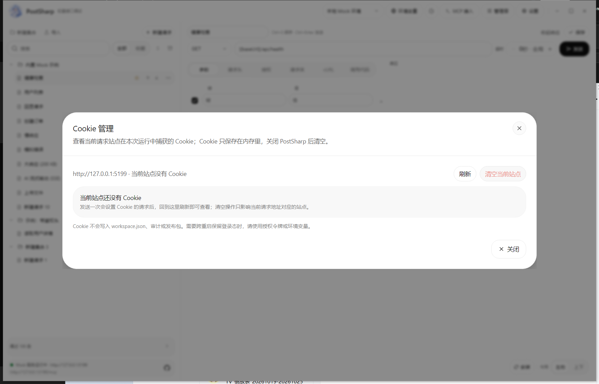
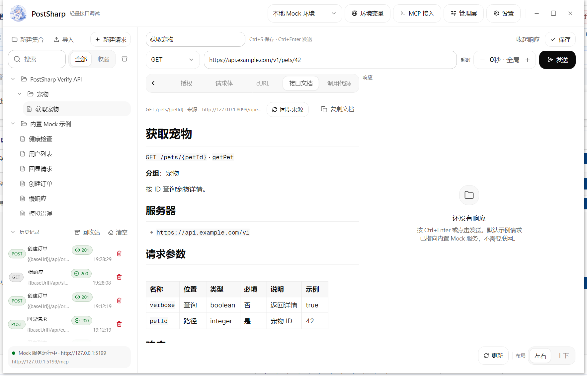
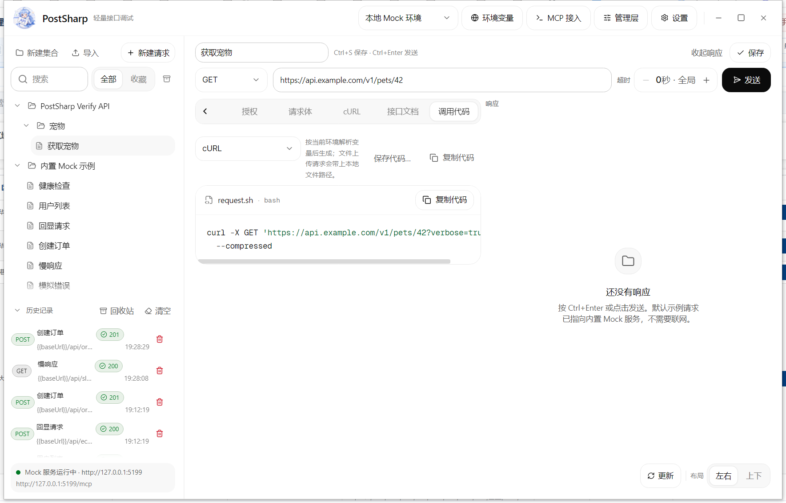

# PostSharp


> 面向 AI 的本地接口调试工作台。基于 **Avalonia 12.1.4** 与 **TKCode.Arc 0.3.2-preview.1**，把「AI 通过 MCP 触发请求 → 审计留痕 → 自动化回归」串成一条闭环，同时保留完整的 Postman 式手动调试能力。


## 目录

- [为什么是 PostSharp](#为什么是-postsharp)
- [功能](#功能)
- [更新日志](CHANGELOG.md)
- [技术栈](#技术栈)
- [快速开始](#快速开始)
- [内置 Mock API](#内置-mock-api)
- [MCP 接入](#mcp-接入)
- [命令行 CLI](docs/cli.md)
- [无头模式与 CI](docs/ci.md)
- [分发与包管理器](docs/distribution.md)
- [启动与内存基线](docs/performance.md)
- [AI 审计与自动化](#ai-审计与自动化)
- [请求与响应能力](#请求与响应能力)
- [授权（OIDC / OAuth 2.0）](#授权oidc--oauth-20)
- [系统全局设置](#系统全局设置)
- [远程存储插件](docs/storage-plugins.md)
- [快捷键](#快捷键)
- [数据与配置](#数据与配置)
- [项目结构](#项目结构)
- [设计与实现](#设计与实现)
- [验证记录](#验证记录)
- [开发约定](#开发约定)
- [常见问题](#常见问题)
- [已知限制与路线图](#已知限制与路线图)
- [许可证](#许可证)

## 为什么是 PostSharp

Postman 擅长手动点按，但 AI 时代的调用大多由 Agent 发起：请求由 MCP 触发，结果需要审计，回归需要套件，流式输出需要把 thinking 和 content 聚合起来。

PostSharp 的定位是：

1. **AI 的本地执行器**：AI 通过 MCP 查询接口、发送请求、获取 cURL、运行套件。
2. **审计中心**：每一次 UI 或 MCP 发送都记录来源、客户端、工具、状态、耗时、cURL、请求/响应预览和 AI 聚合输出。
3. **自动化管理层**：保存回归套件、设置状态码/响应体/JSONPath/响应头断言、查看每个步骤的结果。
4. **人工兜底工作台**：需要手动调试时，完整的参数、请求头、请求体、cURL、响应查看仍然在。

## 功能

### AI 方向

- **MCP 工具**：集合/请求、环境变量、历史与回收站、审计与回收站、自动化套件、系统配置、存储配置/同步/切换、导入导出等语义操作均可由 MCP 调用（窗口尺寸、剪贴板等纯界面动作除外）；`verify_endpoint` / `generate_suite` / `diff_runs` / `explain_failure` / `export_report` 把常见意图压到 1–2 次调用并返回结构化结论。
- **命令行 CLI**：`postsharp-cli` 通过本机 MCP 端点执行套件列表、预检、后台运行、运行历史、失败重跑、请求发送和审计查询；支持 `--json`、`--junit`、`--markdown`、`--html` 和稳定退出码，适合终端与 CI。`postsharp-cli mcp-stdio` 可把 stdin/stdout MCP 桥接到 HTTP MCP，兼容只支持 stdio 的 harness。CLI 是独立下载包，不随桌面安装包分发；应用内「指南 → 命令行 CLI」卡片提供常用命令、MCP 地址复制和下载入口。
- **无头与容器**：`--headless` 只启动 MCP 和内置 Mock，不创建窗口和托盘；Linux 配合 Xvfb 可在 CI 和容器中运行。仓库提供 `Dockerfile`、`--headless` Linux 冒烟、GitHub Actions 示例和可复用复合 Action，见 [无头模式与 CI](docs/ci.md)。
- **完整审计**：来源 `UI` / `MCP`、MCP 客户端名称、工具名、时间、状态、耗时、大小、cURL、请求头和请求/响应预览。
- **SSE / AI 输出聚合**：自动解析 `text/event-stream`，聚合常见 AI 协议的 thinking 与 content，接收中增量刷新，取消后保留已接收内容。
- **自动化套件**：统一套件编排器，左侧集合/接口浏览器、中间画布、右侧节点明细；支持依赖 DAG、条件分支与汇合、失败重试、输入映射、断言、定时运行与失败停止；运行结果进入审计，画布实时显示节点与连线状态。
- **管理层**：一个窗口内切换审计、自动化、指南。

### 调试能力

- **侧栏树**：集合展开/收起和选中节点随工作区保存，下次打开直接回到上次的位置；节点被删除时回退第一个请求，空工作区保持「新建请求」草稿。
- **指南与演示数据**：指南页提供 6 步上手、MCP 配置复制和「重置演示工作区」；重置会清空集合、环境、套件、历史和回收站并恢复内置 Mock 示例，审计与设置保留。
- **复制集合**：集合右键可递归复制整棵子树，参数、请求头、表单、上传和授权都独立，副本换新 id、不继承 OpenAPI 来源与收藏，套件仍指向原请求。
- **系统托盘**：Windows 使用原生 `Shell_NotifyIcon` + `TrackPopupMenu` 托盘菜单，左键打开主页面，右键显示「显示主页面 / 最大化打开 / 退出 PostSharp」；macOS/Linux 使用 Avalonia 托盘。托盘可用时最小化按钮隐藏到托盘，恢复时保留最大化状态。
- **方法**：GET / POST / PUT / PATCH / DELETE / HEAD / OPTIONS。
- **请求头**：键值表、常用头一键插入、重复头提示、环境变量。
- **Cookie 管理**：顶栏 Cookie 按钮查看当前请求站点在本次运行中捕获的 Cookie，显示名称、值、作用域、过期时间和 Secure / HttpOnly 标记；支持刷新与清空当前站点。Cookie 只保存在进程内存，不写入工作区、审计或发布包。
- **重定向策略**：每个请求可切换是否跟随 3xx 重定向；关闭后直接展示 3xx 状态、响应头和 `Location`，便于调试登录跳转与网关转发。策略随请求和历史记录持久化。


- **请求体**：无 / JSON / 文本 / GraphQL / 表单上传；GraphQL 自动组成 POST JSON，支持 Query、Variables 和 Operation name。
- **协议调试**：顶栏协议选择 HTTP / WebSocket / Socket.IO / TCP / SOAP / gRPC。
  - WebSocket：支持 ws / wss（也接受 http / https 自动转换）、请求头与 `Sec-WebSocket-Protocol` 子协议、文本或 Hex 二进制帧；发送一条消息后按等待窗口收集回复帧并自动断开。
  - Socket.IO：使用 Engine.IO v4 的 WebSocket 传输（`EIO=4`），自动握手、连接命名空间、发送一个事件并收集事件回执；事件负载按 JSON 解析，服务端 ping 自动回复 pong。
  - TCP：支持 `host:port`、`tcp://`、`tls://`，文本消息可追加 LF / CRLF，Hex 模式按原始字节发送，收到二进制时显示十六进制。
  - SOAP：支持 1.1 / 1.2；Body 片段自动包进 Envelope，完整 Envelope 原样发送；1.1 自动补 `SOAPAction` 和 `text/xml`，1.2 使用 `application/soap+xml`；响应中的 Fault 会提取到状态和 `SOAP-Fault` 头。
  - gRPC：通过服务端反射读取描述符，支持一元调用、请求 JSON ↔ protobuf 动态编解码、请求头作为 metadata、deadline 和 TLS / h2c；流式 RPC 暂不支持。
  - 这些协议共用参数、请求头、授权、变量解析、响应面板、历史、审计、套件与 MCP `send_request`；WebSocket / Socket.IO / TCP 的回复以带时间戳的会话记录展示。
  - JSON/XML 一键格式化，JSON 一键压缩。
  - 单行切换与单行预览，长文本不再占满编辑区。
  - multipart/form-data：表单字段 + 多文件选择 / 拖拽，每个文件可编辑字段名。
  - 大文件按 64KB 流式读取并显示上传进度；发送中的「取消」可中断上传。
- **cURL / PowerShell 导入 / 导出**：按当前环境解析变量，生成可执行的 bash cURL 或 PowerShell `Invoke-RestMethod`；支持从 Postman、浏览器或 PostSharp 生成的 `-X` / `-H` / `-d` / `--data-raw` / `-F` / `-u` 命令，以及 PowerShell `-Uri` / `-Method` / `-Headers` / `-Body` / `-Form` / `-TimeoutSec` 命令导入请求；可保存为 `.sh` 或 `.ps1`。
- **Postman Collection 导入 / 导出**：读取 Postman Collection v2.0 / v2.1 的嵌套文件夹、请求、查询参数、请求头、Bearer / Basic / API Key 认证、raw / urlencoded / formdata / GraphQL 请求体和集合变量；集合树右键菜单可直接「导出 Postman」，默认导出为 Collection v2.1；也可在导入导出对话框导出选中集合或整个工作区。
- **Postman 环境文件**：独立导入 `values` 或 `variable` 数组，创建或合并同名环境并激活。
- **HAR 1.2 导入**：读取浏览器、Postman、Apifox 导出的 HTTP Archive；默认只保留 XHR / Fetch，支持 query、headers、cookies、JSON / text / form-data 请求体，可切换包含静态资源。
- **Insomnia V4 导入**：读取 `resources` 数组中的 workspace、request_group、request 和 environment；脚本/测试不执行。
- **Hoppscotch 导入**：读取 Collection JSON 的 folders、requests、params、headers、body 和基础认证。
- **springdoc / Knife4j**：OpenAPI 来源可一键补全 `/v3/api-docs` 地址。
- **来源选择**：导入对话框直接展示 OpenAPI、Postman、Environment、cURL、HAR、Insomnia、Hoppscotch、其他工具、Apifox 等小分类卡片，可收起。
- **批量导入**：一次选择多个文件，自动识别 OpenAPI / Postman / HAR / Insomnia / Hoppscotch / cURL；逐文件显示成功或失败结果，单个失败不会中断其他文件。
- **导入反馈**：导入完成后弹出成功对话框，显示请求数、分组数、环境数和失败数；逐文件结果与兼容性提示仍保留在导入窗口，可展开/收起。
- **导入导出进度**：导入、批量导入和导出时，主窗口右下角显示进度条、当前步骤和完成/失败状态；批量导入按文件更新进度，导入数量与文档字段不再做截断。大文档下载后显示「内容过多，已启用后台导入」，关闭导入窗口不会取消任务，右下角可继续查看进度或取消导入。
- **响应**：
  - 状态、耗时、大小、内容类型、响应头。
  - JSON 使用 Arc JsonViewer（搜索、展开、复制值/路径）。
  - Non-JSON / XML 自动格式化或单行展示。
  - 大响应折叠：主视图只展示预览，详情窗口按页查看完整内容，支持复制全部；单次响应超过 8 MB 时截断并明确提示，避免内存耗尽退出。
  - SSE 响应自动选中「AI 聚合」标签，内容 / 思考过程 / 原始事件三视图。
- **集合、历史、环境变量、自动保存**。
- **集合回收站**：删除集合或请求（包括 AI 通过 MCP 删除）都会先移入集合回收站；恢复时回到原集合的原位置并保留 id，引用它的套件随之恢复，原位置已不存在时恢复到根目录；永久删除与清空都需二次确认；最多保留最近 200 项，更早的会自动永久删除。
- **机密变量**：环境变量可点锁形图标设为机密，值在编辑框中隐藏；审计、MCP 返回与套件结果中以 `******` 显示。机密值在本机 SQLite 工作区中以 DPAPI（Windows）或 AES-GCM 本机密钥文件（Linux/macOS）加密保存，旧工作区的明文机密会在首次加载时自动迁移。
- **数据文件保护**：工作区、审计、设置均先写临时文件再替换，并保留上一版 `.bak`；文件损坏时原文件移到旁边保留、自动改用备份，顶部提示条说明发生了什么和原文件位置。
- **调用记录**：主界面历史列表与审计合并为管理层「审计」一个入口；支持来源筛选、分页加载、详情查看和打开原请求。
- **OpenAPI 导入与同步**：从本地 JSON / YAML 文件或 URL 读取 OpenAPI 3.x / Swagger 2.0；按 `x-apifox-folder` 或第一个 tag 创建分组，支持安全方案占位头、多服务器选择、外部 `$ref` 自动下载。大文档不再限制操作数、外部引用数、字段数或示例大小；如果来源 URL 或 OpenAPI servers 带 IP / 域名，会自动创建并激活对应环境，`baseUrl` 直接指向该地址；URL 导入会记住来源、ETag / Last-Modified 与内容指纹，右键集合可「同步 OpenAPI」按 `METHOD + 路径` 增量合并：新增接口、更新文档与缺失参数、保留用户改过的名称/参数值/请求体、文档中删除的接口移入集合回收站；也可开启启动时自动同步。
- **接口文档与调用代码**：导入后的每个请求带「接口文档」页签，离线展示请求参数（路径/查询/请求头/Cookie，含类型、必填、说明、示例、枚举）、请求体 schema 与示例、全部响应状态码/响应头/响应示例；「调用代码」页签按当前环境解析变量后生成 cURL、PowerShell、C# HttpClient、JavaScript fetch、Python requests、Java HttpClient、Go net/http 代码，可复制或保存。




- **自动更新**：已发布安装包启动后每 6 小时在后台检查 GitHub Releases；发现新版本时下载固定命名包并校验 SHA256。下载完成后只显示「可安装」，由你点击右下角「更新 / 安装」按钮主动决定何时替换程序并重启，失败时保留旧版本。右下角和设置窗口都可主动检查更新；设置窗口显示当前版本和更新状态，可关闭自动检查。

### 授权（OIDC / OAuth 2.0）

- **按请求 / 按集合配置**：授权挂在请求或集合上，默认行为是「不附加任何认证」，不再有全局默认令牌。请求默认「继承上级集合」，沿集合层级向上找到最近一层配置；一路都是「继承」就表示这次请求不附加认证。
- **作用域跟着树选中对象走**：选中请求时，「授权」标签页编辑该请求；选中集合时，同一处改为编辑该集合自己的配置，不会再落到上一次打开的请求上。切换集合或请求会立即换成对应的一份配置，上一份的令牌与登录状态不会带过来。
- **逐级覆盖**：请求或子集合可以单独选择「无认证」或换成另一套凭据，只影响自己和它的下级。
- **认证类型**：继承上级集合 / 无认证 / Bearer 令牌 / Basic 认证 / API Key（请求头或查询参数）/ OAuth 2.0。
- **OAuth 2.0（OIDC）**：支持「授权码 + S256 PKCE」和「客户端凭据」两种方式，读取 `.well-known/openid-configuration` 自动发现授权与令牌端点。
  - 授权码模式使用系统默认浏览器：桌面端在 `127.0.0.1` 启动临时回环监听，浏览器授权后重定向到 `http://127.0.0.1:端口/callback`，PostSharp 接收授权码并换取令牌；回调的 `state` 校验通过后才使用。若授权服务器只允许 https 回调，浏览器无法直接回到本机，可把地址栏里的完整回调地址粘贴到授权窗口完成登录。回调页不会把 token 交给浏览器。访问令牌过期前自动用 refresh_token 续期。
  - 客户端凭据模式不需要浏览器和回调地址；填写客户端 ID、密钥和可选授权范围后点击「获取令牌」，发送请求时如果令牌缺失或过期会自动重新申请。
- **新配置默认值**：OAuth 2.0 的重定向地址默认 `http://127.0.0.1:53682/callback`，发现地址和客户端 ID 留空，输入框只显示灰色示例；授权范围默认 `openid profile offline_access`。授权服务器登记的回调地址必须与这里完全一致；系统浏览器模式只接受 `http` 本机回环地址。
- **附加位置**：请求头（`Authorization: Bearer …`）或查询参数（`access_token=…`）；请求里已经手写的同名请求头优先，不会被覆盖。
- **全链路一致**：界面发送、cURL 预览、MCP `send_request` / `get_curl`、自动化套件使用同一套解析结果。
- **落盘加密**：OAuth 的 access_token、refresh_token、id_token，以及 Bearer 令牌、Basic 密码、API Key 值在 Windows 用 DPAPI、在 Linux/macOS 用本机 AES-GCM 密钥加密后写入 `workspace.json`；密钥文件在 Unix 上限制为当前用户读写。审计中的 `Authorization` 与敏感查询参数统一打码。
- **失败可见**：发现、授权、换取令牌每一步的错误都停在窗口里并可复制，不会一闪而过。


截图中的地址来自本地测试环境已保存的配置；新建配置默认是空白，输入框里的灰色文字只是示例。

请求编辑区的「授权」标签页会在标题里写明当前作用对象：选中请求时显示「请求「…」」和继承来源，选中集合时显示「集合「…」」；「打开授权配置…」按当前选中对象打开。集合/请求配置也可以从树节点右键菜单「授权配置」进入：


选中集合后，同一标签页直接编辑该集合的授权，并把保存范围写清楚；切换集合会换成它自己的一份：


### 界面

- 启动时读取系统深色 / 浅色主题；设置窗口可固定为浅色或深色，原生标题栏同步。
- **单实例**：使用命名 Mutex 限制同一用户只运行一个 PostSharp；重复启动直接退出，避免多个窗口同时写工作区和审计。
- 顶栏「设置」直达独立设置窗口；外观、日志和请求默认值分组展示，保存后立即生效。
- **Serilog 文件日志**：默认写入 `<项目目录>\.postsharp\logs\postsharp-YYYYMMDD.log`，按天滚动，保留最近 30 个文件；日志目录与最低日志级别可在设置窗口修改，保存后立即生效。所有 `catch` 都会留下结构化异常日志。
- 界面字体、代码字体、代码字号、窗口自适应；设置窗口可导入本地字体或添加字体目录，导入后的字体会出现在界面/代码字体选项中。
- 设置窗口新增「界面缩放」60% / 80% / 90% / 100% / 120% / 150%、「界面布局」现代分隔 / 经典紧凑、「标签栏溢出」单行滚动 / 多行平铺；默认 80%，小屏幕一屏可看到更多请求参数、历史和响应区域。
- 设置窗口新增「全局圆角」滑杆：0 = 直角、1 = Arc 默认、2 = 双倍圆角，保存后立即应用到全部 Arc 控件。
- 左侧集合栏与编辑区之间有可拖拽分隔条（240–520 DIP），双击恢复默认 320 DIP；宽度随设置持久化。
- 右下角「布局」可在左右 / 上下之间切换请求区与响应区；对应分隔条可拖拽调整宽高并持久化，双击恢复 1:1 默认比例。
- 默认使用左右布局；手动切换为上下布局后保持当前选择并在重启后恢复。顶部请求工具栏提供「收起响应 / 展开响应」，收起后请求区占满可用空间。
- 发送 loading 按请求隔离：切换请求不会显示其他请求的发送状态，可同时发送不同请求；响应只回填当前请求。
- 列表统一列布局：来源/方法/状态/时间固定对齐，长文本省略并在悬浮时显示完整内容。
- Tooltip 统一为浮层卡片：`SurfaceRaised` 背景、1px 边框、圆角与悬浮阴影，最大宽度 380，长文本自动换行；按钮、历史 URL、分隔条和树节点共用同一套样式。
- 类型化视觉：来源 `UI` / `AI · MCP` 使用不同图标与色调；状态成功/警告/失败使用勾/警告/叉图标；`GET` / `POST` / `PUT` / `PATCH` / `DELETE` 使用不同方法徽标。
- 常用操作带图标：发送、保存、新建、重命名、删除、清空、回收站、上传、格式化、运行套件、MCP、设置等。
- 主窗口采用无头自绘标题栏：顶部栏空白区域可拖拽移动，双击切换最大化；最小化、最大化/还原、关闭固定在顶栏最右侧，窗口仍保留边缘缩放。
- 管理层内的下拉选项固定显示在管理层之上，不会跑到主窗体或关闭后才出现。
- 1000×660 窗口下工具栏、审计列表、指南卡片仍保持对齐并可滚动。
- 集合顶部快捷操作：「新建集合」（文件夹图标，左侧）、「导入」（打开 OpenAPI / Postman / cURL / HAR / Insomnia / Hoppscotch 的导入导出对话框，中间）和「新建请求」（加号图标，右侧）。
- 新建集合或请求后自动选中并滚动到树中的对应位置；在「收藏」筛选下创建时自动切回「全部」，避免新条目被过滤。
- 支持最多五级集合：选择集合后可通过三点菜单「新建二级集合」；请求可拖拽进任意集合文件夹，集合也可拖入其他集合（自动阻止循环嵌套与超过五级）。
- 拖拽排序：拖到同级节点上/下边缘可上移/下移，拖到集合中间可移入该集合；根级集合、子集合和请求都支持。
- 树节点图标与文字垂直居中；悬浮三点菜单使用横向省略号，点击热区加宽；悬浮时还会显示上移/下移箭头，可直接点击排序。
- 树节点悬浮三点菜单与右键菜单使用同一组功能并带图标：新建请求、新建二级集合、套件设置（自动勾选当前集合）、授权配置、复制请求、复制 URL、上移、下移、收藏 / 取消收藏、重命名、删除；按集合/请求类型显示适用项。
- 同级集合和请求可上移/下移排序，排序结果直接决定自动化套件的步骤优先级，并随工作区持久化。
- 双击节点直接重命名；三点按钮使用横向省略号，点击热区加宽。
- 收藏有独立的「收藏」筛选；星标与上移/下移一样在选中或悬浮行时显示，点击即可快速收藏 / 取消收藏，星标随工作区持久化。
- 收藏筛选下的集合可以折叠；筛选栏的双箭头按钮可按当前状态全部展开或全部折叠集合。
- 底部历史与回收站使用固定列：方法、名称、状态、时间、操作；方法徽标、名称和 URL 从左侧同一基线开始，状态、时间和操作列固定右对齐。
- 历史记录可折叠：点击「历史记录」左侧箭头收起列表，集合树自动占满侧栏；折叠状态写入设置，下次启动保持。
- 参数/请求头等键值行的启用复选框与输入框垂直对齐。
- 管理层指南使用左右分栏：左侧步骤说明，右侧竖排操作按钮，行动位置统一。
- 内置一分钟指南和示例请求。


## 技术栈

| 项目 | 版本 / 说明 |
| --- | --- |
| .NET | `net10.0` |
| Avalonia | `12.1.4` |
| TKCode.Arc | `0.3.2-preview.1` |
| TKCode.Arc.Fonts | `0.3.2-preview.1` |
| TKCode.Arc.Themes.Corners | `0.3.2-preview.1` |
| TKCode.Arc.Workflow | `0.3.2-preview.1` |
| TKCode.Arc.Foundation | 由 TKCode.Arc 带入，`0.3.2-preview.1`；0.3.2 起不再依赖 AtomUI |
| MVVM | CommunityToolkit.Mvvm `8.4.0` |
| 持久化 | 本地 SQLite：`Microsoft.Data.Sqlite` `10.0.14`；远程 PostgreSQL / MySQL / SQL Server / MongoDB 以插件随包发布（`Npgsql` `10.0.3`、`MySqlConnector` `2.6.2`、`Microsoft.Data.SqlClient` `7.1.1`、`MongoDB.Driver` `2.24.0`）；可选 OLAP 插件：ClickHouse（`ClickHouse.Client` `7.8.2`）、Doris / StarRocks（`MySqlConnector`） |
| 存储插件 | `PostSharp.Storage.Abstractions` 契约 + `plugins/<name>/plugin.json` 目录扫描 |
| 浏览器授权 | 系统默认浏览器 + 本机 TCP 回环回调（RFC 8252），不引用 WebView2 或第三方浏览器引擎 |
| 令牌存储 | Windows DPAPI（`System.Security.Cryptography.ProtectedData` `10.0.13`）；Linux/macOS AES-GCM + 本机密钥文件 |
| 日志 | Serilog `4.3.0` + Serilog.Sinks.File `7.0.0`，按天滚动 |
| OpenAPI | YAML：YamlDotNet `16.3.0`；JSON：`System.Text.Json` |
| Postman / cURL / HAR / Insomnia / Hoppscotch | `System.Text.Json` 与内置解析器，无新增运行时依赖 |
| 自测 | xUnit `2.9.3` + Microsoft.NET.Test.Sdk `17.14.1` |
| Mock / MCP | 原生 `TcpListener` + 最小 HTTP/SSE 解析，无额外 Web 框架 |

## 快速开始

### 环境

- .NET 10 SDK（验证版本：10.0.402）
- Windows 10/11 为主要验证平台；Windows 专属的标题栏 API 做了平台判断。
- 单点登录使用系统默认浏览器和本机回环回调，不再依赖 WebView2 运行时。

### 运行

```bash
dotnet run --project src/PostSharp/PostSharp.csproj
```

构建：

```bash
dotnet build PostSharp.slnx
```

自测：

```bash
dotnet test tests/PostSharp.Tests/PostSharp.Tests.csproj
```

单独构建/打包官方存储插件（默认四类 + ClickHouse / Doris / StarRocks）：

```powershell
powershell -ExecutionPolicy Bypass -File scripts/build-storage-plugins.ps1
```

插件契约与自定义数据库接入见 [docs/storage-plugins.md](docs/storage-plugins.md)。

NativeAOT（可选通道，发布包仍默认自包含 JIT）：

```powershell
dotnet publish src/PostSharp/PostSharp.csproj -c Release -r win-x64 -p:PublishAot=true -p:SelfContained=true -p:UseOptimizedPublish=false
powershell -ExecutionPolicy Bypass -File scripts/aot-smoke.ps1
```

冒烟脚本会构建原生产物、启动进程，并通过 MCP 走完集合/环境/套件/历史/审计/发送/持久化重启检查。支持范围、已验证结果和限制见 [docs/aot.md](docs/aot.md)。

NativeAOT 不支持跨操作系统编译（Windows 上构建 Linux 包会报 `Cross-OS native compilation is not supported`）：Linux/macOS 需在对应系统安装 SDK + clang / Xcode 后用 PowerShell 7 执行同一脚本，`-RuntimeIdentifier` 会按当前系统自动选择；跨架构（linux-arm64 / win-arm64）同样需要目标架构工具链。

### Apifox 迁移

Apifox 的原生格式暂未直接解析；当前推荐三条官方导出路径，PostSharp 已经有对应导入器：

1. **推荐：Apifox → Postman**
   - Apifox 打开「项目设置 → 导出数据」，选择 `Postman`，导出 Collection JSON。
   - 在 PostSharp「导入 → Postman」中选择文件，或直接粘贴 JSON。
   - 适合保留文件夹、请求顺序、认证和请求体；Apifox 的脚本/测试不会执行。
2. **OpenAPI / Swagger**
   - Apifox 可导出 OpenAPI 3.1 / 3.0 / Swagger 2.0 的 JSON 或 YAML。
   - 在 PostSharp「导入 → OpenAPI」中导入文件或 URL。
   - 适合标准接口文档；同名 method + path、脚本、部分安全方案可能被合并或省略。
3. **浏览器 / Apifox → HAR**
   - 在 Apifox 或浏览器开发者工具中导出 `.har`。
   - 在 PostSharp「导入 → HAR」中导入；默认只保留 XHR / Fetch，可勾选包含静态资源。
   - 适合快速抓取真实请求；响应、脚本和二进制文件内容不会导入。

后续会增加 Apifox 原生格式适配评估，在此之前优先使用上述三条路径。导入对话框的来源卡片会直接显示这些路径和当前状态，避免只能靠大分类猜测。

### 第一次使用

1. 启动后会生成示例工作区和本地环境：
   - 环境：`本地 Mock 环境`
   - 变量：`baseUrl = http://127.0.0.1:5199`、`token = demo-token-123`
   - 示例请求：健康检查、用户列表、回显、创建订单、慢响应、模拟错误、大响应、SSE、上传。
2. 选中「健康检查」，按 `Ctrl+Enter`。
3. 打开顶栏「管理层」：
   - **审计**：查看刚才的 UI 发送。
   - **自动化**：运行「内置 Mock 冒烟测试」。
   - **指南**：一分钟了解全部核心功能；末尾「命令行 CLI」卡片可复制命令和 MCP 地址，并从独立 CLI Release 下载。
4. 顶栏「设置」打开独立设置窗口：主题、日志目录、字体、超时、默认请求体等。
5. 集合树顶部的「导入」打开导入/导出对话框，先选择来源卡片，再选择文件或粘贴内容；底部「批量导入文件…」可以一次选择多个文件并自动识别格式。
6. 选中请求并打开「授权」标签页：默认「继承上级集合」，标题会写明继承自哪个集合；要单独配置就先选类型（Bearer / Basic / API Key / OAuth 2.0），再点「打开授权配置…」。选中集合时同一标签页改为编辑该集合的授权，同集合下未单独配置的请求共用这份授权；切到另一个集合会显示它自己的配置，不会沿用上一份。


## 内置 Mock API

服务监听 `127.0.0.1:5199`；端口占用时自动尝试 `5200`–`5210`，示例环境变量会使用实际端口。

| 方法 | 路径 | 说明 |
| --- | --- | --- |
| GET | `/api/health` | 健康检查 |
| GET | `/api/users` | 用户列表，支持 `page` 等查询参数 |
| GET | `/api/users/{id}` | 用户详情，不存在返回 404 |
| POST | `/api/orders` | 创建订单，返回 201 |
| POST | `/api/echo` | 回显方法、查询参数、请求头、请求体 |
| GET | `/api/error` | 固定 500 |
| GET | `/api/slow?ms=1200` | 延迟响应，最大 5000ms |
| GET | `/api/large?kb=200` | 大响应，用于验证折叠与分页详情 |
| GET | `/api/ai/stream` | SSE 流，混合 thinking/content 事件 |
| POST | `/api/upload` | 接收 multipart，返回字节数、文件名和 Content-Type |

## MCP 接入

应用内「MCP 接入」可查看端点与客户端配置：

```text
http://127.0.0.1:5199/mcp
```

```json
{
  "mcpServers": {
    "postsharp": {
      "url": "http://127.0.0.1:5199/mcp"
    }
  }
}
```

支持 Streamable HTTP 的 MCP 客户端（Cursor、Claude Code、Cline 等）可以直接添加。服务实现 JSON-RPC 2.0，支持 `initialize`、`notifications/initialized`、`ping`、`tools/list`、`tools/call`。

设置 →「MCP 访问控制」可启用本机 token 和只读模式。启用 token 后，客户端需要带请求头：

```json
{
  "mcpServers": {
    "postsharp": {
      "url": "http://127.0.0.1:5199/mcp",
      "headers": {
        "Authorization": "Bearer <MCP token>"
      }
    }
  }
}
```

只读模式只暴露查看、描述、导出类工具，发送、修改和删除会返回 403；token 缺失或错误返回 401。CLI 使用 `--token` 或环境变量 `POSTSHARP_MCP_TOKEN`。token 使用本机 DPAPI/AES 加密保存，可在设置中生成或重置。

设置页的「MCP 后台常驻」提供三种模式：

- **页面常驻（默认）**：关闭主窗口隐藏到系统托盘，由当前页面进程继续提供 MCP；托盘菜单提供「显示主页面」「最大化打开」「退出 PostSharp」。
- **后台独立服务**：关闭主窗口后启动隐藏的独立后台进程，客户端和页面可以完全退出，MCP 仍可被 AI / CLI 调用；后台服务托盘菜单可打开客户端或退出服务。
- **不常驻**：关闭窗口即退出进程。

同一时刻只允许一个 MCP 服务实例。打开客户端时会先停止后台服务并接管工作区；关闭客户端后按当前模式转入页面托盘或再启动后台服务。

### 工具列表

| 工具 | 用途 |
| --- | --- |
| `list_collections` | 查看完整集合树，返回 `parentId`、`depth`、`order` 和请求顺序 |
| `create_collection` | 新建集合，支持 `parentId`（最多 5 级）、收藏和同级排序 |
| `update_collection` | 修改名称/收藏/父级/顺序，`parentId=null` 可移到根目录 |
| `move_collection` | 移动集合到指定父级和位置 |
| `delete_collection` | 删除集合及其子集合/请求（移入集合回收站，可在界面恢复） |
| `get_request` | 读取请求完整定义 |
| `create_request` | 新建请求，支持参数、请求头、JSON/Text/Multipart、上传、收藏、位置，以及 WebSocket / Socket.IO / TCP / SOAP / gRPC 协议字段 |
| `update_request` | 修改任意字段（含协议、消息内容、Socket.IO 事件/命名空间、TCP、SOAP 版本/Action、gRPC 服务/方法/deadline），可移动集合或调整顺序 |
| `move_request` | 移动请求到指定集合并设置顺序 |
| `delete_request` | 删除请求（移入集合回收站，可在界面恢复） |
| `send_request` | 发送请求，返回状态、耗时、大小、响应头、响应体；支持 HTTP / WebSocket / Socket.IO / TCP / SOAP / gRPC 一元调用，SSE 时同时返回聚合的 thinking/content |
| `soap_describe` | 读取 WSDL，列出服务、端口、operation、SOAPAction、请求元素，可选生成示例 Envelope |
| `grpc_describe` | 通过服务端反射列出服务/方法，或返回指定方法的请求/响应字段与示例 JSON |
| `get_curl` | 生成已解析环境变量的可执行 cURL（机密变量以 `******` 代替） |
| `run_sequence` | 按顺序运行一组请求（轻量自动化，不含断言/映射） |
| `start_sequence_run` / `get_sequence_run_job` / `cancel_sequence_run` | 后台顺序发送、轮询每步进度、取消；支持 `idempotencyKey` |
| `list_suites` | 查看套件、步骤顺序、workflow 节点/连线、延迟、断言和输入映射 |
| `get_suite` | 读取单个套件的完整定义（含稳定步骤 id、workflow 和运行策略） |
| `create_suite` | 创建套件，步骤支持断言/映射；可选 `workflow` 定义任意 DAG |
| `create_suite_from_collections` | 按集合/请求当前顺序快速生成线性/并行组套件 |
| `update_suite` | 修改名称/策略；传入 `steps` 或 `workflow` 可整体替换、增删、重排或分支编排 |
| `validate_suite` | 运行前预检，返回节点 id、错误码、提醒和修复建议 |
| `run_suite` | 同步运行套件，返回运行 id、每个步骤的断言、延迟、映射执行结果 |
| `start_suite_run` / `get_suite_run_job` / `cancel_suite_run` | 后台启动套件（可带 `idempotencyKey`）、轮询节点/连线进度、主动取消 |
| `list_suite_runs` / `get_suite_run` | 查看最近 20 次运行摘要 / 读取一次运行的完整结果 |
| `rerun_failed_suite` / `continue_suite_from_step` | 只重跑失败步骤及依赖 / 从历史步骤继续并补跑上游依赖 |
| `delete_suite` | 删除套件 |
| `verify_endpoint` | 一次调用验证端点：状态码、响应体、JSONPath/响应头断言逐项检查，返回结论、耗时和掩码响应预览 |
| `generate_suite` | 从集合/请求生成可运行套件，按最近一次成功发送固定期望状态；`dryRun` 只预览草稿和预检结果 |
| `export_report` | 把一次运行导出为 Markdown / HTML / JUnit XML / JSON，写入数据目录 `reports` 并返回路径 |
| `diff_runs` | 对比两次运行：新增失败、修复、状态码变化、耗时回归/改善、增删步骤和节点状态 |
| `explain_failure` | 解释失败：归类到预检/网络/状态/正文/断言/依赖，返回步骤、证据、修复提示和下一步工具调用 |
| `list_audit` | 查询 UI/MCP 审计摘要，支持 `source=UI\|MCP` |
| `get_audit` / `delete_audit` | 读取单条审计详情 / 移入审计回收站 |
| `list_history` / `get_history` / `delete_history` / `list_history_trash` | 查看发送历史、读取完整快照、单条移入回收站 / 历史回收站 |
| `clear_history` / `restore_history` / `purge_history` / `empty_history_trash` | 历史移入回收站、恢复、永久删除、清空 |
| `list_environments` | 查看环境和变量（机密变量值为 `******`，并带 `secret: true`） |
| `create_environment` / `rename_environment` / `delete_environment` / `activate_environment` | 环境新建、重命名、删除、切换 |
| `set_variable` / `delete_variable` | 新增/更新/删除环境变量，可用 `secret` 设为机密 |
| `clear_audit` / `list_audit_trash` / `restore_audit` / `purge_audit` / `empty_audit_trash` | 审计移入回收站、查询、恢复、永久删除、清空 |
| `list_collection_trash` / `restore_collection_trash` / `purge_collection_trash` / `empty_collection_trash` | 集合/请求回收站查询、恢复、永久删除、清空 |
| `duplicate_request` | 复制请求到同一集合的下一位置 |
| `get_settings` / `update_settings` | 读取或修改系统配置 |
| `check_updates` | 立即检查 GitHub Releases，已发布安装包会下载并校验新版 |
| `get_storage_config` / `upsert_storage_profile` / `delete_storage_profile` / `set_storage_binding` | 查看/新增/删除远程存储配置，绑定三个数据分类（远程类型需安装对应插件） |
| `test_storage_profile` / `sync_storage` / `switch_storage` | 测试连接、单向同步、备份后切换存储 |
| `import_content` / `export_workspace` | 导入 Postman/OpenAPI/HAR/Insomnia/Hoppscotch/cURL/PowerShell，导出 Postman Collection |
| `start_import` / `get_import_job` / `cancel_import` | 后台导入并轮询进度、取消；支持 `idempotencyKey` |
| `start_storage_sync` / `get_storage_sync_job` / `cancel_storage_sync` | 后台存储同步并轮询进度、取消；支持 `idempotencyKey` |

破坏性工具（`delete_*` / `clear_*` / `purge_*` / `empty_*` / `restore_*` 和 `switch_storage`）支持 `dryRun: true`：只返回目标名称、影响数量和下一步提示，不执行修改；去掉 `dryRun` 后才会真正执行。`start_suite_run`、`start_sequence_run`、`start_import`、`start_storage_sync` 支持 `idempotencyKey`，同一 key 重复调用返回同一个 jobId。

设置 →「MCP 访问控制」可分别允许**发送**、**修改**、**管理**权限；只读模式优先，工具列表会按权限裁剪，越权调用返回 `-32003`。读取类工具始终可用。

`create_suite` 的映射规则字段：`sourceStepIndex`（从 0 开始，只能引用更早步骤）或 `sourceStepId`、`sourcePath`（支持 `data.token`、`items[0].id`）、`targetKind`（`Body`/`Header`/`Query`/`Path`）、`targetPath`、`template`（如 `Bearer {value}`）。

示例：先取健康检查，再把 `status` 注入下一步的回显请求体：

```json
{
  "name": "AI workflow",
  "stopOnError": true,
  "steps": [
    { "requestId": "<health-id>", "expectedStatus": 200, "bodyContains": "ok", "delayMs": 200 },
    {
      "requestId": "<echo-id>",
      "expectedStatus": 200,
      "mappings": [
        {
          "sourceStepIndex": 0,
          "sourcePath": "status",
          "targetKind": "Body",
          "targetPath": "fromHealth",
          "template": "{value}"
        }
      ]
    }
  ]
}
```

### MCP 意图工具

意图工具把常见工作压到 1–2 次调用，返回结构化结论而不是原始响应：

| 意图 | 调用 | 返回 |
| --- | --- | --- |
| 验证一个接口 | `verify_endpoint {"requestId":"<id>","expectedStatus":200,"assertions":[{"kind":"JSONPath","path":"data.ok","expected":"true"}]}` | `passed`、逐项 `checks`、`conclusion`、`responsePreview` |
| 从集合生成套件 | `generate_suite {"collectionIds":["<id>"],"dryRun":true}` | 每步的 `expectedStatus` 和推断依据 `evidence`；确认后传 `dryRun:false` 保存 |
| 对比两次运行 | `diff_runs {"suiteId":"<id>","baseRunId":"<runId>"}` | 新增失败、修复、状态码变化、耗时回归和节点变化 |
| 解释失败 | `explain_failure {"suiteId":"<id>","runId":"<runId>"}` | `findings` 带步骤、分类、证据、提示和 `nextAction` |
| 导出报告 | `export_report {"suiteId":"<id>","format":"junit"}` | 报告内容、字节数、截断标记和 `.postsharp/reports` 下的文件路径 |

`generate_suite` 只固定最近一次成功发送的状态码；最近一次失败时不会把错误状态写成期望值，而是在 `notes` 中提示。报告文件写在数据目录的 `reports/` 下，只读模式也可以导出。

### 安全

- 仅监听回环地址 `127.0.0.1`。
- **拒绝网页调用**：浏览器里的网页同样能访问 `127.0.0.1`，因此 `/mcp` 会校验 `Origin` 与 `Host`：带非本机 `Origin`（含 `null`）或非回环 `Host`（DNS 重绑定）的请求一律返回 `403`；桌面 MCP 客户端不发送 `Origin`，不受影响。
- CORS 只回显本机页面的 `Origin`（如 MCP Inspector 的 `http://localhost:6274`），不再使用 `*`。
- 删除类工具（`delete_collection` / `delete_request`）只移入集合回收站，用户可在界面恢复。
- 机密变量的值不会以明文返回给 AI：`list_environments`、`get_curl`、`send_request`、`run_suite` 与审计中均为 `******`；`send_request` 返回的 `Set-Cookie` 等凭据响应头与审计一样按名称打码；`set_variable` 传回 `******` 或省略 `value` 都不会覆盖真实值；AI 只能把变量设为机密，不能取消机密（只能在界面中取消）。
- 打码防止 AI **读到**机密值，但不阻止 AI **使用**它：AI 仍可新建一个发往任意地址、带 `{{token}}` 的请求并发送。只把 MCP 交给可信的客户端，并在审计中复查 AI 发起的请求。
- 默认只监听本机；如启用 token，未带 token 的请求返回 401。只读模式会隐藏并拒绝发送/修改/删除。不要把端点改成 `0.0.0.0` 或直接暴露公网。
- 所有 AI 发送都会进入审计，包含客户端名称、工具名和权限（UI / ReadWrite / ReadOnly）。

### SOAP / gRPC 的 AI 驱动示例

- **gRPC**：先 `grpc_describe { url, service, method }` 获取 `requestSample`，再用 `create_request` 设置 `protocol: "gRPC"`、`grpcService`、`grpcMethod`、`messageBody`，最后 `send_request`。服务端需开启 reflection；流式方法会返回明确错误。
- **SOAP**：先 `soap_describe { wsdlUrl, includeSample: true }` 获取 operation 的 `endpoint`、`soapVersion`、`soapAction` 和示例 Envelope，再 `create_request` 设置 `protocol: "SOAP"` 与对应字段，最后 `send_request`。示例 Envelope 可直接作为 `messageBody`，也可以只传 Body 片段由客户端自动包装。
- 两个 describe 工具只读取描述信息，不会发送业务请求；真正的调用仍走 `send_request`，因此会写入历史、审计并受同一套打码规则约束。

## AI 审计与自动化

### 审计

- **UI 发送**：来源 `UI`。
- **MCP 发送**：来源 `MCP`，记录 `initialize` 中的 `clientInfo.name` 和工具名（`send_request` / `run_sequence` / `run_suite`）。
- 审计详情包括：请求名称、方法、解析后的 URL、环境、状态、耗时、大小、cURL、请求头、请求/响应预览。
- SSE 请求额外记录 **AI 聚合输出**：thinking、content、事件数。
- **凭据打码**：`Authorization`、`Proxy-Authorization`、`Cookie`、`Set-Cookie`、`X-Api-Key` 等请求/响应头只保留认证方案（如 `Bearer ******`），PostSharp 自己生成的 URL、请求头、请求体和 cURL 按「机密变量解析为 `******`」重新生成，不论值多长、是否含引号都不会写入明文；服务器返回的内容（响应预览、AI 输出、回显）则按值查找替换（含 URL 编码、JSON 转义、`\/` 转义和 shell 引号等写法），只替换不少于 8 个字符的值，避免把 `true`、`admin` 这类常见文本一并改掉。
- 请求失败、超时或取消时写入日志的地址也是打码后的地址。
- 审计中的请求在发送前就按发送时的请求和环境生成打码副本，发送途中修改请求或切换环境不会改变审计内容。
- 升级后首次启动、以任何方式关闭环境变量对话框（保存、取消、Esc、点击外部）、MCP 把变量设为机密时，都会对已有审计记录补做打码；写入失败会在下次触发时重试，失败原因显示在顶部提示条。
- 清空审计会先确认并移入 **审计回收站**，不会立即永久删除；回收站支持恢复、单条永久删除和清空，永久删除/清空均需再次确认。
- 审计记录与审计回收站保存在 SQLite `postsharp.db`；默认不限制条数，可在系统设置中指定最多保留条数，超出后自动丢弃最早记录（不再写入数据库），套件执行仍按步骤正常写入审计；旧版 `audit.json` / `audit-trash.json` 首次启动自动导入后不再增长。


### 自动化套件

- **统一套件编排器**：自动化页「组装套件」打开三栏编辑器。左侧是复用主窗口风格的集合/接口浏览器（搜索、全部/收藏、展开折叠、全选），中间是唯一的工作流画布，右侧是选中节点的明细面板；集合选择、画布与明细编辑的是同一份套件。
- **集合与接口混合**：可以勾选整个集合（自动展开其下请求），也可以单独勾选接口，或从左侧树把集合/接口直接拖到画布；节点按选择顺序加入。集合右键「套件设置」会直接打开编辑器并预选当前集合，超过 200 个请求的集合会先提示从左侧细化选择。
- **画布布局**：左右栏均可折叠，分隔条可拖拽调整宽度；新增节点或打开套件时自动居中展示当前流程图。
- **节点明细**：延迟、重试次数/间隔、条件、汇合方式、并行组；「规则映射」「规则断言」「条件规则」二级弹窗；映射来源可选择任意已完成上游步骤。
- **DAG 执行语义**：连线表示依赖与分支，支持总是、上游成功、上游失败、上游跳过和条件表达式；节点汇合支持全部上游完成（All）与任一上游到达（Any）；套件可设置最大并行度、失败即停止和定时运行。顺序执行等价于线性 DAG。开启失败即停止时，失败节点的失败分支和汇合节点仍会执行，未进入失败分支的未开始节点标记为未运行。
- **条件表达式**：结构化规则支持状态码、响应 JSON 字段、响应头、耗时、步骤结果和环境变量，操作符含等于/不等于/包含/不包含/存在/不存在/大于/小于/正则/属于，规则可按全部（All）或任一（Any）组合；条件不满足时节点标记跳过并沿分支继续传播。多上游汇合时，节点条件以第一条已到达的上游结果为准；需要按不同上游分别判断时请使用连线条件。
- **AI 自主编排**：MCP 可按步骤数组或 `workflow` 创建/更新/重排/删除套件；`workflow` 支持任意节点、连线、边条件、All/Any 汇合和最大并行度，省略时自动生成线性/并行组 DAG。`validate_suite` 返回结构化预检错误，`get_suite` 返回稳定步骤 id 与完整工作流，`run_suite` 返回运行 id，`start_suite_run` 可在后台运行并通过 `get_suite_run_job` 轮询进度、`cancel_suite_run` 取消；`list_suite_runs` / `get_suite_run` 可回看最近 20 次运行，失败后可 `rerun_failed_suite` 或 `continue_suite_from_step`。意图层再提供 `verify_endpoint`（一次发送并判定）、`generate_suite`（从集合/请求生成带期望状态的套件）、`diff_runs`（两次运行差异）、`explain_failure`（失败步骤与断言定位）和 `export_report`（Markdown/HTML/JUnit/JSON）。
- **下一步延迟**：每个步骤可设置当前步骤结束到下一请求的延迟，默认 200ms；用于维护接口依赖的调用间隔。
- **前序出参映射**：每个步骤可配置多条映射规则，从前序某个步骤的响应中提取字段，写入当前请求的：
  - 请求体（支持 `data.token` 这类嵌套路径）
  - 请求头
  - 查询参数
  - URL 占位符（`{id}` / `:id`）
- **来源路径**：支持点路径和数组索引，例如 `data.token`、`items[0].id`。
- **值模板**：默认 `{value}`，也可写成 `Bearer {value}` 等；目标为请求体时保留原始 JSON 类型，模板自定义时自动解析 JSON 或作为字符串。
- 每个步骤支持：
  - `expectedStatus`：期望状态码；省略时接受 2xx/3xx。
  - `bodyContains`：响应体必须包含的文本；在打码后的响应体上判断，避免借断言逐字猜出机密。
- `stopOnError` 控制失败后是否停止。
- 套件编辑器内可直接「运行套件」：运行中按钮显示「运行中…」，旁边的「取消运行」可中止正在发送的请求并跳过后续步骤；结果标记为「已取消」并保留已完成步骤，被中断的那一步不计入失败；因取消或失败停止而没有运行的步骤显示为「N 步未运行」。
- **画布运行反馈**：运行开始时节点进入等待态，执行中显示加载动画，完成/失败/跳过分别显示勾、错误和淡出；连线按分支条件显示已激活或已跳过，汇合和失败分支可直接在图上核对。
- 运行结果展示通过/失败、状态码、耗时和错误原因，并逐条写入审计。
- 套件编排窗口会按屏幕宽度调整三栏尺寸；映射规则采用单行五列布局（来源步骤、来源字段、目标类型、目标字段、值模板），一屏可同时查看和编辑更多规则。
- **执行一致性**：UI、MCP 和定时任务共用同一套 DAG 执行器；重试、延迟、映射、断言、审计、取消和失败停止在顺序、并行组与画布分支中行为一致。画布节点位置、依赖边、分支条件和汇合方式随套件持久化。
- **运行前预检**：保存和运行都会检查缺失请求、环、悬空节点/连线、无效映射、无效条件、断言字段和环境变量。错误会阻止保存/运行并在编辑器内按节点列出，可直接定位；提醒不阻止运行，但会在套件详情中持续显示。
- **运行历史**：每个套件保存最近 20 次运行摘要（节点、连线、步骤结果和取消/停止状态），自动化页可在「运行历史」中切换查看；记录随套件持久化，重启后仍可回看。
- **失败重跑 / 从节点继续**：失败运行可只重跑失败步骤及其依赖；历史结果中的每个步骤也可从该节点继续运行下游。重跑会补跑上游依赖，避免输入映射因缺少响应而失败。


### SSE / AI 输出聚合

普通 Postman 只保留 SSE 的推送结果，用户看不到完整生成过程。PostSharp 会：

1. 按 SSE 规范读取 `event:` / `data:` 事件。
2. 兼容常见 AI 协议：
   - OpenAI / OpenRouter：`choices[].delta.content`、`reasoning_content`、`reasoning` 和 `reasoning_details[]`。
   - Anthropic：`content_block_delta` 的 `thinking_delta` / `text_delta`。
   - Gemini：`candidates[].content.parts[].text`（含 `thought`）。
   - 阿里云 DashScope / 百炼：OpenAI 兼容模式；原生 `output.choices[].message`、`output.text` 也会自动识别。
   - 常见通用字段 `thinking` / `reasoning` / `content` / `text` / `response`。
   - 非标准结构可在「设置 → SSE 自定义解析」填写思考/内容 JSON 路径，优先于自动识别。
3. 将 thinking 和 content 分别追加聚合，保留原始事件流。
4. 自动切到「AI 聚合」标签，提供内容 / 思考过程 / 原始事件三视图和复制按钮。
5. 流式接收时每 150ms 增量刷新内容，取消后保留已接收部分并标记「已取消」。
6. 取消后若服务端返回过 `id:`，可通过「继续」带 `Last-Event-ID` 重连并追加新事件。
7. 审计和 MCP `send_request` 都返回聚合后的完整输出。

> 适配按事件 JSON 结构自动判断，不需要选择供应商；非 JSON 的 SSE 事件仍保留在「原始事件」中，但不会参与内容聚合。

## 请求与响应能力

- **请求头**
  - 常用头一键插入：JSON Content-Type、Accept JSON、Bearer Token。
  - 重复头提示，不静默覆盖。
  - 发送时自动补充 Accept / User-Agent，JSON/文本请求体自动补充 Content-Type。
- **请求体**
  - JSON/XML 格式化与 JSON 压缩。
  - JSON 请求体提供「JSON 视图」开关，可切换为与响应体一致的 JsonViewer（展开、搜索、复制路径/值）。
  - 长请求体在编辑区固定高度内滚动，不再撑开页面或缺少滚动条。
  - 表单上传：多文件列表、每个文件的字段名、拖拽添加、表单字段；自动构造 multipart。
- **请求超时**：每个请求可单独设置超时秒数（0–3600，0 表示跟随设置中的全局超时）；请求级超时优先于全局值。
- **cURL**：按当前环境解析变量，支持 `-H`、`--data-raw`、`-F`。
- **响应**
  - JSON 树、响应头、AI 聚合。
  - 响应体支持「JSON 视图」开关，以及「格式化」「压缩」操作。
  - 关闭 JSON 视图或压缩后切换到原始文本视图，在左上角显示文本 JSON，支持鼠标拖选和 Ctrl+C 复制；内容超出时出现水平和垂直滚动条。
  - 大响应折叠为 8 KB 预览，详情窗口按 16 KB 分页，支持复制完整内容；单次响应超过 8 MB 时只保留前 8 MB，并显示截断提示。
  - 自动格式化开关和阈值可配置。
- **列表**：所有长文本使用省略号 + Tooltip，来源/状态/时间列对齐。

### 调用记录（历史与审计合并）

- 主界面不再重复展示历史列表，统一从「管理层 → 审计」查看所有 UI / MCP 调用记录；审计详情中的「打开请求」可回到当时的请求配置。
- 审计列表按页增量加载，滚动到底部自动追加；历史数据仍保留用于 MCP 兼容和旧数据恢复。
- 历史回收站数据随工作区持久化，重启后仍可通过 MCP 查询/恢复。


## 系统全局设置

顶栏「设置」打开独立设置窗口。窗口内编辑的是草稿，点「保存设置」后写入本地 SQLite 的 settings 文档，并立即更新内存中的设置；下次启动重新读取该文档。

- **主题**：跟随系统 / 浅色 / 深色。跟随系统会在启动时读取 Windows 主题，并在系统切换时同步。
- **渲染模式**：默认「软件（低内存）」，用 CPU 绘制并避免 GPU/ANGLE 原生内存；可切「自动（GPU）」获得硬件加速。修改后重启生效。
- **全局圆角**：0–2 倍滑杆，0 = 直角，1 = Arc 默认，2 = 双倍圆角；通过 `TKCode.Arc.Themes.Corners` 统一覆盖 Arc 设计令牌，不改变颜色、边框、阴影和动效。
- **SSE 自定义解析**：可填写「思考节点路径」和「内容节点路径」，例如 `output.choices[0].message.reasoning_content`、`output.choices[0].message.content`；留空时使用内置自动识别，填写后优先按自定义路径提取。
- **日志目录**：默认 `<项目目录>\.postsharp\logs`；可浏览选择其他目录或直接打开。保存时会校验目录可写，校验失败会保留原设置并给出原因；若写入 SQLite 失败，当前会话仍会应用新值，但重启后回到上次成功保存的设置。
- **日志级别**：调试 / 信息 / 警告 / 错误，默认「调试」。低于所选级别的日志不会写入文件，更严重的日志始终保留；保存后立即作用于当前会话，并写入 SQLite 的 settings 文档供下次启动读取。
- **界面字体 / 代码字体**：内置 Inter、系统默认、微软雅黑、Geist Mono、Consolas、Cascadia Mono；导入或扫描到的自定义字体会追加到列表。
- **字体**：「导入字体文件…」把 TTF / OTF / TTC 复制到 `<项目目录>\.postsharp\fonts` 并立即加载；「添加字体目录…」直接扫描已有目录（例如系统字体目录或下载的字体包）。点击已加载字体名可同时设为界面和代码字体；「打开字体库」「重新扫描」分别定位目录和重新读取。字体目录列表支持移除外部目录。
- **代码字号**：12 / 13 / 14 / 16。
- **请求超时**：10 / 30 / 60 / 120 / 300 秒，作为未单独设置超时的请求的全局默认值。
- **默认请求体**：无 / JSON / 文本 / 表单上传（用于新建请求）。
- **大响应折叠阈值**：32 / 64 / 128 / 256 KB。
- **审计最多保留**：不限（默认，0）/ 100 / 500 / 1000 / 2000；设置后超出自动丢弃最早记录，套件执行仍正常写入审计。
- **存储**：系统配置、集合与接口记录、套件自动化分别绑定本地 SQLite 或远程 PostgreSQL / MySQL / SQL Server / MongoDB；远程类型由插件提供，默认四类随包发布，ClickHouse / Doris / StarRocks 作为可选 OLAP 插件提供，其它数据库可按 `docs/storage-plugins.md` 自行实现。支持测试连接、单向同步和备份后切换，切换后重启生效。连接不可用时只写本地 SQLite，不开启远程回写。
- **自动格式化 JSON/XML 响应**。
- **恢复默认**：把草稿恢复为默认值，保存后生效。


远程存储采用插件架构：主程序只内置本地 SQLite，PostgreSQL / MySQL / SQL Server / MongoDB 四个插件随包发布；ClickHouse / Doris / StarRocks 作为可选 OLAP 插件单独分发，其它数据库把实现放进数据目录的 `plugins` 后点「重新扫描」即可。插件契约、目录格式、OLTP/OLAP/NoSQL 实现示例和失败规则见 [远程存储插件开发指南](docs/storage-plugins.md)。插件以当前用户权限运行，只安装可信来源的插件。

### 内存与性能

- 默认软件渲染显著低于 GPU/ANGLE 模式（本机冷启动约 100–130 MB 私有内存，GPU 模式约 220 MB 起）；需要硬件加速时可在设置中切回自动。
- 审计只保留 AI 内容/思考各 32 KB、cURL 16 KB、请求/响应预览 2 KB；历史请求体最多 256 KB；SSE 原文、思考、内容各最多 2 MB。超出部分会标记为已截断，避免长时间运行后把完整 AI 流留在 500 + 1000 条审计/回收站记录里。
- 单次响应在 8 MB 内完整显示；超过 8 MB 时保留前 8 MB 并显示截断提示，避免一次性占用过多内存。审计与回收站仍使用更小的截断副本。
- 主集合树、审计列表和套件集合浏览器按页增量加载，滚动到底部自动追加，避免一次性创建全部行导致大工作区卡顿；历史列表已合并到审计。


## 快捷键

| 快捷键 | 动作 |
| --- | --- |
| `Ctrl+Enter` | 发送 |
| `Ctrl+S` | 保存 |
| `Ctrl+N` | 新建请求 |
| `Ctrl+Shift+F` | 格式化请求体 |
| `Delete`（集合树获得焦点时） | 删除选中的集合或请求，确认后移入集合回收站 |
| `Ctrl+Enter`（确认弹窗内） | 执行确认（删除 / 移入回收站 / 永久删除） |
| `Enter`（单行输入框内） | 发送 |
| `Enter`（弹窗内） | 激活当前焦点按钮；重命名弹窗直接保存 |
| `Shift+F10` / 菜单键 | 集合树右键菜单 |
| `Esc` | 关闭弹窗 / 右键菜单 / 管理层 |

## 数据与配置

```text
Windows 默认: <项目目录>\.postsharp\
  postsharp.db     本地 SQLite：settings/workspace/suites 文档、审计与审计回收站
  storage.json     存储配置与三个分类的绑定；远程连接串用当前 Windows 用户 DPAPI 加密
  backups\         切换存储前自动备份的 SQLite 文件
  plugins\         远程存储插件（用户下载后放入；默认四类随安装包发布）
  fonts\           导入的字体文件（应用字体库），启动时自动加载
  logs\            默认日志目录；postsharp-YYYYMMDD.log，按天滚动
  settings.json    旧版设置文件，首次启动导入 SQLite 后保留为兼容副本
  workspace.json   旧版工作区文件，首次启动导入 SQLite 后保留为兼容副本
  audit.json       旧版审计文件，首次启动自动导入 SQLite 后保留为兼容副本
  audit-trash.json 旧版审计回收站文件，首次启动自动导入 SQLite
```

- 默认数据目录是项目目录下的 `.postsharp`（已加入 `.gitignore`）；如果当前目录不可写，回退到 `%APPDATA%\PostSharp`。可用环境变量 `POSTSHARP_DATA_DIR` 指定其它目录。
- 删除整个目录即可恢复首次运行的示例。
- 系统配置、集合与接口记录、套件自动化分别保存为 SQLite 文档 `settings` / `workspace` / `suites`；审计和审计回收站保存在同一数据库的 `AuditEntries` 表。旧版 JSON 会在首次启动导入，原文件保留作兼容副本。
- SQLite 使用 WAL、事务和参数化 SQL；保存失败会在顶部提示条显示原因，下次保存自动重试。
- 设置窗口「存储」可为三个分类分别绑定本地 SQLite 或远程 PostgreSQL / MySQL / SQL Server / MongoDB；本地 SQLite 同时作为离线缓存。远程类型由 `plugins` 目录中的插件提供，默认四类随包发布；其它数据库按 `docs/storage-plugins.md` 实现。切换或同步会先备份本地数据库，切换后重启 PostSharp 使用新存储。远程连接失败或写入失败时自动回写会立即暂停，只写本地 SQLite；恢复连接后在设置中测试连接，或直接执行同步/切换。
- 机密变量在内存中保留原值供发送请求和 MCP 解析使用，但写入本机 SQLite 工作区前会用 DPAPI（Windows）或 AES-GCM 本机密钥文件（Linux/macOS）加密；旧工作区的明文机密在首次加载时迁移，换机器或换用户后需要重新输入。授权配置跟着请求/集合走，令牌、刷新令牌、ID 令牌、客户端密钥（ClientSecret）、Basic 密码和 API Key 值使用同一套本机机密保护。
- 旧工作区中明文的 ClientSecret 会在首次加载时迁移为加密字段；授权刷新遇到网络、超时或服务端临时错误时保留 refresh_token，只有明确失效才要求重新登录。
- 服务器返回的状态文本和 Content-Type 也进入打码流程；集合回收站超过容量时会明确提示已永久删除最早的条目。
- 日志为 UTF-8 文本，默认保留最近 30 个文件；修改设置中的日志目录或日志级别后立即生效，旧日志不会自动迁移。
- 字体文件只在本机读取；导入时复制到应用字体库，移除字体目录不会删除已导入的文件。
- 本地数据不主动上传；绑定远程数据库并由用户执行同步/切换时才会写入对应远程库。

## 项目结构

```text
src/PostSharp/
  Assets/                 透明底 Logo、紧凑图标、多尺寸 ICO
  Controls/               图标标签、弹层宿主、集合/接口浏览器等控件
  Models/
    RequestItem.cs        请求/集合、multipart 字段、收藏与展开状态
    RequestAuth.cs        请求/集合的授权配置（类型、附加位置、凭据、OAuth 2.0）
    AuthorizationProfile.cs OAuth 2.0 发现配置与加密令牌
    TreeDisplayNode.cs    展平后的侧栏树行
    SuiteSourceCollection.cs 套件来源集合/接口行
    SuiteBuilderModels.cs 套件步骤、映射、断言与条件编辑器模型
    SuiteWorkflow.cs      套件 DAG 节点、分支边与汇合方式
    SuiteCondition.cs     结构化条件规则与显示文案
    AppSettings.cs        全局设置（字体、字体目录、侧栏宽度、历史折叠等）
    StorageProfile.cs     本地/远程存储配置与 DPAPI 连接串
    StorageConfig.cs      存储分类绑定与默认本地 SQLite
    FontDirectoryItem.cs  设置窗口中的字体目录行
    AuditEntry.cs         审计记录
    TestSuite.cs          自动化套件、步骤、结果
    HistoryEntry.cs       历史快照
    EditableRow.cs        自动补行的键值编辑集合
    OpenApiImport.cs      OpenAPI 导入后的分组/请求模型
    TransferImport.cs     Postman / cURL / HAR 导入的分离式请求与导出文档模型
    TrashedNode.cs        集合回收站条目（保留原位置与 id）
    MethodTones.cs        HTTP 方法徽标颜色（各列表共用）
  Services/
    AppPaths.cs           本地数据与日志目录
    AppLog.cs             Serilog 文件日志与目录切换
    DataFile.cs           数据文件原子写入、.bak 备份与损坏文件隔离
    SecretMasker.cs       机密变量与凭据请求头打码
    ThemeService.cs       主题偏好解析与 ArcTheme 应用
    FontService.cs        字体导入、字体目录扫描与 Avalonia 私有字体集合
    OpenApiImportService.cs OpenAPI/Swagger JSON、YAML、URL 解析
    PostmanImportService.cs Postman Collection v2.0/v2.1 解析、认证/请求体转换与提示
    PostmanEnvironmentImportService.cs Postman Environment JSON 解析
    PostmanExportService.cs 集合/工作区导出为 Postman Collection v2.1
    HarImportService.cs   HAR 1.2 请求提取、静态资源过滤、请求体转换与提示
    InsomniaImportService.cs Insomnia v4 workspace/request_group/request/environment 解析
    HoppscotchImportService.cs Hoppscotch Collection JSON 解析
    ImportFileDetector.cs 批量导入文件格式自动识别
    CurlImportService.cs   bash 风格 cURL 参数解析与请求还原
    RequestComposer.cs    环境变量、URL、认证注入、cURL、multipart 组合
    AuthResolver.cs       请求 → 集合的授权继承解析与摘要
    AuthInjection.cs      一次请求解析出的认证材料
    AuthorizationService.cs OIDC 流程、令牌刷新与认证头/查询参数生成
    AuthSecretProtector.cs 令牌与密钥的 DPAPI 加密
    HttpRequestService.cs HTTP、超时、格式化、SSE 解析聚合
    MockApiServer.cs      Mock API / SSE / 上传
    McpServer.cs          MCP JSON-RPC 协议与工具
    McpWorkspaceAdapter.cs MCP 与 UI 线程的适配
    WorkspaceStore.cs     工作区持久化（含授权配置）
    SuiteStore.cs         自动化套件独立持久化
    SuiteWorkflowFactory.cs 由步骤列表生成线性 DAG
    SuiteWorkflowScheduler.cs DAG 并行调度、分支、汇合与跳过传播
    SuiteConditionEvaluator.cs 结构化条件求值
    SuiteAssertionEvaluator.cs 套件断言求值
    AuditStore.cs         审计持久化
    SettingsStore.cs      设置持久化
    DocumentBackends.cs   本地 SQLite 文档表与后端工厂（远程类型交给插件）
    StoragePlugins.cs     plugins 目录扫描、AssemblyLoadContext 隔离与失败降级
    StorageConfigStore.cs 本地存储配置与分类绑定
    StorageCoordinator.cs 本地缓存、远程连通性校验、同步、备份与切换
    OpenApiMarkdownRenderer.cs OpenAPI 接口文档（请求参数/请求体/响应）
    OpenApiSyncService.cs 按 METHOD + 路径增量合并，保留用户修改，移除项进回收站
    CodeSampleService.cs  从当前请求生成 cURL/PowerShell/C#/JS/Python/Java/Go 调用代码
  ViewModels/
    MainWindowViewModel.cs 状态、命令、审计、套件运行、导入导出
    WorkflowEditorViewModel.cs 套件编排器：来源、画布、节点明细、规则弹窗与运行反馈
    CollectionPickerViewModel.cs 可复用的集合/接口浏览器（搜索、收藏、展开、多选）
    SettingsViewModel.cs  设置草稿、校验与保存
    TreeTrashViewModel.cs 集合回收站：移入、恢复到原位置、永久删除确认
    CollectionTree.cs     集合树规则（层级上限、扁平顺序同步），主窗口与回收站共用
    AuditScrubber.cs      审计记录补做打码、写盘与删除旧备份
    DataNoticeViewModel.cs 数据文件恢复提示
    AuthorizationViewModel.cs 授权窗口状态机（登录、回调、刷新、注销）
  Views/
    MainWindow.axaml      主界面 + 管理层
    SettingsWindow.axaml  独立设置窗口
    AuthorizationWindow.axaml 授权配置与内嵌登录窗口
    WorkflowEditorWindow.axaml 套件编排窗口（画布 + 节点明细 + 运行控制）
    TextViewerWindow.axaml 大响应分页详情
    TreeTrashDialogs.axaml 集合回收站与永久删除确认弹窗
    EnvironmentVariableRow.axaml 环境变量行（含机密开关）
    DataNoticeBar.axaml   数据文件恢复提示条
  Controls/
    IconLabel.cs          统一图标 + 文字按钮内容
    CollectionPicker.axaml 集合/接口浏览器（搜索、收藏、展开、多选）
  Styles/
    ToolTipStyles.axaml   全局 Tooltip 浮层卡片样式
  App.cs                  全局样式与主窗口启动
  Program.cs               Arc 启动注册
src/PostSharp.Storage.Abstractions/
  StorageContracts.cs      插件契约：IStorageProviderPlugin / IDocumentBackend / 选项与结果
  SqlDocumentBackend.cs    ADO.NET 插件共用的分类文档表实现
src/Plugins/
  PostSharp.Storage.PostgreSql/  PostgreSQL 插件（Npgsql）
  PostSharp.Storage.MySql/       MySQL 插件（MySqlConnector）
  PostSharp.Storage.SqlServer/   SQL Server 插件（Microsoft.Data.SqlClient）
  PostSharp.Storage.MongoDb/     MongoDB 插件（MongoDB.Driver）
  PostSharp.Storage.ClickHouse/  ClickHouse OLAP 插件（ReplacingMergeTree）
  PostSharp.Storage.Doris/       Apache Doris OLAP 插件（Unique Key）
  PostSharp.Storage.StarRocks/   StarRocks OLAP 插件（Unique Key）
tests/
  PostSharp.Tests/
    PostmanImportServiceTests.cs
    PostmanExportServiceTests.cs
    PostmanEnvironmentImportServiceTests.cs
    HarImportServiceTests.cs
    InsomniaImportServiceTests.cs
    HoppscotchImportServiceTests.cs
    OpenApiImportServiceTests.cs
    ImportFileDetectorTests.cs
    CurlImportServiceTests.cs
    DataFileTests.cs
    SecretMaskerTests.cs
    McpServerSecurityTests.cs
    TreeTrashViewModelTests.cs
    AuditScrubberTests.cs
docs/
  screenshot.png
  postman-import.png
  har-import.png
  management-audit.png
  management-automation.png
  guide.png
  settings.png
  history-trash.png
  tree-actions.png
  suite-builder.png
  suite-mapping.png
  audit-trash.png
  context-menu.png
  tree-trash.png
  env-secret.png
  data-recovery.png
  authorization.png
  request-authorization.png
  collection-authorization.png
```

## 设计与实现

- **MVVM**：CommunityToolkit.Mvvm 源生成器，XAML 编译绑定，列表模板声明 `x:DataType`。
- **Arc**：控件、令牌、主题；没有硬编码颜色/圆角/字号。
- **弹层**：Arc 弹层使用窗口内 popup overlay；普通 Avalonia Window 通过 `EnablePopupOverlayLayer()` 反射开启（README 的常见问题有说明）。
- **线程**：MCP 在监听线程接收，工作区读写切回 UI 线程；HTTP 在后台执行，结果回 UI 线程。
- **SSE**：`HttpCompletionOption.ResponseHeadersRead` + 流式 `StreamReader`；按事件聚合，不做全量 JSON 猜测。
- **大响应**：主视图只绑定预览字符串，完整文本只保存在 VM；详情窗口按页取子串，避免一次性布局超大文本。
- **侧栏树**：可见行扁平化为 `TreeDisplayNode`；刷新时按集合/请求对象做增量对账，未变化的行复用节点与容器，`ItemsControl` 使用 `VirtualizingStackPanel` 只实例化视口内的行。
- **审计**：发送路径统一走 `RecordAudit`，UI/MCP 共用；MCP 客户端名和工具名由调用上下文传入。
- **授权解析**：`AuthResolver` 沿「请求 → 父集合 → …」找到最近一层非「继承」的配置，一路继承则返回 null（不附加认证）；`MainWindowViewModel` 用当前树选中对象决定 `EditingAuth`，集合与请求各编辑自己的 `RequestAuth`。`AuthorizationService` 把配置解析成请求头或查询参数，`RequestComposer` 统一注入并跳过用户手写的同名头。
- **安全**：Mock/MCP 仅回环；审计写入前对 `Authorization` 头和含 token/key/secret/password 的查询参数打码。

## 验证记录

初始版本在 Windows 上验证：

| 项目 | 结果 |
| --- | --- |
| 健康检查 | `200 OK` |
| 用户列表（含查询参数） | `200 OK`，total=5 |
| 回显请求 | `200 OK`，`X-Demo-Token = demo-token-123`，JSON body 正确 |
| 创建订单 | `201 Created` |
| 慢响应 1200ms | `200 OK`，约 1.2s |
| 模拟错误 | `500` |
| 用户详情 | `200 OK` |
| 大响应 200KB | 主视图折叠，详情分页可读 |
| SSE | 10 个事件，聚合 content 98 字、thinking 27 字；AI 标签自动打开；接收中每 150ms 增量刷新，取消保留已收内容 |
| SSE 取消 | 取消后状态显示「已取消 · 保留已接收内容」，已收 thinking/content 不清空 |
| SSE 供应商适配 | OpenRouter `reasoning_details[]`、阿里云 DashScope 原生 `output.choices[].message` / `output.text` 聚合通过；OpenAI 兼容模式保持 |
| SSE 继续 | 取消后带 `Last-Event-ID` 的「继续」请求重连并追加内容；无 id 时按钮隐藏 |
| 全局圆角 | 设置滑杆 0 / 1 / 2 保存后立即重绘 Arc 控件；0 为直角、1 为默认、2 为双倍圆角 |
| 界面缩放 | 默认 80%；`AppSettings.UiScale=0.9` 启动后主窗口整体缩小、可见行数增加；1.0 恢复默认。缩放使用 `LayoutTransformControl`，提供 60% / 80% / 90% / 100% / 120% / 150% |
| 界面布局 | 设置卡片可切换「现代分隔 / 经典紧凑」，保存后生效；紧凑模式收紧标题栏、编辑区边距和设置分区 |
| 历史行布局 | 方法徽标（POST/GET）完整显示，名称与 URL 左对齐并按宽度省略，时间与删除按钮固定右对齐 |
| 标签栏溢出 | 设置卡片可切换「单行滚动 / 多行平铺」；多行模式显示 WrapPanel 标签，点击「请求头」可切换 Arc Tabs 内容，弧形标题栏被覆盖隐藏 |
| multipart 上传 | `200 OK`，receivedBytes 107111，fileName `screenshot.png` |
| multipart 多文件 | 两个文件分别配置字段名并写入 multipart；cURL/Postman 导出均保留全部文件；拖拽添加与单文件移除验证通过 |
| multipart 进度 | 文件按 64KB 流式读取；发送中显示已上传/总大小和百分比，取消按钮可中断 |
| MCP `send_request` SSE | 返回 `isSse=true`、`sseEventCount=10`、完整 content/thinking |
| MCP 审计 | `list_audit` 来源/客户端/工具正确；`get_audit` 含 AI 输出 |
| MCP 套件 | create/run/delete 通过；断言 3/3 |
| MCP 集合/请求 | 嵌套集合创建/移动/删除、请求顺序调整、`create_suite_from_collections` 生成套件、`update_suite` 重排全部通过 |
| MCP 映射 | `sourceStepIndex` 将健康检查 `status` 映射到下一步请求体，运行 2/2 |
| 参数合并 | `existing=1&page=2&q=中文` |
| 历史记录删除 | 单条/清空均先确认并移入回收站；恢复、二次确认永久删除均已验证 |
| 审计删除 | 清空先确认并移入审计回收站；恢复与清空回收站二次确认已验证 |
| 菜单一致性 | 三点菜单与右键菜单共用最大功能集（复制/收藏/上移/下移/新建/重命名/删除），均带图标 |
| 同级排序 | 集合/请求上移、下移；顺序持久化并影响套件步骤优先级 |
| 套件延迟 | 步骤延迟默认 200ms；300ms 测试中请求间隔符合预期 |
| 出参映射 | 健康检查 `status` 映射到回显请求体 `fromHealth`，运行结果 2/2，回显体包含 `fromHealth: ok` |
| 套件断言 | JSONPath `$.data.token`、`items[0].id` 与响应头 `X-Trace` 断言通过；失败路径显示实际值 |
| 套件重试 | 失败步骤按配置重试，结果区显示尝试次数；重试次数上限 10 次 |
| 套件条件/并行/定时 | 上一步成功/失败条件、并行组、定时分钟数写入工作区；条件不满足显示「跳过」，并行组忽略延迟/映射 |
| PowerShell | `Invoke-RestMethod` 的 URI/Method/Headers/Body/Form/TimeoutSec 导入通过；导出 `.ps1` 与 bash cURL 并存 |
| 二级集合 | 3 点菜单创建二级集合、父子缩进、ParentId 持久化验证 |
| 拖拽 | 请求上下拖动调整同级顺序；集合拖入集合/拖到上边缘排序；自动阻止自身/后代循环 |
| 收藏筛选 | 收藏请求/集合显示星标；「收藏」筛选独立展示；重启后保留 |
| 集合组装套件 | 勾选集合生成 9 步骤套件并出现在自动化列表 |
| 套件编排器 | 三栏编辑器、集合/接口混合勾选、纯画布、节点明细与映射/断言/条件弹窗已接入；列表视图已移除，避免与画布结构不一致 |
| DAG 执行 | 线性顺序、并行分支、条件边、All/Any 汇合、失败分支、跳过传播与取消共用同一执行器；新增 4 个 DAG 语义测试并通过 |
| 画布运行反馈 | 编辑器内运行套件时节点显示等待/运行/完成/失败/跳过，连线显示激活/跳过；取消按钮和运行中禁用编辑已接入 |
| 套件弹层 | 套件编排窗口打开时启用窗口 overlay，Arc Select / Tooltip 不再触发 `no overlay layer` 异常 |
| 分页加载 | 主集合树、审计与套件集合浏览器首屏分页，滚动到底部自动追加，避免一次性创建大量行 |
| 套件交互 | 左侧树可拖入画布；集合复选框支持集合内全选/全不选；左右栏可折叠，分隔条可拖拽；新增节点自动居中 |
| 套件弹层 | 条件下拉、条件规则、规则映射、规则断言通过 `VisualLayerManager` + 延迟重试修复；下拉位置随 UI 缩放重新锚定 |
| 套件选中 | 管理层套件行改为图标卡片，选中显示强调色边框、左侧色条和底色；空列表显示组装入口提示 |
| 审计单条删除 | 审计每行右侧增加删除按钮，详情头部也可删除；记录移入审计回收站，可恢复或永久删除 |
| 最近历史 | 主页面左栏恢复「最近记录」，最多保留并在启动时加载最近 100 条；点击载入请求，支持单条删除、清空和回收站 |
| 最近记录布局 | 默认收起，只显示标题栏；展开后记录行占满左栏，方法、名称/URL、状态/时间左右对齐，选中显示左侧强调色条和底色 |
| 列表行组件 | 历史、审计、套件统一使用原生 `SelectableRow`，不再用 Arc Button 包裹整行；行占满宽度，删除按钮仅在选中行内显示，选中态只保留左侧色块；运行历史标题与下拉框同一水平线 |
| MCP 弹窗 | MCP 接入弹窗加宽到 1000，工具说明和客户端配置在常见窗口宽度下不再过度换行 |
| 弹窗宽度回归 | 懒加载后辅助弹窗在 Opened 时自身 Bounds.Width 仍为 0，宽度回退到 420；改用主窗口宽度计算 80%，MCP/环境弹窗实测恢复 |
| 设置标题栏 | 设置窗口改用与主窗口一致的自定义标题栏（品牌标识、最小化/最大化/关闭、拖动和双击最大化），不再受原生标题栏跟随系统主题的颜色影响 |
| 弹窗宽度 | 主窗口内所有 Arc 弹窗按主窗口宽度的 80% 打开；编排器内弹窗按编排器宽度的 80% 打开，避免固定宽度过窄或过宽 |
| 汇合说明 | 移除会遮挡字段的长 ToolTip，改为输入框下方的可换行说明，右侧节点明细不再被浮层遮挡 |
| GitHub 入口 | 左侧栏底部状态区增加 GitHub 图标，点击打开 `https://github.com/mrsealhh/postsharp` |
| 套件预检 | 缺失请求、环、悬空节点/连线、无效映射/条件/断言和环境变量会阻止保存或运行；编辑器按节点列出问题并支持定位，管理层持续展示提醒 |
| 运行历史 | 每个套件持久化最近 20 次运行摘要、步骤结果、节点/连线快照；自动化页可切换历史，重启后保留 |
| 失败重跑 | 失败运行可只重跑失败步骤及依赖；每个步骤结果提供「从此步继续」，自动补跑上游依赖 |
| 稳定性测试 | 新增预检、环/悬空边、映射上游、重跑计划、历史 DTO 往返和调度快照测试；222 个测试全部通过 |
| MCP 套件更新 | `update_suite` 替换步骤后重建线性工作流，旧节点不再导致预检失败；修复后构建 0 警告/错误、222 个测试通过 |
| MCP DAG | `create_suite` / `update_suite` 接受 `workflow.nodes`、`workflow.edges`，支持边条件、All/Any 汇合和最大并行度；构建 0 警告/错误 |
| MCP 运行历史 | 新增 `list_suite_runs`、`get_suite_run`、`rerun_failed_suite`、`continue_suite_from_step`；运行结果带稳定运行 id；222 个测试通过 |
| MCP 单条清理 | 新增 `get_history`、`delete_history`、`delete_audit`，审计/历史单条移入回收站可恢复 |
| MCP 后台运行 | 新增 `start_suite_run` / `get_suite_run_job` / `cancel_suite_run`；任务返回节点/连线实时进度和最终运行 id，退出应用后任务不保留 |
| MCP 预检 | 新增 `validate_suite`，返回 `code`、`severity`、`stepId`、`stepName`、`message`、`hint`；后台任务预检失败也会带回结构化问题 |
| MCP 覆盖审核 | 明确 UI/MCP 差异与 CLI 路线，见 `docs/product-todos.md` 第 10 节；CLI 报告已支持，字体和流式能力仍列入后续 TODO |
| 缩放弹层 | 窗口内容改由 `VisualLayerManager` 内的 `ScaleHost` 承载，弹层位于缩放容器外，并同步 `ArcZoom`，避免 80% 缩放时 Arc 下拉偏移 |
| 设置窗口 | 顶栏「设置」直达独立窗口；主题、日志、字体、请求默认值分组展示，保存后写入 `settings.json` 并立即应用；重复点击只激活已打开窗口 |
| 设置弹层 | 设置窗口内的 Arc 下拉正常弹出，不再触发「no overlay layer」崩溃 |
| 授权窗口弹层 | 请求「GET /ping」打开授权配置窗口，「类型」下拉正常展开并列出 6 项认证方式，进程保持运行，日志无「no overlay layer」异常 |
| 请求级超时 | 慢响应请求单独设为 1 秒后发送，返回「请求超时，1 秒内没有收到响应」；超时期间可通过取消停止请求 |
| 启动主题 | Windows 为深色时「跟随系统」启动为深色；切换为「浅色」或「深色」重启后保持对应外观 |
| 文件日志 | 启动写入 `%APPDATA%\PostSharp\logs\postsharp-20261025.log`；修改日志目录并保存后，新日志立即写入新目录 |
| 日志级别 | 设置窗口把级别从「调试」改为「信息」「警告」并保存，`settings.json` 写入 `LogLevel`；当前会话立即过滤低级别日志，重启后从启动首行起按保存级别写入 |
| cURL 预校验 | 空白 URL 调用 `BuildCurl` 直接返回「# 无法生成 cURL：请输入请求地址。」，日志中不再出现「生成 cURL 失败」和异常堆栈 |
| 异常日志 | 所有 `catch` 均记录结构化异常；工作区写入失败、请求超时、OpenAPI 解析失败等可在日志中检索 |
| 树节点 Delete | 选中请求按 `Delete` 弹出「删除请求？」；`Esc` 取消且保留请求，`Ctrl+Enter` 确认后删除 |
| 确认弹窗快捷键 | 删除、移入回收站、永久删除弹窗均显示 `Ctrl+Enter 确认，Esc 取消`，键盘可完成全部操作 |
| OpenAPI JSON | Petstore 样例：3 个请求 / 2 个分组；服务器地址、query/header、`$ref` schema 示例生成正确 |
| OpenAPI YAML | Swagger 2 风格路径样例：2 个请求 / 1 个分组；路径级参数与 DELETE 正确解析 |
| OpenAPI URL | 从本地 HTTP 服务下载 OpenAPI JSON 后导入，集合、分组、请求 URL 正确 |
| OpenAPI UI | 导入 `http://127.0.0.1:8099/openapi.json` 成功；请求显示「接口文档」与「调用代码」页签，路径参数 `petId` 替换为 42、query `verbose=true`，截图见 `docs/openapi-docs.png` / `docs/openapi-code.png` |
| AI 聚合视图 | SSE Mock 10 事件验证：内容/思考/原始事件增加「格式化」「压缩」；JSON/XML 格式化或压成单行，纯文本整理空行；内容区支持横向/纵向滚动条、可选中复制；压缩后内容与复制按钮保持一致 |
| Postman 导入 | 参考目录 9 个 Postman Collection v2.1 样例全部解析成功；缺失 URL 与脚本/认证差异会以提示列出 |
| Apifox 迁移 | 导入对话框提示 Apifox「项目设置 → 导出数据 → Postman / OpenAPI」路径，并新增 HAR 迁移入口；Apifox 原生格式适配列入后续计划 |
| Postman 嵌套/表单 | 嵌套文件夹、query/header、Bearer 认证、raw JSON、urlencoded、formdata 单文件、集合变量导入为环境均验证通过 |
| Postman 导出 | 选中集合导出后再导入，集合名、子集合、请求、查询参数、禁用请求头、multipart 字段与文件路径保持 |
| Postman 提示 | 导入完成后保留兼容性提示区；集合变量自动创建并激活独立环境，脚本/测试不会执行 |
| Postman 环境 | Environment JSON 导入 `baseUrl`、`token` 和禁用变量；重复变量保留第一个并显示提示 |
| HAR 导入 | Chrome/Postman/Apifox 风格 HAR：XHR/Fetch 过滤、query/header/cookie、JSON body、form-data 和重复请求去重验证通过 |
| HAR 静态资源 | 默认跳过 image/script/stylesheet/font/document；勾选「包含静态资源」后全部导入 |
| HAR 提示 | 静态资源、重复请求、Cookie、multipart 文件内容均进入兼容性提示，不静默丢弃 |
| springdoc | OpenAPI 标签页「填入 springdoc / Knife4j 地址」可把服务地址补全为 `/v3/api-docs` |
| cURL 导入 | Postman 风格多行 cURL、JSON 请求体、multipart、Basic Auth、`--max-time`、`-G` 查询参数解析通过 |
| cURL 保存 | 当前请求可保存为 `.sh`；与「复制 cURL」共享同一份已解析环境变量结果 |
| Insomnia 导入 | v4 JSON：workspace、request_group、request、environment、bearer 认证和 JSON body 解析通过 |
| Hoppscotch 导入 | Collection JSON：文件夹、params、headers、JSON body、bearer 认证解析通过 |
| OpenAPI 增强 | `x-apifox-folder` 分组、securitySchemes 占位 Authorization、多服务器选择与请求 URL 重基、外部 `$ref` 自动下载与失败提示通过 |
| OpenAPI 外部引用 | 相对文档 URL 引用、下载失败降级和大文档导入通过；不再限制外部引用数量与单文件大小 |
| 大规模导入 | 600 个 OpenAPI 操作的模拟文档完整导入，单文档 500 条上限已取消；HAR 5000 条截断同样取消 |
| 深层 OpenAPI | 80 层嵌套 schema 的文档导入成功，JSON 解析/写出不再受默认 64 层限制 |
| OpenAPI 自动环境 | 无 servers 的 URL 导入按来源 origin 创建环境；带 IP / 域名 servers 的文档按服务器地址创建环境并激活第一个，`baseUrl` 可直接发送请求 |
| 后台导入 | 大文档下载与解析在后台任务执行，关闭导入窗口不取消；右下角进度条、完成/失败状态和取消入口可用 |
| OpenAPI 参数/文档 | 路径参数替换进 URL，请求参数表与响应状态码/响应头/响应 schema/示例渲染为 Markdown；单测 `ParsesPathParametersAndResponseDocuments` 通过 |
| OpenAPI 表单 | urlencoded 生成 `Text` 请求体与 `Content-Type`，multipart 生成 `Multipart` + 表单字段并跳过二进制占位；单测通过 |
| OpenAPI 同步 | 按 `METHOD + 路径` 合并：新增、更新、移除进回收站，用户改过的名称与参数值保留；单测 `SyncMergesOperationsAndKeepsUserEdits` 通过 |
| 调用代码 | 当前请求可生成 cURL / PowerShell / C# HttpClient / JavaScript fetch / Python requests / Java HttpClient / Go net/http；multipart 与缺文件场景生成占位路径，不阻塞导出 |
| 存储插件 | 主程序仅引用抽象层；四类默认插件构建/发布到程序 `plugins` 目录；临时数据目录加载 MongoDB 插件成功，连接不可达返回失败消息且进程不退出 |
| OLAP 插件 | ClickHouse（`ReplacingMergeTree` + `FINAL/argMax`）、Doris / StarRocks（MySQL 协议 + Unique Key）三个插件可独立发布；加载、失败隔离与插件目录扫描沿用同一契约 |
| 数据库不通降级 | 本地缓存存在时先只写 SQLite，后台连通性校验成功后才开启远程回写；写入失败立即暂停远程回写，等待用户测试连接或同步 |
| 连接测试只读 | 单测确认 `TestAsync` 只执行 `SELECT 1`，不创建文档表；首次写入才建表，避免“测试连接”产生副作用 |
| MySQL 实连 | 本机临时 MySQL 8.0.28：插件 `TestAsync` 成功，写入 workspace 后读取 Payload/Revision，覆盖写入后 Revision 更新，`ReadAll` 返回 1 条 |
| PostgreSQL 实连 | 本机临时 PostgreSQL 11.15：插件 `TestAsync` 成功，写入/读取/覆盖写入 Revision 验证通过 |
| SQL Server 实连 | 本机 LocalDB 2019：插件 `TestAsync` 成功，写入/读取/覆盖写入 Revision 验证通过 |
| MongoDB 实连 | 本机临时 MongoDB：插件 `TestAsync` 成功，写入/读取/覆盖写入 Revision 验证通过 |
| OLAP 插件 | ClickHouse / Doris / StarRocks 插件编译通过；七个官方插件放入临时插件目录后扫描结果为 7 个插件、0 个问题 |
| ClickHouse 实连 | 公共 ClickHouse playground（play 账号）：插件 `TestAsync` 成功；无凭证/错误密码时返回明确认证失败且进程不退出，完整写入待在可写库验证 |
| Doris / StarRocks | 插件编译、依赖打包与目录扫描通过；当前环境没有可连接的 Doris/StarRocks 实例，SQL 使用 MySQL 协议 + Unique Key 表，待有实例时补实连记录 |
| 导入来源卡片 | OpenAPI、Postman Collection、Postman Environment、cURL、HAR、Insomnia、Hoppscotch、YApi/ApiPost/Eolink、Apifox 九张卡片同屏展示，选中态清晰 |
| 批量导入 | 文件选择器允许多选；自动识别 OpenAPI / Postman / HAR / Insomnia / Hoppscotch / cURL，逐文件成功/失败互不影响 |
| 导入反馈 | 导入完成后弹出成功对话框，显示文件/请求/分组/环境统计和失败数；批量结果与兼容性提示保留在导入窗口可展开 |
| 粘贴区 | 长 JSON 在固定高度内自适应滚动；底部边框完整，不再被外层裁切 |
| 请求体 JSON 视图 | JSON 请求体可切换 JsonViewer；搜索、展开、复制路径/值可用；长 JSON 在固定高度内滚动 |
| 响应 JSON 底部 | 响应区 JsonViewer 高度按 Tab 实际高度收敛，最后一行和底部边界在窗口内可见 |
| 响应体工具栏 | JSON 视图开关切换树/原文；格式化显示 JSON 树；压缩切换为单行原文；操作失败有提示 |
| 响应原文 | 关闭 JSON 视图后立即在左上角显示文本 JSON，不再空白；支持鼠标拖选、Ctrl+C 复制，自动格式化后保留换行缩进 |
| 响应边框 | 响应体使用与请求体一致的 1px 边框、Surface 背景和圆角，内容不贴窗口边缘 |
| 响应滚动 | 左右 / 上下布局下，原始文本和压缩后的单行 JSON 均按内容长度出现水平 / 垂直滚动条，长行和长文本可滚动查看 |
| SSE 自定义路径 | 设置 `payload.thought` / `payload.answer` 后从非标准 SSE 事件提取思考/内容，留空回到自动识别 |
| 单实例 | 第二次启动立即退出，系统中始终只有 1 个 PostSharp 进程 |
| 导入框架 | 导入状态、命令和反馈拆分到 `ImportViewModel`，工作区写入通过 `IImportHost` 边界完成；批量解析通过 `IImportProvider` 注册表分发；来源切换、粘贴导入和批量导入行为保持 |
| 导入导出 UI | 「导入 / 导出」对话框宽 720–900 DIP；来源卡片可收起，批量入口、粘贴区、可折叠结果/提示区在 125% 缩放下不重叠 |
| Arc 0.3.2 | 升级 `TKCode.Arc` 到 `0.3.2-preview.1`，移除 AtomUI 传递依赖；启动改用 `UseArc(...)`，主题改用 `ArcTheme.Apply`；构建、222 个测试、主窗口启动和控件渲染通过 |
| Arc 主题与弹层 | 浅色/深色启动正常；协议 Select 弹层、ToolTip 和主界面控件渲染正常 |
| 1.10.24 发布 | 三平台 ZIP + NativeAOT ZIP 及各自 SHA256 上传 GitHub Release（`v1.10.24`）；更新器按 `<资产名>.sha256` 精确匹配校验值，JIT/AOT 各自只认本通道资产；AOT 包自带 `.postsharp-aot` 与更新标记，AOT 冒烟 18 项通过 |
| 更新通道实测 | 用 1.10.23 JIT 包调用 `check_updates`：下载 1.10.24 主包、SHA256 与发布值一致、整目录替换后重启为 1.10.24（待安装标记自动清除）；AOT 1.10.24 调用 `check_updates` 返回「已是最新」（状态 4，说明 AOT 更新已启用），AOT 资产自更新从下一版生效 |
| NativeAOT | `PublishAot=true` 生成约 63 MB 原生 exe；全部本地文档与 MCP 结果改用 source-generated JSON，存储插件在 AOT 下自动回退本地 SQLite；`scripts/aot-smoke.ps1` 18 项检查通过（启动、70 个 MCP 工具、集合/环境/套件/历史/审计/发送/套件运行/设置重启持久化），日志无异常，自有代码 0 条 IL 告警 |
| 自测 | `dotnet test tests/PostSharp.Tests/PostSharp.Tests.csproj`：232 个测试全部通过（含 OpenAPI 响应/表单/同步/缓存、调用代码、数据文件、机密打码、MCP 来源校验、集合回收站、审计补做打码、授权凭据打码、SQLite 文档读写、存储配置、内存截断、SSE 文本格式化、深层/递归 schema、OpenAPI 自动环境与大规模导入、更新版本解析、套件预检/重跑计划/运行历史） |
| P2 修复 | 客户端密钥首次加载迁移为 DPAPI 加密；临时刷新失败保留 refresh_token；状态文本/Content-Type 打码；集合回收站超容量提示 |
| 内存基线 | Release 冷启动：软件渲染约 100–130 MB 私有内存；自动 GPU 渲染约 220 MB 起；设置页可切换 |
| 长会话内存 | 连续 10 次 400 KB SSE：审计 AI 内容单条最大 32 KB，历史请求体上限 256 KB，SSE 单流上限 2 MB；进程不再按完整 AI 流累积 |
| 内存诊断 | `dotnet-gcdump` 显示 live heap 约 55 MB；剩余主要是 Avalonia/Skia/ANGLE 原生内存；`dotnet-counters` 的 LOH 在大响应后会延迟回收，故默认软件渲染并限制审计文本 |
| 存储配置 | 设置窗口「存储」显示本地 SQLite 路径、数据库类型、连接串、三个分类绑定、测试连接、同步和切换按钮；新增远程库后字段可编辑 |
| 项目数据目录 | 首次启动把旧 `%APPDATA%\PostSharp` 的 settings/workspace/audit/postsharp.db 复制到项目 `.postsharp`，本地文档表看到 settings/workspace/suites 三类 |
| MCP 语义工具 | `tools/list` 返回 70 个工具；实测 `get_settings`、`update_settings`、`check_updates`、`get_storage_config`、`test_storage_profile`、`switch_storage`、集合授权、环境 CRUD、导出工作区均返回结果 |
| MCP 访问控制 | 启用 token 后无 token/错误 token 返回 401，正确 Bearer 返回 200；只读模式 `tools/list` 只剩 21 个读工具，`send_request` 返回 403；审计记录 `permission=ReadWrite`；CLI `--token` 调用成功 |
| 远程存储错误 | 用不可达 PostgreSQL / MongoDB 配置测试连接，返回 `success=false` 和面向用户的失败原因，未阻塞本地 SQLite |
| 自动更新入口 | 顶栏「更新」按钮和设置窗口「检查更新」均可主动触发；下载完成后按钮变为「安装」，由用户点击后才应用；版本标签解析、包名/校验文件和开发目录禁用逻辑通过单测 |
| 发送 loading | 慢响应发送中切换到创建订单，发送按钮不显示其他请求的 loading；两个请求均完成并写入历史 |
| 审计 SQLite | 旧 `audit.json` 55 条启动导入 `postsharp.db`，新请求写入数据库；`audit.json` 时间戳不再变化；SQLite 读写单测通过 |
| 审核修复 | 套件映射后的机密不再写入历史；授权查询令牌与 API Key 请求头不进入审计、MCP 返回或日志；授权刷新超时显示错误而不崩溃（单测/构建） |
| 列表对齐 | 1000/1400 宽度下审计行、状态/时间、方法徽标、操作列保持对齐 |
| 树节点操作 | 悬浮三点菜单（新建请求/二级集合/收藏/重命名/删除）、双击重命名、右键菜单（含收藏）均验证 |
| CLI 指南 | 指南页 CLI 卡片提供命令复制、MCP 地址复制、独立 CLI 下载和说明入口；桌面包不再包含 `cli/` |
| CLI 报告 | `suite run/rerun-failed/continue` 支持 `--junit`、`--markdown`、`--html`；`--version` 和帮助信息通过构建 |
| CLI 打包 | CLI 使用独立 `PostSharp.Cli-*.zip` 发布，桌面三平台包不再包含 `cli/` |
| 跨平台构建 | Linux x64 / macOS arm64 自包含包构建通过；Windows 包构建和测试通过 |
| 三平台打包 | ZIP 条目统一使用 `/`，`run.sh` / `run.command` 为 LF 并带 `0100755` 可执行位；桌面包不含 `cli/`，无 PDB 和用户数据 |
| Cookie 管理 | 顶栏 Cookie 入口可打开；空状态、刷新、清空按钮可见；Cookie 容器读取与按站点清除单测通过 |
| 机密变量落盘 | 机密环境变量在 Capture 后为 DPAPI/AES-GCM 密文，ToEnvironmentModel 可还原原值；旧明文读取保持兼容（单测） |
| 机密落盘复测 | MCP `set_variable secret=true` 后停止应用，在 `postsharp.db`、WAL 与日志中搜索示例令牌均无明文；工作区只保留 `dpapi:v1:` 密文 |
| MCP 常驻 | 页面模式关闭窗口进程存活；后台模式关闭客户端后只剩一个 `--mcp-service` 进程，CLI 仍可用；再次打开客户端会停止服务并接管；重复启动第二个服务会因单实例锁退出 |
| 发布体积 | 1.10.24 三平台自包含包：Windows 65.7 MB、Linux 65.3 MB、macOS 66.5 MB（移除 AtomUI 后比 1.10.22 小约 7 MB）；NativeAOT 包约 33 MB；CLI 独立发布 |
| 套件编排布局 | 右侧明细禁用横向滚动；汇合方式/并行组改为显式标签并单独换行，长说明不再撑宽左列 |
| Postman 导出 | 集合右键「导出 Postman」直接生成 v2.1 Collection；选中集合导出后 JSON 结构、请求名和 URL 通过单测 |
| GraphQL | Query、Variables、Operation name 自动组成 POST JSON；Variables 必须是 JSON 对象；Postman Collection 导出/导入往返通过单测 |
| 协议请求 | 本地回环实测 WebSocket 文本收发（101）、Socket.IO v4 握手/命名空间/事件回执、TCP 文本收发与 LF 结束符；HTTP 请求不携带协议选项 |
| SOAP 实连 | 对 `dataaccess.com` 的 `NumberToWords` 发送 SOAP 1.1 Envelope，返回 `five hundred`；WSDL 解析出端点、operation、请求元素和示例 Envelope |
| gRPC 实连 | 通过 `grpcb.in:9001` 服务端反射解析 `hello.HelloService/SayHello`，发送 `{"greeting":"PostSharp"}` 返回 `{"reply":"hello PostSharp"}`；h2c 与 TLS 均可用 |
| MCP 协议工具 | `soap_describe` 返回 WSDL 操作与示例；`grpc_describe` 返回方法、字段和示例 JSON；`send_request` 对 SOAP / gRPC 返回 200 与响应体 |
| 签名说明 | macOS 未签名/未公证的 Gatekeeper 处理与公证步骤已写入 `docs/macos.md`；Linux 使用 SHA256 校验 |
| 重定向策略 | 请求级开关随 Clone、工作区 DTO 和历史记录往返；关闭时由独立 HttpClient handler 直接返回 3xx（单测） |
| OAuth 客户端凭据 | 授权窗口可选择客户端凭据；令牌请求体包含 `grant_type=client_credentials`、客户端 ID/密钥和 scope；缺少客户端密钥时配置校验失败（单测） |
| 收藏持久化 | 收藏请求后显示星标，重启应用后仍保留 |
| 树节点拖拽 | 请求上下拖动调整同级顺序；集合拖入集合或拖到边缘排序成功；循环/深度校验生效 |
| 集合层级 | 集合最多五级；新建与拖拽路径均做深度校验 |
| 键值行对齐 | 参数、请求头、环境变量和上传字段的复选框与输入框垂直居中 |
| 树展开性能 | 26 个集合 / 147 个请求的工作区：展开/收起视口内集合约 0.2–19ms，展开含 171 行的根集合约 92ms（优化前同场景 0.7–1.7s）；仅视口内的行被实例化 |
| 指南布局 | 左侧说明、右侧竖排操作，按钮宽度和位置统一（1000×660 可滚动） |
| 套件窗口 | 组装套件/映射窗口按主窗口宽度自适应加宽；映射规则单行五列，滚动区可展示更多规则 |
| 无头标题栏 | 顶部栏空白区域拖拽移动；右上角最小化/最大化还原/关闭；边缘缩放可用 |
| 回收站对齐 | 方法、名称、状态、时间、恢复/永久删除列固定对齐 |
| 右键菜单 | 请求/集合菜单可用，复制请求/URL 已验证 |
| 侧栏拖拽 | 拖动分隔条从 320 调到 400 DIP，`settings.json` 写入 `TreePaneWidth=400`；重启后保持；双击分隔条恢复 320 DIP |
| 请求/响应拖拽 | 左右布局拖动竖向分隔条、上下布局拖动横向分隔条，`settings.json` 写入 `RequestPaneRatio`；重启后保持；双击恢复 1:1 |
| 布局切换 | 右下角「布局」可在左右 / 上下间切换；发送请求后不覆盖手动选择；`settings.json` 写入 `WorkspaceLayout`，重启后保持 |
| 历史折叠 | 点击箭头后历史列表收起、集合树占满侧栏，`HistoryCollapsed=true` 持久化；重启后保持折叠，再次点击恢复展开 |
| 字体导入 | 设置窗口导入 `MapleMono-NF-CN-Bold.ttf`，文件复制到 `%APPDATA%\PostSharp\fonts`，状态显示成功且字体列表刷新 |
| 字体目录 | 「添加字体目录…」扫描目录并加载 7 个字体族；外部目录可从列表移除，保存后 `FontDirectories=[]` |
| Maple Mono | 界面与代码字体均设为 `Maple Mono NF CN`，启动日志确认字形解析为同一字体族，主界面/请求/响应/历史均使用该字体 |
| Tooltip 视觉 | 按钮、历史 URL、分隔条的悬浮提示统一为浮层卡片；深色/浅色主题下背景、边框、阴影和文字对比正常，不再是无底色的裸文本 |
| MCP 来源校验 | 实机 `curl`：无 `Origin` 的 `ping` 返回 200；`Origin: https://evil.example`、`text/plain` 无预检请求、`Host: rebind.evil.example` 均返回 403；`http://localhost:6274` 预检回显该 Origin，不再返回 `*`；Mock API 的 CORS 不变 |
| 机密变量 | MCP `set_variable secret=true` 后 `list_environments` 显示 `******`，回传 `******` 不覆盖原值；`send_request` 回显、`get_curl`、`get_audit` 与 SQLite 审计均不含 `demo-token-123`；环境变量对话框中该值以圆点显示 |
| 集合回收站 | MCP 删除集合（含 1 个请求）与「健康检查」后，二者进入集合回收站并标注来源；点「恢复」后「健康检查」回到「内置 Mock 示例」第一位且 id 不变 |
| 损坏恢复 | 在 `workspace.json` 写入半截 JSON 后启动：原文件移到 `workspace.unreadable-*.json`（内容原样保留），工作区从 `.bak` 恢复，顶部显示「数据文件已从备份恢复」提示条；日志无 ERR |
| 审核复测 | MCP `set_variable` 省略 `value` 设为机密后原值保留；`secret=false` 被拒绝；运行中设为机密后，此前的审计记录与本地 SQLite 均不再含明文；文件被独占打开时原地保留、不移动不覆盖（单测） |
| 二次审核复测 | 5 个字符且含单引号的机密值用于请求头和查询参数时，打码后的 cURL 中不含原值（单测）；文件被独占时改用 `.bak` 打开且之后写入被拒绝（单测）；集合连同子集合移入回收站后按原顺序恢复，原集合已不存在的请求恢复到根级集合（单测） |
| 三次审核复测 | 重建打码请求失败时按当前环境全部机密值兜底，短机密与上传文件路径均不出现在 cURL 中；同一机密重复 600 次时预览截断处不残留机密片段；审计补做打码写盘失败后下次触发会重试；关闭后重复出现的警告会重新打开提示条（单测） |
| 四次审核复测 | 主文件缺失且 `.bak` 被占用时两次保存均被拒绝、`.bak` 原样保留；`.bak` 损坏时移到旁边；`.bak` 被独占打开时保存仍成功；目录不可写时保存返回失败而不抛异常；`\/` 与 `\u002B` 转义的机密回显被打码；集合回收站超过 200 项时丢弃最早一项；无所属集合的请求删除返回失败（单测） |
| 截图 | README 主界面与 OpenAPI 文档截图均使用初始演示工作区；旧本地数据截图已移除 |
| 构建 | Debug / Release 0 警告、0 错误 |
| Linux 预览包 | `scripts/build-linux-release.ps1` 生成自包含 `linux-x64` 包；包内不含 WebView/WebView2 运行时；系统浏览器、锁文件和 AES 本机密钥路径编译通过，待 WSL 实机启动验证 |
| macOS 预览包 | `scripts/build-osx-release.ps1` 生成 `osx-arm64` / `osx-x64` 自包含包；未签名、未公证；系统浏览器回调和 AES 密钥路径已编译，待 macOS 实机验证 |
| OIDC 登录（历史） | 1.10.12 之前的内嵌 WebView2 验证记录；当前版本已移除 WebView2，统一使用系统默认浏览器 |
| OIDC 系统浏览器 | 默认通过系统默认浏览器登录；本机 TCP 回环监听收到 `code`/`state` 后返回成功页，回调地址校验和取消路径已通过单测；真实 IdP 需按登记的 `http://127.0.0.1:端口/callback` 验收 |
| OIDC 重定向兼容 | 应用始终把配置的 `redirect_uri` 原样发给 IdP；loopback 自动接收，https 或其他绝对地址显示「手动回调地址」输入，避免自行改值导致 `redirect_uri mismatch` |
| 集合级授权 | 请求「账号列表（集合授权）」为「继承上级集合」，解析到集合的 OAuth 2.0 令牌；演示账号接口返回 `200 OK`，cURL 预览含 `Authorization: Bearer …` |
| 请求级覆盖 | 同一集合内请求「账号列表（请求关闭认证）」显式设为「无认证」，发送返回 `401 Unauthorized`，证明请求级可以覆盖集合 |
| 无全局默认 | 根集合「无认证验证」的请求未配置授权；即使集合授权已登录，发送仍返回 `401 Unauthorized`，不再有全局默认令牌 |
| Bearer 与变量 | 集合设为 Bearer 且令牌填 `{{token}}`，MCP 发送 `GET /api/echo` 回显 `Authorization: Bearer demo-token-123`；未配置认证的对照请求无该头 |
| 查询参数注入 | 请求级 Bearer + 附加位置「查询参数」：回显 `access_token=demo-token-123`，请求头不含 Authorization |
| MCP 授权一致性 | `send_request` 走同一解析：集合授权请求 `200`、无认证请求 `401`；审计 `Curl` / `RequestHeaders` 中 `Authorization` 为 `Bearer ****` |
| 授权窗口 | 新窗口包含类型/附加位置、Bearer/Basic/API Key 凭据、OAuth 2.0 配置、登录/刷新/退出与系统默认浏览器回调 |
| 集合级授权入口 | 树中选中集合后，「授权」标签页标题为「集合「测试集合A」· 未配置授权」，类型下拉默认「继承上级集合」；改为 Bearer 并填写令牌后保存，`workspace.json` 中该集合 `Auth.AuthType=Bearer`、`TokenCipher` 有值，集合内两个请求的 `Auth` 仍为空 |
| 作用域切换 | 选中「测试集合B」后授权标签页立即变为「集合「测试集合B」· 未配置授权」，令牌输入为空，不显示集合 A 的 `collection-a-token`；再选中请求 A1 时变为「请求「请求A1」· 继承自集合「测试集合A」」，摘要显示集合 A 的 Bearer 令牌 |
| 集合级 OIDC（历史） | 旧版内嵌 WebView2 验证记录；当前版本改为系统默认浏览器登录，集合继承与令牌注入逻辑不变 |
| 集合作用域隔离 | 从集合 B 打开授权窗口，标题为「授权配置 · 集合「测试集合B」· PostSharp」，说明为「该集合当前未配置授权」；切换为 OAuth 2.0 后显示「尚未登录」，不出现集合 A 的登录用户与令牌 |
| 授权说明联动 | 在集合 B 的授权窗口切换类型后，窗口上方的对象说明从「Bearer 令牌」实时改为「OAuth 2.0 · 未登录」，不再停留在打开窗口时的旧摘要 |
| OAuth 默认值 | 新集合切换到 OAuth 2.0 后，发现地址和客户端 ID 为空，重定向地址默认 `http://127.0.0.1:53682/callback`；输入框显示灰色示例占位符，授权范围默认 `openid profile offline_access` |
| 授权复制与解析 | 临时控制台验证：`RequestAuth.Clone()` 后修改副本的 access_token 不影响原对象；`AuthResolver` 对「集合 A Bearer → 子集合 B 继承 → 请求」解析到集合 A，子集合 C 配 API Key 时请求 2 解析到集合 C |
| 构建 | Debug / Release 均 0 警告、0 错误；`csharpier check .` 通过 |
| 托盘与最小化 | Windows 托盘改用原生 `Shell_NotifyIcon` + `TrackPopupMenu`，右键菜单在 Windows 11 溢出区也能正常显示（实测菜单出现在光标处，含显示主页面/最大化/退出）；菜单动作延迟到 `Dispatcher` 执行；退出、切到后台和后台服务停止时显式 `Dispose` 托盘图标，减少残留；托盘图标使用 `.ico`；最小化按钮在托盘可用时隐藏到托盘，恢复时保留最大化状态；Debug 构建 0 警告 0 错误，265 个测试通过 |
| CI | `.github/workflows/ci.yml`：Windows 依次执行格式检查、Debug 构建、packaging 清单校验和测试；Ubuntu 发布 Linux 自包含包，用 `--headless` 校验 84 个工具并运行演示套件；Docker job 构建镜像并校验容器内端点；action-smoke 用仓库内复合 Action 启动发布包并校验工具列表 |
| MCP 意图工具 | 新增 `verify_endpoint` / `generate_suite` / `export_report` / `diff_runs` / `explain_failure`，工具总数 75；只读模式暴露 `export_report` / `diff_runs` / `explain_failure`，隐藏发送和生成；`verify_endpoint` 记录审计；单测覆盖检查项、期望状态推断、四种报告、diff 分类、失败定位和 source-generated JSON；259 个测试通过。本机已有 PostSharp 实例占用单实例锁，未做 GUI/MCP 实机联调 |
| 集合树状态 | `CollectionDto.IsExpanded` 与 `SelectedCollectionId` / `SelectedRequestId` 随工作区落盘；启动恢复展开状态和选中节点，节点被删除时回退第一个请求，空工作区保持「新建请求」；旧工作区默认展开；选中/展开变化合并为一次延迟保存（单测） |
| 复制集合 | 右键「复制集合」递归复制子集合与请求，参数、请求头、表单、上传、授权都复制为独立对象；所有节点换新 id，套件仍指向原请求；副本不继承 OpenAPI 来源和收藏；成功后 Toast「已复制集合」，失败走顶部提示条；单测覆盖深拷贝、id 与授权隔离、原树不变 |
| MCP dry-run | 实测 `delete_request {dryRun:true}` 返回 `dryRun=true`、`affected=1` 和目标，随后 `get_request` 仍能读取；`delete_suite {dryRun:true}` 后套件仍存在；删除/清空/永久删除/恢复/切换存储的 schema 自动带 `dryRun` |
| MCP 幂等键 | 实测 `start_suite_run` 同 `idempotencyKey` 连续调用两次返回同一 `jobId`；`get_suite_run_job` 带出 `idempotencyKey`，运行完成；重复 key 用于另一个套件返回明确错误；单测覆盖 key 查找与大小写 |
| MCP 长任务 job | `start_sequence_run` / `start_import` / `start_storage_sync` 立即返回 jobId；实测顺序任务同 key 返回同一 jobId、2/2 步完成，导入任务完成并返回结果；进度、取消和终态由统一 `McpJob` 管理 |
| MCP 细粒度权限 | 设置页可分别开启发送/修改/管理；单测确认 `AllowSend=false` 隐藏 `send_request`/`run_suite` 但保留 `delete_request`，`AllowAdmin=false` 隐藏 `update_settings`/`sync_storage`；越权调用返回 `-32003` |
| 首次启动引导 | 首次启动弹出 3 步欢迎对话框（发送请求 / 接入 MCP / 运行套件）；「打开指南」完成引导并切到指南页，「跳过」只标记已读；Debug 构建 0 警告 0 错误 |
| 无头模式 | Windows 实机 `PostSharp.exe --headless` 启动后健康端点 `200`，无主窗口；Linux CI 用 `xvfb-run` 启动自包含包，`initialize` 后 `tools/list` 返回 84 个工具并跑通演示套件；Docker 镜像构建、容器内健康检查与工具列表通过 |
| 分发清单 | `scripts/update-packaging.ps1` 生成 winget/scoop/brew 清单；`winget validate` 通过，Scoop JSON 可解析；版本 1.11.3，Windows/macOS 哈希与发布资产一致 |
| 重置演示工作区 | 指南页「一分钟上手」增加入口；确认弹窗说明会清空集合、环境、套件、历史和回收站并恢复内置 Mock 示例，审计和设置保留；`Ctrl+Enter` 确认、`Esc` 取消；Debug 构建 0 警告 0 错误 |
| 启动与内存基线 | `perf-smoke.ps1` 新增 `McpReadyMs`，改为 HTTP 直连 5199；修复旧端口扫描最多约 1.8s 的测量虚高。1.11.3 本机复测：JIT MCP 就绪 664–690 ms、空闲内存 100–108 MB；AOT 581–590 ms、约 81 MB；均达到 1.5s / 150MB 目标（首次运行新二进制仍受杀毒扫描影响） |

## 开发约定

### 分支策略

```text
master                 稳定可发布
  └── dev              集成分支
        ├── feature/initial-mvp
        ├── feature/logo
        ├── feature/ai-workbench
        ├── feature/history-recycle
        ├── feature/ui-polish
        ├── feature/sidebar-actions
        ├── feature/tree-polish
        ├── feature/audit-trash
        ├── feature/suite-priority
        ├── feat/settings-logging-openapi
        └── feat/postman-curl-transfer
```

- 功能从 `dev` 拉出 `feature/<short-name>`（本次需求使用 `feat/<short-name>`），合并回 `dev` 自测，再合并 `master`。
- 当前 `master` / `dev` 已包含 AI 工作台、历史回收站、UI 图标/层级修复与集合树操作；对应 feature 分支保留提交。
- `feat/settings-logging-openapi`：独立设置窗口、Serilog 日志、系统主题、树节点 Delete、确认弹窗快捷键、OpenAPI 导入。
- `feat/postman-curl-transfer`：Postman Collection 导入/导出、cURL 导入/保存、HAR 1.2、Postman 环境文件、Insomnia V4、Hoppscotch、springdoc/Knife4j 预设、来源卡片、OpenAPI 增强与 xUnit 自测。

### 提交与代码

- Conventional Commits：`feat:`, `fix:`, `docs:` 等。
- 使用 Arc 令牌，不写十六进制颜色、固定圆角/字号。
- 每个字段有可见 `Label`；图标按钮有 `AutomationProperties.Name`。
- 长文本列表使用 `TextTrimming="CharacterEllipsis"` + `ToolTip.Tip`。
- `.editorconfig` / `.gitattributes` 统一 UTF-8 + LF。
- Avalonia 固定 `12.1.4`；升级 TKCode.Arc 前确认其 Avalonia 依赖仍为 `12.1.4`，不同时改 `global.json`。

## 常见问题

**Mock 端口被占用？**  
自动顺延，侧栏底部显示实际地址；示例环境变量使用实际端口。

**Arc Select/菜单不显示？**  
确认 `EnablePopupOverlayLayer()` 被调用，窗口内有 `VisualLayerManager EnableOverlayLayer="True"`；管理层、对话框和 Toast 需放在该 `VisualLayerManager` 的内容中，才能让下拉层显示在它们之上。

**如何恢复示例？**  
关闭应用，删除项目目录下的 `.postsharp` 目录（包括 `postsharp.db`、`storage.json` 和 `backups`），重新启动。

**日志在哪里？**  
默认 `<项目目录>\.postsharp\logs\postsharp-YYYYMMDD.log`，按天滚动、保留最近 30 个文件；可在设置窗口修改目录和日志级别，保存后新日志立即按新设置写入。

**设置保存失败怎么办？**  
设置窗口会保留原设置并显示失败原因。优先检查项目目录和数据库文件的写权限，或 `postsharp.db` 是否被其他程序占用。

**SSE 请求一直等到超时？**  
当前按流结束或 `[DONE]` 结束；若服务端保持连接不关闭，会受请求超时控制。

**上传文件名是什么？**  
选择文件时取文件名；Mock 接口会回显文件名和字节数。

**大响应为什么只显示一部分？**  
超过阈值后主视图只展示预览，点「查看完整响应」按 16KB 分页查看，也可复制完整内容；超过 8 MB 的单次响应会截断并提示，避免应用内存耗尽。

**深色标题栏？**  
自绘标题栏使用当前主题的顶栏颜色；Windows DWM 适配仅影响原生窗口边框/阴影。

## 发布与自动更新

自动更新只对带有 `.postsharp-update-enabled` 标记的发布包启用，避免开发目录覆盖自身。

发布新版本（三类主包 + 可选 NativeAOT 包）：

```powershell
.\scripts\build-release.ps1 -Version 1.11.3
.\scripts\build-linux-release.ps1 -Version 1.11.3
.\scripts\build-osx-release.ps1 -Version 1.11.3 -RuntimeIdentifier osx-arm64
# 可选：NativeAOT 单独产物（Windows 上构建）
.\scripts\build-aot-release.ps1 -Version 1.11.3
# CLI 独立发布，不进入上面三个桌面包
.\scripts\build-cli-release.ps1 -Version 1.1.0 -RuntimeIdentifier win-x64 -SelfContained
.\scripts\build-cli-release.ps1 -Version 1.1.0 -RuntimeIdentifier linux-x64 -SelfContained
.\scripts\build-cli-release.ps1 -Version 1.1.0 -RuntimeIdentifier osx-arm64 -SelfContained
```

脚本会生成：

- `artifacts/PostSharp-win-x64.zip` / `.sha256`：Windows x64 自包含应用目录，根目录包含 `PostSharp.exe`、.NET 运行时和默认四个存储插件；带 Windows 自动更新标记。CLI 不在桌面包内，单独从 CLI Release 下载。
- `artifacts/PostSharp-linux-x64.zip` / `.sha256`：Linux x64 自包含包，根目录 `run.sh` 已具备可执行位；不启用 Windows 自动更新。
- `artifacts/PostSharp-osx-arm64.zip` / `.sha256`：macOS arm64 自包含包，根目录 `run.command` 已具备可执行位；未签名、未公证，不启用 Windows 自动更新。
- `artifacts/PostSharp-aot-win-x64.zip` / `.sha256`：Windows x64 NativeAOT 单文件包，约 63 MB；不含存储插件（AOT 下自动回退本地 SQLite）；带 `.postsharp-aot` 与更新标记，只从 `PostSharp-aot-win-x64.zip` 自更新，不会和 JIT 包混装。
- `artifacts/plugins/PostSharp.Storage.*.zip`：默认四类与 ClickHouse / Doris / StarRocks 插件包，可作为 Release 附加资产单独上传。

三个 ZIP 由 `scripts/zip-directory.ps1` 统一生成：条目使用 `/`，启动脚本为 LF，`PostSharp`、`run.sh`、`run.command` 带 Unix `0100755` 可执行位。打包脚本会删除插件里的 `win-x64` / `linux-x64` / `osx-*` 自包含 RID 目录，以及 `runtimes` 中非目标平台的子目录；1.10.19 的体积约为 Windows 73 MB、Linux 72 MB、macOS 73 MB。CLI 单独打包，不写入这些包。

在 GitHub 创建与版本一致的 tag 和 Release，上传三组 ZIP + SHA256；NativeAOT 通道同时上传 `PostSharp-aot-win-x64.zip` 及其 SHA256；AOT 安装只在该资产上自更新，与 JIT 通道互不覆盖。Windows 应用启动后每 6 小时检查 `releases/latest`，下载并校验包；下载完成后仅提示「可安装」，由用户点击右下角「更新 / 安装」确认后再由独立 PowerShell 更新器替换应用目录并重启，失败时恢复备份。Linux/macOS 预览包当前需要手动下载和解压，不参与 Windows 自动更新。

### 分发与包管理器

`packaging/` 提供 winget、Scoop 和 Homebrew 清单模板，发布后运行：

```powershell
.\scripts\update-packaging.ps1 -Version 1.11.3
```

会从 `artifacts/*.sha256` 读取校验值并更新 `packaging/winget/PostSharp.yaml`、`packaging/scoop/postsharp.json`、`packaging/homebrew/postsharp.rb`。安装命令、上游提交方式和已知限制见 [docs/distribution.md](docs/distribution.md)。仓库还提供 `.github/workflows/release.yml`，可在 Actions 页面手动构建全部平台包并创建 draft release。

### 已知限制与路线图

### 已完成（导入升级）

- OpenAPI / Swagger、Postman Collection、Postman Environment、cURL、PowerShell、HAR 1.2、Insomnia V4、Hoppscotch 导入。
- Postman Collection、cURL、PowerShell 导出。
- 导入来源小分类卡片：可收起，避免大分类隐藏入口。
- 批量导入：多选文件、自动识别格式、逐文件成功/失败结果。
- 导入反馈：成功弹出统计对话框；逐文件结果和兼容性提示默认折叠，可展开。
- OpenAPI：`x-apifox-folder` 分组、securitySchemes 占位头、多服务器选择、外部 `$ref` 自动下载；路径/查询/请求头/Cookie 参数、请求体 schema、响应状态码/响应头/示例离线文档；URL 来源增量同步（新增/更新/移除进回收站，保留用户修改）；cURL/PowerShell/C#/JS/Python/Java/Go 调用代码导出。
- 存储插件：`PostSharp.Storage.Abstractions` 契约 + `plugins` 目录扫描；本地 SQLite 兜底，PostgreSQL / MySQL / SQL Server / MongoDB 默认随包；ClickHouse / Doris / StarRocks 为可选 OLAP 插件；连接不可用时只写本地，写入失败立即暂停远程回写；自定义数据库接入见 `docs/storage-plugins.md`。
- SSE：接收中 150ms 增量刷新，取消保留已接收内容，支持 `Last-Event-ID` 继续。
- 套件：集合/接口混合编排、纯画布工作流、依赖 DAG、条件分支与 All/Any 汇合、最大并行、JSONPath / 响应头断言、失败重试、输入映射、定时运行，以及运行中的节点/连线状态。
- multipart：多文件、拖拽添加、单文件移除、64KB 流式上传进度与取消。
- 界面：请求/响应独立拖拽高度并持久化、请求体 JSON 视图、全局圆角、单实例保护。
- 迁移指南：YApi / ApiPost / Eolink / Apifox 卡片引导。
- 自测：232 个 xUnit 测试。

### 当前 MVP 限制

- 存储插件在进程内加载，权限等同当前用户程序，不支持热卸载；替换同名插件后建议重启应用。
- 正式发布包是自包含 JIT；NativeAOT 是已验证的可选通道（见 [docs/aot.md](docs/aot.md)）：本地文档和 MCP 结果已全部改为 source-generated JSON，设置通过显式转换器读写，`scripts/aot-smoke.ps1` 覆盖启动、MCP 工具、发送、套件和重启持久化。限制是 NativeAOT 下进程内存储插件不可用（依赖 `AssemblyLoadContext`，自动回退本地 SQLite），`Google.Protobuf` 依赖仍带 IL2104/IL3053 告警。AOT 包由 `scripts/build-aot-release.ps1` 生成 `PostSharp-aot-win-x64.zip` 随同版本 Release 发布，并按 AOT 通道自更新。
- OpenAPI 同步按 `METHOD + 路径` 匹配；导入不再限制操作数量，保留循环引用和网络超时保护。Webhook / callback 与运行时响应校验未实现。
- SSE 取消后可用 `Last-Event-ID` 手动「继续」；自动重连和从任意断点恢复仍依赖服务端支持。
- multipart 已支持多文件、64KB 流式上传、进度和取消；断点续传、分片上传协议和超大文件校验未实现。
- 套件已支持依赖 DAG、条件分支、All/Any 汇合、结构化条件表达式和定时运行；暂不支持循环节点、任意跳转和 CSV/JSON 数据驱动。CLI 已支持 JUnit、Markdown 和 HTML 报告；自动化页保存最近 20 次运行摘要，支持切换历史、重跑失败和从节点继续；完整请求/响应仍以审计为准。
- 主页面「最近记录」保留最近 100 条请求快照，用于快速载入重发；不保存响应正文，完整请求/响应与来源请查审计。历史记录和审计仍是两个入口：前者服务快速重放，后者服务留痕与排查。
- PowerShell 导入/导出覆盖常见 Invoke-RestMethod / Invoke-WebRequest 参数；`-Credential`、证书、代理等高级参数需要手工补充。
- Postman 导入支持 Collection v2.0 / v2.1 与环境文件；脚本/测试、OAuth2/Digest/NTLM 认证、多文件字段不会完整转换，导入后会以提示列出。
- HAR 导入不保存响应、脚本和二进制文件内容；静态资源默认过滤，multipart 文件字段需要重新选择文件。
- Insomnia 目前支持 v4 JSON；Insomnia v5 YAML 需要先从 Insomnia 导出为 v4 JSON。
- Hoppscotch 支持 Collection JSON；环境文件、multipart 文件内容和脚本不会导入。
- 字体设置主要覆盖窗口正文和代码视图；Arc 组件的内部令牌字体不保证全部跟随。
- OpenAPI 导入会优先使用 `x-apifox-folder`，支持 securitySchemes 占位认证头、服务器选择和外部 `$ref` 自动下载；回调/Webhook 仍未实现。
- Cookie 仅支持当前进程内存中的查看和按站点清空，未做跨重启持久化、导入导出或按请求隔离；代理、客户端证书、重试/退避、HTTP/2 开关和流式下载未实现；OAuth 2.0 已支持授权码 + PKCE 与客户端凭据，隐式、设备码和密码模式仍未实现；Postman 脚本/测试执行未实现；Postman / HAR / cURL / Insomnia / Hoppscotch 已支持基础导入，Postman Collection 与 cURL 支持导出。
- GraphQL 已支持 HTTP POST、Query、Variables、Operation name 和 Postman Collection 往返；WebSocket / Socket.IO / TCP 已支持单条消息发送与回复收集，尚未提供常驻会话、消息列表和多轮交互；Socket.IO 仅支持 WebSocket 传输（未实现轮询回退）。
- SOAP 已支持 1.1/1.2、Envelope 包装、SOAPAction 和 Fault 提取，WSDL 解析为浅层描述（WSDL 外部 import、WS-Security、MTOM、WS-Addressing 未实现）。
- gRPC 已支持服务端反射 + 一元调用 + metadata/deadline；流式 RPC、`.proto` 文件导入/描述符文件、自签名证书和复杂 Any 类型未实现；未开启 reflection 的服务暂不可用。
- MQTT / WebSocket 之外的实时消息协议（Socket.IO 轮询回退、MQTT、SOAP WS-*）仍按需求立项。
- 授权只支持请求与集合两级（含多级集合继承），没有工作区级或环境级默认授权；同一集合的授权由该集合对象持有，未单独覆盖的下级请求共用同一个令牌，刷新后同步生效。
- 单点登录使用系统默认浏览器；复制请求会复制一份独立的授权与令牌，副本重新登录或刷新不会影响原请求；删除集合/请求时其授权配置一起移除。
- MCP 仅本地回环并拒绝网页来源；已支持可选本机 token 和只读模式，但仍无 OAuth、SSE 通知和按工具细粒度权限。后台独立服务是一个隐藏的同程序进程，不是注册为 Windows 服务 / systemd / launchd，也不支持开机自启；服务进程异常退出后端点会停止。MCP 套件已支持任意 DAG、结构化预检、后台运行/进度轮询/取消、运行历史和失败重跑；后台任务只保存在当前进程内，应用退出后需通过运行历史查看已完成结果。
- CLI 不再随桌面安装包分发，需要从独立 `cli-v1.1.0` Release 下载；CLI 调用时要求桌面端正在运行或保持 MCP 托盘常驻。
- Windows 尚未 Authenticode 签名；Linux/macOS 预览包未签名，macOS 未公证，Gatekeeper 可能需要手动允许或执行 `xattr -dr com.apple.quarantine`。真正的签名/公证需要证书、Apple 账号和对应构建环境。
- 删除环境仍为直接删除，尚未进入回收站。

### 后续路线图

详细的产品化 TODO、验收标准、迭代顺序和交接清单见 [PostSharp 后续产品化 TODO 与开发交接](docs/product-todos.md)。

平台约束：新功能按跨平台方案设计，Windows 专属能力单独开 feature。当前提供 Windows x64 正式包、Linux x64 预览包和 macOS arm64 预览包；CLI 作为独立跨平台包发布。Linux/WSL 启动说明见 [Linux / WSL 运行说明](docs/linux-wsl.md)，macOS 启动与限制见 [macOS 运行说明](docs/macos.md)。Linux 签名安装器/AppImage/deb、macOS 签名公证和统一 CI 仍属于 P2-02 后续工作。

1. 导入对话框 XAML 独立拆分，继续降低 `MainWindow.axaml` 体积。
2. OpenAPI 更多安全方案与回调/Webhook 提示。
3. Apifox 原生格式评估：先收集官方导出样本和 schema，不做无样本逆向。
4. 套件 CSV/JSON 数据驱动、循环节点和失败重跑策略。
5. HTTP 传输补全：代理、客户端证书、重试/退避、HTTP/2 和流式下载。
6. OAuth 补全：设备码、隐式和密码模式，以及工作区/环境级默认授权。
7. 上传断点续传；gRPC 流式 / .proto 导入、SOAP WS-Security / MTOM、MQTT 等按需求立项。
8. 发布可信链：Windows Authenticode、macOS Developer ID 签名 + 公证 + stapling、Linux 安装包与 GPG/minisign 校验。
9. MCP 系统服务化：注册 Windows 服务 / systemd / launchd、开机自启，以及多客户端隔离和更细粒度的工具权限。

## 许可证

本项目采用 **MIT License**，可自由使用、修改、分发和商用，只需保留版权声明与许可证文本。

完整条款见 [LICENSE](LICENSE)。

---

如果这个工具对你有用，欢迎基于 `dev` 继续扩展；核心原则不变：**AI 触发、全程留痕、结果可回归、人工可接管**。
