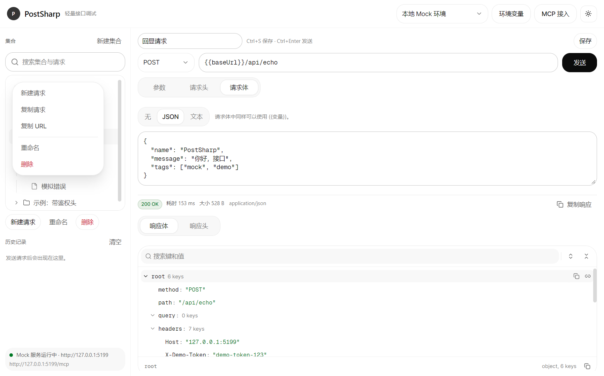

# PostSharp

> 轻量、离线可用的接口调试桌面工具。基于 **Avalonia 12.1.4** 与 **TKCode.Arc 0.3.0-preview.2**，界面使用 Arc 设计语言，内置 Mock API 和 MCP 服务，适合日常接口调试、联调自测和 AI 自动化。


## 目录

- [功能](#功能)
- [技术栈](#技术栈)
- [快速开始](#快速开始)
- [内置 Mock API](#内置-mock-api)
- [MCP 接入](#mcp-接入)
- [快捷键](#快捷键)
- [数据与配置](#数据与配置)
- [项目结构](#项目结构)
- [设计与实现](#设计与实现)
- [验证记录](#验证记录)
- [开发约定](#开发约定)
- [常见问题](#常见问题)
- [已知限制与路线图](#已知限制与路线图)

## 功能

- **接口调试**：GET / POST / PUT / PATCH / DELETE / HEAD / OPTIONS，支持 URL 查询参数、请求头、JSON/文本请求体。
- **响应查看**：状态码、耗时、大小、内容类型、响应头；JSON 响应使用 Arc `JsonViewer` 树形展示，支持搜索、复制值和复制路径；非 JSON 使用等宽文本视图。
- **集合管理**：新建集合/请求、重命名、删除确认、复制请求、复制 URL、搜索过滤、自动保存。
- **右键菜单**：在集合树中右键集合或请求，可新建请求、复制请求、复制 URL、重命名、删除；菜单在窗口内渲染，不依赖系统弹窗。
- **历史记录**：每次发送保存请求快照，点击恢复为草稿；支持清空。
- **环境变量**：多环境、变量启用/停用，可在 URL、请求头、请求体中使用 `{{变量名}}`。
- **内置 Mock API**：应用启动时监听 `127.0.0.1:5199`，示例请求开箱即用，不依赖外网。
- **MCP 接入**：在 `http://127.0.0.1:5199/mcp` 暴露 Streamable HTTP 的 MCP 服务，AI 客户端可以管理接口、发送请求、运行请求序列。
- **主题与自适应**：浅色/深色切换，系统标题栏同步深色；窗口按屏幕工作区计算尺寸，编辑器/响应区按比例布局并可拖动分隔条。

### 右键菜单

集合树右键菜单提供新建请求、复制请求、复制 URL、重命名和删除；右键集合时自动隐藏请求相关项。菜单在窗口内渲染，支持点击外部或按 `Esc` 关闭。



## 技术栈

| 项目 | 版本 / 说明 |
| --- | --- |
| .NET | `net10.0` |
| Avalonia | `12.1.4`（固定版本） |
| TKCode.Arc | `0.3.0-preview.2`（固定版本） |
| AtomUI | 由 TKCode.Arc 带入，`6.2.8` |
| MVVM | CommunityToolkit.Mvvm `8.4.0` |
| 持久化 | `System.Text.Json`，本地单文件 |
| Mock / MCP | 原生 `TcpListener` + 最小 HTTP 解析，无额外 Web 框架 |

## 快速开始

### 环境

- .NET 10 SDK（当前验证版本：10.0.402）
- Windows 10/11 为主要验证平台；代码对 Windows 专属的标题栏 API 做了平台判断，其他平台理论可运行，但尚未做完整回归。

### 运行

```bash
dotnet run --project src/PostSharp/PostSharp.csproj
```

构建：

```bash
dotnet build PostSharp.slnx
```

发布（Windows x64 示例）：

```bash
dotnet publish src/PostSharp/PostSharp.csproj -c Release -r win-x64 --self-contained false
```

### 首次使用

首次运行会生成示例工作区和本地环境：

- 环境：`本地 Mock 环境`
- 变量：`baseUrl = http://127.0.0.1:5199`、`token = demo-token-123`
- 集合：`内置 Mock 示例`、`示例：带鉴权头`

打开后直接选中「健康检查」，按 `Ctrl+Enter` 或点击「发送」即可看到响应。

## 内置 Mock API

端口被占用时会自动尝试 `5200`–`5210`，示例工作区会使用实际启动的端口。

| 方法 | 路径 | 说明 |
| --- | --- | --- |
| GET | `/api/health` | 健康检查，返回服务状态 |
| GET | `/api/users` | 用户列表，支持查询参数（示例 `page=1`） |
| GET | `/api/users/{id}` | 用户详情，不存在返回 404 |
| POST | `/api/orders` | 创建订单，返回 201 |
| POST | `/api/echo` | 回显方法、查询参数、请求头和请求体 |
| GET | `/api/error` | 固定返回 500 |
| GET | `/api/slow?ms=1200` | 延迟响应，`ms` 范围 0–5000 |

## MCP 接入

应用内点击「MCP 接入」可以查看端点、复制客户端配置。端点：

```text
http://127.0.0.1:5199/mcp
```

客户端配置示例：

```json
{
  "mcpServers": {
    "postsharp": {
      "url": "http://127.0.0.1:5199/mcp"
    }
  }
}
```

支持 Streamable HTTP 的 MCP 客户端（Cursor、Claude Code、Cline 等）可以直接添加该地址。服务实现 JSON-RPC 2.0，支持 `initialize`、`notifications/initialized`、`ping`、`tools/list`、`tools/call`，JSON-RPC 错误按标准返回。

### 已开放工具

| 工具 | 用途 |
| --- | --- |
| `list_collections` | 查看集合和请求 |
| `get_request` | 读取请求完整定义 |
| `create_collection` | 新建集合 |
| `create_request` | 新建请求 |
| `update_request` | 修改请求；传 `collectionId` 可移动到其他集合 |
| `delete_request` | 删除请求 |
| `send_request` | 发送请求，返回状态、耗时、大小、响应头、响应体 |
| `run_sequence` | 按顺序执行多个请求（自动化），可设置遇错停止 |
| `list_history` | 查看最近发送历史 |
| `list_environments` | 查看环境与变量 |
| `set_variable` | 新增或更新环境变量 |

### 自动化示例

让 AI 客户端依次执行「健康检查 → 用户列表」：

```text
调用 run_sequence，requestIds 传入这两个请求的 id，stopOnError 设为 true。
```

MCP 发送同样写入历史记录，UI 中的集合/请求变更会实时刷新。

### 安全说明

- MCP 只监听回环地址 `127.0.0.1`，不会暴露到局域网。
- 当前版本没有 MCP 鉴权，请勿修改为 `0.0.0.0` 或直接暴露到公网。
- Mock API 同样只监听回环地址。

## 快捷键

| 快捷键 | 动作 |
| --- | --- |
| `Ctrl+Enter` | 发送当前请求 |
| `Ctrl+S` | 保存当前请求 |
| `Ctrl+N` | 新建请求 |
| `Enter`（单行输入框内） | 发送当前请求 |
| `Shift+F10` / 菜单键 | 在集合树上打开右键菜单 |
| `Esc` | 关闭右键菜单 |

## 数据与配置

工作区数据保存在当前用户的应用数据目录：

```text
Windows: %APPDATA%\PostSharp\workspace.json
```

内容包括集合、请求、环境变量和最近 40 条历史记录。删除该文件即可恢复首次运行的示例工作区。

- 数据不会上传到任何服务。
- 工作区文件为 UTF-8 JSON，可直接备份或纳入内部配置管理。
- 应用退出时会自动保存一次。

## 项目结构

```text
src/PostSharp/
  Models/
    RequestItem.cs         请求、集合模型
    EnvironmentModel.cs    环境与变量
    EditableRow.cs         自动补行的键值编辑集合
    HistoryEntry.cs        历史记录快照
  Services/
    HttpRequestService.cs  HttpClient 封装、URL/变量解析、JSON 格式化、响应解码
    MockApiServer.cs       本地 HTTP 服务（Mock + MCP 共用监听端口）
    McpServer.cs           MCP JSON-RPC 协议实现
    McpWorkspaceAdapter.cs MCP 工具与 UI 线程之间的适配层
    WorkspaceStore.cs      workspace.json 读写与 DTO 映射
    VariableResolver.cs    {{变量}} 解析
  ViewModels/
    MainWindowViewModel.cs 主视图模型、命令、状态
  Views/
    MainWindow.axaml       主界面
    MainWindow.axaml.cs    集合树重建、右键菜单、弹层和标题栏适配
  Program.cs               Arc / AtomUI 启动注册
docs/
  screenshot.png           主界面截图
  context-menu.png         右键菜单截图
```

## 设计与实现

### MVVM 与绑定

- 使用 CommunityToolkit.Mvvm 的源生成器生成属性和命令。
- XAML 启用编译绑定，所有列表项模板都声明 `x:DataType`。
- 编辑器的 `Text`、`SelectedItem`、`SelectedValue` 等使用双向绑定；命令只通过 `Command` 执行。
- 长时间操作（发送请求）通过 `async` 命令执行，不阻塞 UI 线程。

### TKCode.Arc 的使用

界面使用 Arc 的设计令牌和控件，没有硬编码颜色、圆角或字号：

- 布局：`Grid` / `StackPanel` / `DockPanel`，编辑器与响应区使用星号比例 + `GridSplitter`。
- 控件：`Button`、`Input`、`Select`、`SegmentedControl`、`Tabs`、`TreeView`、`SearchField`、`JsonViewer`、`ScrollArea`、`EmptyState`、`Badge`、`CopyButton`、`Dialog`、`Toast`、`ThemeSwitcher` 等。
- 颜色/字号/间距全部来自 `ArcDesignTokenResource`，因此深浅色切换和 Accent 变化全窗一致。
- Arc 弹层（Select、Tooltip 等）默认使用窗口内 popup overlay layer；普通 Avalonia `Window` 需要显式开启该层，代码见 `MainWindow.EnablePopupOverlayLayer()` 注释。若后续改为 AtomUI `Window`，可以移除这一适配。

### 集合树与右键菜单

- Arc `TreeView` 的节点是内联 `TreeViewItem`，视图在集合结构或搜索条件变化时重建树，并保留展开状态。
- 树行是自绘控件，没有普通的 `ContextMenu` 属性，因此右键菜单使用窗口内的 Arc 风格浮层：通过视觉树命中行 → 读取节点 → 选中 → 在鼠标位置显示菜单卡片。
- 菜单卡片使用 `SurfaceRaised`、`RadiusPanel`、`ShadowFloating` 等令牌；点击外部或按 Esc 关闭。
- 右键集合时只显示集合相关动作，右键请求时额外显示「复制请求 / 复制 URL」。

### 弹层与暗色标题栏

- 普通 Avalonia `Window` 默认没有 `PopupOverlayLayer`，Arc 的 `Select` / 菜单会回退到原生 popup 并可能报错。`EnablePopupOverlayLayer()` 通过反射打开 Avalonia 的内部开关，使 Arc 弹层在窗口内渲染。
- 深色模式下通过 DWM `DWMWA_USE_IMMERSIVE_DARK_MODE` 同步原生标题栏颜色（非 Windows 平台自动跳过）。

### HTTP 细节

- `HttpClient` 使用 `AutomaticDecompression`（gzip/deflate/brotli），60 秒超时，支持取消。
- URL 合并已有查询参数和表格里的参数，参数值、请求头、请求体都会做环境变量替换。
- 请求体按 `BodyMode` 设置 `application/json` 或 `text/plain`；用户自定义 `Content-Type` 时以用户为准。
- 响应按 `charset` 解码（已注册 GBK/GB18030 等代码页）；JSON 自动格式化后交给 `JsonViewer`。
- 网络错误、超时、取消都会在响应区显示具体原因，不写入历史。

### MCP 线程模型

- MCP 请求运行在本地监听线程，所有工作区读写通过 `Dispatcher.UIThread` 切回 UI 线程。
- 发送请求时先在 UI 线程克隆请求和环境，再在后台线程执行 HTTP，最后回 UI 线程写历史，避免 UI 卡顿和跨线程访问集合。
- `run_sequence` 复用同一个发送流程，按传入顺序串行执行。

## 验证记录

以下结果来自初始版本的本地 Mock 服务验证（`PostSharp` + `postsharp-mock`）：

| 请求 | 结果 |
| --- | --- |
| `GET /api/health` | `200 OK`，125 B，约 10 ms |
| `GET /api/users` | `200 OK`，`total = 5` |
| `POST /api/echo` | `200 OK`，回显请求体和 `X-Demo-Token` |
| `POST /api/orders` | `201 Created` |
| `GET /api/slow?ms=1200` | `200 OK`，约 1219 ms |
| `GET /api/error` | `500 Internal Server Error` |
| `GET /api/users/1` | `200 OK`，返回用户 1 |
| 参数合并 | 已有 `existing=1` + 新增 `page=2` / `q=中文` 均正确送达 |
| MCP `run_sequence` | 2 个请求全部成功，`succeeded=2` |
| MCP 工具 | `list_collections` / `send_request` / `create_request` / `update_request` / `delete_request` / `set_variable` 均验证通过 |

> 重新验证时，启动应用后使用内置示例即可；Mock 服务随应用启动/退出。

## 开发约定

### 分支策略

```text
master                 稳定可发布
  └── dev              集成分支，日常合并目标
        └── feature/*  功能开发分支，例如 feature/initial-mvp
```

- 功能开发从 `dev` 拉出 `feature/<short-name>`。
- 完成后先合并到 `dev` 自测，再合并到 `master` 发版。
- 不要在 `master` 上直接开发。
- 当前初始版本同时存在于 `master`、`dev`、`feature/initial-mvp`，后续从 `dev` 继续。

### 提交信息

推荐 Conventional Commits：

```text
feat: add request context menu
fix: keep popup overlay inside the window
docs: refresh README and screenshots
```

### 代码约定

- 使用 Arc 令牌，不在视图中写十六进制颜色、固定圆角或字号。
- 使用 `arc:` 前缀引用 Arc 控件；C# 中与 Avalonia 同名类型使用别名。
- 仓库提供 `.editorconfig` 和 `.gitattributes`，统一 UTF-8 编码与 LF 行尾。
- 每个字段有可见 `Label`；图标按钮必须有 `AutomationProperties.Name`。
- 新功能同时考虑空状态、加载状态、错误状态和深浅色。
- 不要升级 Avalonia / TKCode.Arc 版本而不做完整回归；两者版本相互锁定。
- 不要启用 `InvariantGlobalization`，日期/数字格式依赖区域数据。

### 添加一个 Mock 接口

1. 在 `MockApiServer.HandleClientAsync` 的 `switch (path)` 中增加分支。
2. 返回 `WriteResponseAsync(stream, status, reason, payload, token)`。
3. 在应用内新增示例请求并验证 MCP `send_request` 与 `run_sequence`。
4. 更新 README 的接口表。

## 常见问题

**启动时提示端口被占用？**  
Mock 服务会自动顺延端口，侧栏底部显示实际地址；示例环境变量使用实际端口。若手工配置了 `baseUrl`，请同步修改。

**Select 下拉/右键菜单不显示或报 popup 错误？**  
确认 `MainWindow.EnablePopupOverlayLayer()` 仍被调用，且窗口内保留 `VisualLayerManager EnableOverlayLayer="True"`。若改用 AtomUI `Window`，可去掉该反射适配。

**如何恢复初始示例？**  
关闭应用，删除 `%APPDATA%\PostSharp\workspace.json`，重新启动。

**为什么深色模式下标题栏没有变化？**  
DWM 标题栏适配只在 Windows 生效；非 Windows 或系统未启用深色标题栏时保持系统默认。

**构建报 `ATOMUILOC008`？**  
`App` 类必须是 `partial`，并保留 `UseAtomUI(...)` 中的 `UseArc()` 注册。

**历史记录会无限增长吗？**  
不会，最多保留最近 40 条；工作区文件为单文件覆盖写入。

## 已知限制与路线图

当前为初始 MVP，暂未实现：

- cURL / OpenAPI / Postman Collection 导入导出
- Cookie 管理、代理、客户端证书、OAuth
- form-data / urlencoded 可视化编辑表格
- 请求断言、变量提取、定时任务和 MCP 事件通知（SSE）
- 多窗口、工作区切换、云同步
- MCP OAuth / 鉴权（当前仅本地回环）

计划优先级：

1. 导入导出 + 请求断言（提高联调效率）
2. form-data / 文件上传
3. 自动化编排（断言、变量提取、定时触发）
4. MCP SSE 通知与更细粒度的权限控制

## 交接说明

- 代码入口：`src/PostSharp/Program.cs`、`App.cs`。
- 主要交互逻辑：`ViewModels/MainWindowViewModel.cs`。
- 本地协议与 Mock：`Services/`。
- 主界面：`Views/MainWindow.axaml`。
- 提交前请至少执行 `dotnet build PostSharp.slnx`，并在 Windows 上手动验证发送、右键菜单、环境变量和 MCP 工具。
- 项目已配置 `.gitignore`，只忽略 `bin/`、`obj/`、IDE 文件等构建产物；源码、截图和文档都会进入版本库。
