# PostSharp


> 面向 AI 的本地接口调试工作台。基于 **Avalonia 12.1.4** 与 **TKCode.Arc 0.3.1-preview.2**，把「AI 通过 MCP 触发请求 → 审计留痕 → 自动化回归」串成一条闭环，同时保留完整的 Postman 式手动调试能力。

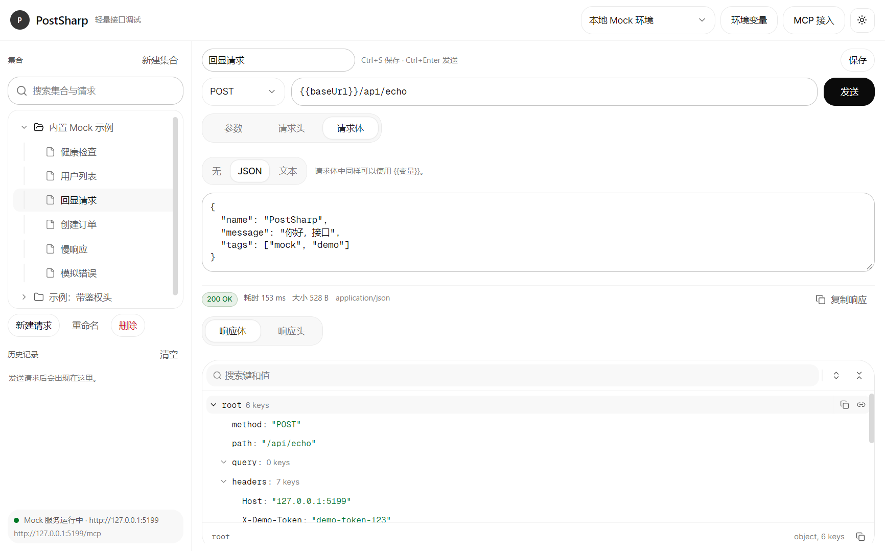

## 目录

- [为什么是 PostSharp](#为什么是-postsharp)
- [功能](#功能)
- [技术栈](#技术栈)
- [快速开始](#快速开始)
- [内置 Mock API](#内置-mock-api)
- [MCP 接入](#mcp-接入)
- [AI 审计与自动化](#ai-审计与自动化)
- [请求与响应能力](#请求与响应能力)
- [系统全局设置](#系统全局设置)
- [快捷键](#快捷键)
- [数据与配置](#数据与配置)
- [项目结构](#项目结构)
- [设计与实现](#设计与实现)
- [验证记录](#验证记录)
- [开发约定](#开发约定)
- [常见问题](#常见问题)
- [已知限制与路线图](#已知限制与路线图)
- [许可证](#许可证)

## 为什么是 PostSharp

Postman 擅长手动点按，但 AI 时代的调用大多由 Agent 发起：请求由 MCP 触发，结果需要审计，回归需要套件，流式输出需要把 thinking 和 content 聚合起来。

PostSharp 的定位是：

1. **AI 的本地执行器**：AI 通过 MCP 查询接口、发送请求、获取 cURL、运行套件。
2. **审计中心**：每一次 UI 或 MCP 发送都记录来源、客户端、工具、状态、耗时、cURL、请求/响应预览和 AI 聚合输出。
3. **自动化管理层**：保存回归套件、设置状态码/响应体/JSONPath/响应头断言、查看每个步骤的结果。
4. **人工兜底工作台**：需要手动调试时，完整的参数、请求头、请求体、cURL、响应查看仍然在。

## 功能

### AI 方向

- **MCP 工具**：接口 CRUD、发送请求、获取 cURL、审计查询、自动化套件创建/运行/删除。
- **完整审计**：来源 `UI` / `MCP`、MCP 客户端名称、工具名、时间、状态、耗时、大小、cURL、请求头和请求/响应预览。
- **SSE / AI 输出聚合**：自动解析 `text/event-stream`，聚合常见 AI 协议的 thinking 与 content，接收中增量刷新，取消后保留已接收内容。
- **自动化套件**：步骤支持 `expectedStatus` / `bodyContains`，以及 JSONPath、响应头断言；支持失败重试、条件执行、并行组、定时运行与失败停止；运行结果进入审计。
- **管理层**：一个窗口内切换审计、自动化、指南。

### 调试能力

- **方法**：GET / POST / PUT / PATCH / DELETE / HEAD / OPTIONS。
- **请求头**：键值表、常用头一键插入、重复头提示、环境变量。
- **请求体**：无 / JSON / 文本 / 表单上传。
  - JSON/XML 一键格式化，JSON 一键压缩。
  - 单行切换与单行预览，长文本不再占满编辑区。
  - multipart/form-data：表单字段 + 多文件选择 / 拖拽，每个文件可编辑字段名。
  - 大文件按 64KB 流式读取并显示上传进度；发送中的「取消」可中断上传。
- **cURL / PowerShell 导入 / 导出**：按当前环境解析变量，生成可执行的 bash cURL 或 PowerShell `Invoke-RestMethod`；支持从 Postman、浏览器或 PostSharp 生成的 `-X` / `-H` / `-d` / `--data-raw` / `-F` / `-u` 命令，以及 PowerShell `-Uri` / `-Method` / `-Headers` / `-Body` / `-Form` / `-TimeoutSec` 命令导入请求；可保存为 `.sh` 或 `.ps1`。
- **Postman Collection 导入 / 导出**：读取 Postman Collection v2.0 / v2.1 的嵌套文件夹、请求、查询参数、请求头、Bearer / Basic / API Key 认证、raw / urlencoded / formdata 请求体和集合变量；导出选中集合或整个工作区为标准 v2.1 文件。
- **Postman 环境文件**：独立导入 `values` 或 `variable` 数组，创建或合并同名环境并激活。
- **HAR 1.2 导入**：读取浏览器、Postman、Apifox 导出的 HTTP Archive；默认只保留 XHR / Fetch，支持 query、headers、cookies、JSON / text / form-data 请求体，可切换包含静态资源。
- **Insomnia V4 导入**：读取 `resources` 数组中的 workspace、request_group、request 和 environment；脚本/测试不执行。
- **Hoppscotch 导入**：读取 Collection JSON 的 folders、requests、params、headers、body 和基础认证。
- **springdoc / Knife4j**：OpenAPI 来源可一键补全 `/v3/api-docs` 地址。
- **来源选择**：导入对话框直接展示 OpenAPI、Postman、Environment、cURL、HAR、Insomnia、Hoppscotch、其他工具、Apifox 等小分类卡片，可收起。
- **批量导入**：一次选择多个文件，自动识别 OpenAPI / Postman / HAR / Insomnia / Hoppscotch / cURL；逐文件显示成功或失败结果，单个失败不会中断其他文件。
- **导入反馈**：导入完成后弹出成功对话框，显示请求数、分组数、环境数和失败数；逐文件结果与兼容性提示仍保留在导入窗口，可展开/收起。
- **响应**：
  - 状态、耗时、大小、内容类型、响应头。
  - JSON 使用 Arc JsonViewer（搜索、展开、复制值/路径）。
  - Non-JSON / XML 自动格式化或单行展示。
  - 大响应折叠：主视图只展示预览，详情窗口按页查看完整内容，支持复制全部。
  - SSE 响应自动选中「AI 聚合」标签，内容 / 思考过程 / 原始事件三视图。
- **集合、历史、环境变量、自动保存**。
- **历史记录管理**：单条删除与清空都会先弹出确认，删除项进入回收站；回收站支持恢复、永久删除，永久删除前再次确认。
- **OpenAPI 导入**：从本地 JSON / YAML 文件或 URL 读取 OpenAPI 3.x / Swagger 2.0；按 `x-apifox-folder` 或第一个 tag 创建分组，支持安全方案占位头、多服务器选择、外部 `$ref` 自动下载（限 20 个、每个 2 MB、10 秒超时），并带出服务器地址、查询参数和请求体示例。

### 界面

- 启动时读取系统深色 / 浅色主题；设置窗口可固定为浅色或深色，原生标题栏同步。
- **单实例**：使用命名 Mutex 限制同一用户只运行一个 PostSharp；重复启动直接退出，避免多个窗口同时写工作区和审计。
- 顶栏「设置」直达独立设置窗口；外观、日志和请求默认值分组展示，保存后立即生效。
- **Serilog 文件日志**：默认写入 `%APPDATA%\PostSharp\logs\postsharp-YYYYMMDD.log`，按天滚动，保留最近 30 个文件；日志目录与最低日志级别可在设置窗口修改，保存后立即生效。所有 `catch` 都会留下结构化异常日志。
- 界面字体、代码字体、代码字号、窗口自适应；设置窗口可导入本地字体或添加字体目录，导入后的字体会出现在界面/代码字体选项中。
- 设置窗口新增「全局圆角」滑杆：0 = 直角、1 = Arc 默认、2 = 双倍圆角，保存后立即应用到全部 Arc 控件。
- 左侧集合栏与编辑区之间有可拖拽分隔条（240–520 DIP），双击恢复默认 320 DIP；宽度随设置持久化。
- 请求区与响应区之间有独立拖拽条（上下方向），可分别调整高度并持久化；双击恢复 1:1 默认比例。
- 请求成功后自动切换为左右布局；顶部请求工具栏提供「收起响应 / 展开响应」，收起后请求区占满可用空间。
- 列表统一列布局：来源/方法/状态/时间固定对齐，长文本省略并在悬浮时显示完整内容。
- Tooltip 统一为浮层卡片：`SurfaceRaised` 背景、1px 边框、圆角与悬浮阴影，最大宽度 380，长文本自动换行；按钮、历史 URL、分隔条和树节点共用同一套样式。
- 类型化视觉：来源 `UI` / `AI · MCP` 使用不同图标与色调；状态成功/警告/失败使用勾/警告/叉图标；`GET` / `POST` / `PUT` / `PATCH` / `DELETE` 使用不同方法徽标。
- 常用操作带图标：发送、保存、新建、重命名、删除、清空、回收站、上传、格式化、运行套件、MCP、设置等。
- 主窗口采用无头自绘标题栏：顶部栏空白区域可拖拽移动，双击切换最大化；最小化、最大化/还原、关闭固定在顶栏最右侧，窗口仍保留边缘缩放。
- 管理层内的下拉选项固定显示在管理层之上，不会跑到主窗体或关闭后才出现。
- 1000×660 窗口下工具栏、审计列表、指南卡片仍保持对齐并可滚动。
- 集合顶部快捷操作：「新建集合」（文件夹图标，左侧）、「导入」（打开 OpenAPI / Postman / cURL / HAR / Insomnia / Hoppscotch 的导入导出对话框，中间）和「新建请求」（加号图标，右侧）。
- 支持最多五级集合：选择集合后可通过三点菜单「新建二级集合」；请求可拖拽进任意集合文件夹，集合也可拖入其他集合（自动阻止循环嵌套与超过五级）。
- 拖拽排序：拖到同级节点上/下边缘可上移/下移，拖到集合中间可移入该集合；根级集合、子集合和请求都支持。
- 树节点图标与文字垂直居中；悬浮三点菜单使用横向省略号，点击热区加宽；悬浮时还会显示上移/下移箭头，可直接点击排序。
- 树节点悬浮三点菜单与右键菜单使用同一组功能并带图标：新建请求、新建二级集合、复制请求、复制 URL、上移、下移、收藏 / 取消收藏、重命名、删除；按集合/请求类型显示适用项。
- 同级集合和请求可上移/下移排序，排序结果直接决定自动化套件的步骤优先级，并随工作区持久化。
- 双击节点直接重命名；三点按钮使用横向省略号，点击热区加宽。
- 收藏有独立的「收藏」筛选；星标随工作区持久化，收藏集合会展示其内容。
- 底部历史与回收站使用固定列：方法、名称、状态、时间、操作；方法与状态徽标和审计列表一致。
- 历史记录可折叠：点击「历史记录」左侧箭头收起列表，集合树自动占满侧栏；折叠状态写入设置，下次启动保持。
- 参数/请求头等键值行的启用复选框与输入框垂直对齐。
- 管理层指南使用左右分栏：左侧步骤说明，右侧竖排操作按钮，行动位置统一。
- 内置一分钟指南和示例请求。

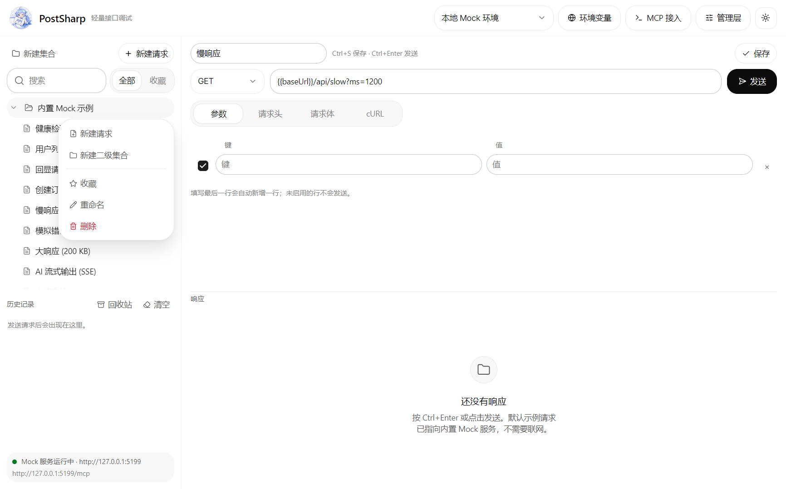

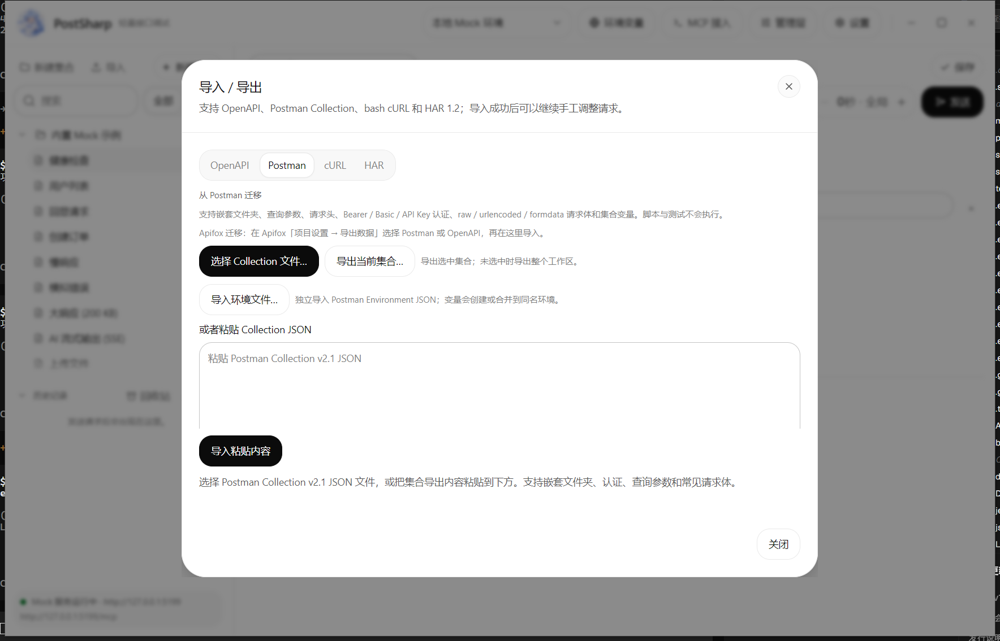

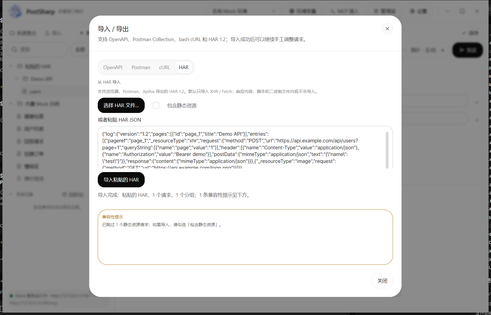

## 技术栈

| 项目 | 版本 / 说明 |
| --- | --- |
| .NET | `net10.0` |
| Avalonia | `12.1.4` |
| TKCode.Arc | `0.3.1-preview.2` |
| TKCode.Arc.Fonts | `0.3.1-preview.2` |
| TKCode.Arc.Themes.Corners | `0.3.1-preview.2` |
| AtomUI | 由 TKCode.Arc 带入，`6.2.8` |
| MVVM | CommunityToolkit.Mvvm `8.4.0` |
| 持久化 | `System.Text.Json`，本地文件 |
| 日志 | Serilog `4.3.0` + Serilog.Sinks.File `7.0.0`，按天滚动 |
| OpenAPI | YAML：YamlDotNet `16.3.0`；JSON：`System.Text.Json` |
| Postman / cURL / HAR / Insomnia / Hoppscotch | `System.Text.Json` 与内置解析器，无新增运行时依赖 |
| 自测 | xUnit `2.9.3` + Microsoft.NET.Test.Sdk `17.14.1` |
| Mock / MCP | 原生 `TcpListener` + 最小 HTTP/SSE 解析，无额外 Web 框架 |

## 快速开始

### 环境

- .NET 10 SDK（验证版本：10.0.402）
- Windows 10/11 为主要验证平台；Windows 专属的标题栏 API 做了平台判断。

### 运行

```bash
dotnet run --project src/PostSharp/PostSharp.csproj
```

构建：

```bash
dotnet build PostSharp.slnx
```

自测：

```bash
dotnet test tests/PostSharp.Tests/PostSharp.Tests.csproj
```

### Apifox 迁移

Apifox 的原生格式暂未直接解析；当前推荐三条官方导出路径，PostSharp 已经有对应导入器：

1. **推荐：Apifox → Postman**
   - Apifox 打开「项目设置 → 导出数据」，选择 `Postman`，导出 Collection JSON。
   - 在 PostSharp「导入 → Postman」中选择文件，或直接粘贴 JSON。
   - 适合保留文件夹、请求顺序、认证和请求体；Apifox 的脚本/测试不会执行。
2. **OpenAPI / Swagger**
   - Apifox 可导出 OpenAPI 3.1 / 3.0 / Swagger 2.0 的 JSON 或 YAML。
   - 在 PostSharp「导入 → OpenAPI」中导入文件或 URL。
   - 适合标准接口文档；同名 method + path、脚本、部分安全方案可能被合并或省略。
3. **浏览器 / Apifox → HAR**
   - 在 Apifox 或浏览器开发者工具中导出 `.har`。
   - 在 PostSharp「导入 → HAR」中导入；默认只保留 XHR / Fetch，可勾选包含静态资源。
   - 适合快速抓取真实请求；响应、脚本和二进制文件内容不会导入。

后续会增加 Apifox 原生格式适配评估，在此之前优先使用上述三条路径。导入对话框的来源卡片会直接显示这些路径和当前状态，避免只能靠大分类猜测。

### 第一次使用

1. 启动后会生成示例工作区和本地环境：
   - 环境：`本地 Mock 环境`
   - 变量：`baseUrl = http://127.0.0.1:5199`、`token = demo-token-123`
   - 示例请求：健康检查、用户列表、回显、创建订单、慢响应、模拟错误、大响应、SSE、上传。
2. 选中「健康检查」，按 `Ctrl+Enter`。
3. 打开顶栏「管理层」：
   - **审计**：查看刚才的 UI 发送。
   - **自动化**：运行「内置 Mock 冒烟测试」。
   - **指南**：一分钟了解全部核心功能。
4. 顶栏「设置」打开独立设置窗口：主题、日志目录、字体、超时、默认请求体等。
5. 集合树顶部的「导入」打开导入/导出对话框，先选择来源卡片，再选择文件或粘贴内容；底部「批量导入文件…」可以一次选择多个文件并自动识别格式。

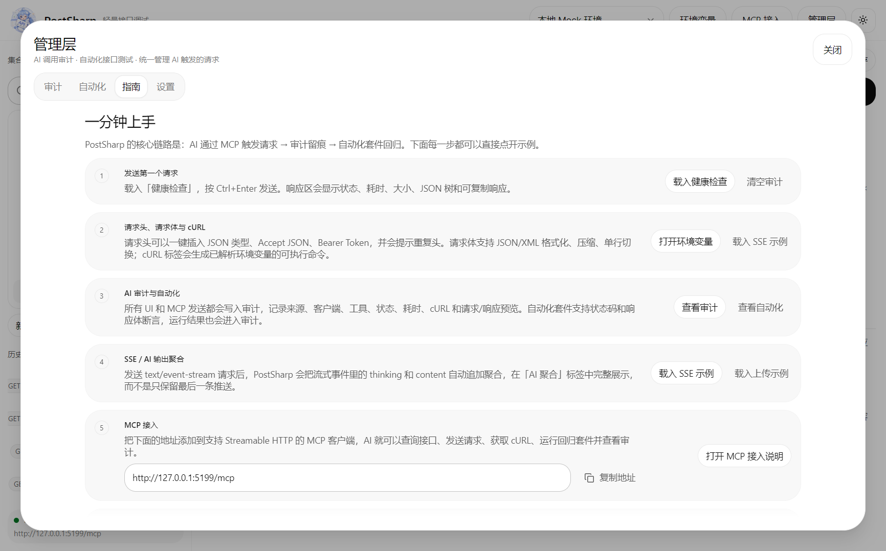

## 内置 Mock API

服务监听 `127.0.0.1:5199`；端口占用时自动尝试 `5200`–`5210`，示例环境变量会使用实际端口。

| 方法 | 路径 | 说明 |
| --- | --- | --- |
| GET | `/api/health` | 健康检查 |
| GET | `/api/users` | 用户列表，支持 `page` 等查询参数 |
| GET | `/api/users/{id}` | 用户详情，不存在返回 404 |
| POST | `/api/orders` | 创建订单，返回 201 |
| POST | `/api/echo` | 回显方法、查询参数、请求头、请求体 |
| GET | `/api/error` | 固定 500 |
| GET | `/api/slow?ms=1200` | 延迟响应，最大 5000ms |
| GET | `/api/large?kb=200` | 大响应，用于验证折叠与分页详情 |
| GET | `/api/ai/stream` | SSE 流，混合 thinking/content 事件 |
| POST | `/api/upload` | 接收 multipart，返回字节数、文件名和 Content-Type |

## MCP 接入

应用内「MCP 接入」可查看端点与客户端配置：

```text
http://127.0.0.1:5199/mcp
```

```json
{
  "mcpServers": {
    "postsharp": {
      "url": "http://127.0.0.1:5199/mcp"
    }
  }
}
```

支持 Streamable HTTP 的 MCP 客户端（Cursor、Claude Code、Cline 等）可以直接添加。服务实现 JSON-RPC 2.0，支持 `initialize`、`notifications/initialized`、`ping`、`tools/list`、`tools/call`。

### 工具列表

| 工具 | 用途 |
| --- | --- |
| `list_collections` | 查看完整集合树，返回 `parentId`、`depth`、`order` 和请求顺序 |
| `create_collection` | 新建集合，支持 `parentId`（最多 5 级）、收藏和同级排序 |
| `update_collection` | 修改名称/收藏/父级/顺序，`parentId=null` 可移到根目录 |
| `move_collection` | 移动集合到指定父级和位置 |
| `delete_collection` | 删除集合及其子集合/请求 |
| `get_request` | 读取请求完整定义 |
| `create_request` | 新建请求，支持参数、请求头、JSON/Text/Multipart、上传、收藏和位置 |
| `update_request` | 修改任意字段，可移动集合或调整顺序 |
| `move_request` | 移动请求到指定集合并设置顺序 |
| `delete_request` | 删除请求 |
| `send_request` | 发送请求，返回状态、耗时、大小、响应头、响应体；SSE 时同时返回聚合的 thinking/content |
| `get_curl` | 生成已解析环境变量的可执行 cURL |
| `run_sequence` | 按顺序运行一组请求（轻量自动化，不含断言/映射） |
| `list_suites` | 查看套件、步骤顺序、延迟、断言和输入映射 |
| `get_suite` | 读取单个套件的完整定义（含稳定步骤 id） |
| `create_suite` | 创建套件，步骤支持 `expectedStatus`、`bodyContains`、`delayMs`、`mappings`、`stopOnError` |
| `create_suite_from_collections` | 按集合/请求当前顺序快速生成套件 |
| `update_suite` | 修改名称/失败策略，传入 `steps` 可整体替换、增删或重排工作流 |
| `run_suite` | 运行套件，返回每个步骤的断言、延迟、映射执行结果 |
| `delete_suite` | 删除套件 |
| `list_audit` | 查询 UI/MCP 审计摘要，支持 `source=UI|MCP` |
| `get_audit` | 读取单条审计详情（含完整请求/响应预览、cURL、AI 聚合输出） |
| `list_history` | 查看最近发送历史 |
| `list_environments` | 查看环境和变量 |
| `set_variable` | 新增/更新环境变量 |

`create_suite` 的映射规则字段：`sourceStepIndex`（从 0 开始，只能引用更早步骤）或 `sourceStepId`、`sourcePath`（支持 `data.token`、`items[0].id`）、`targetKind`（`Body`/`Header`/`Query`/`Path`）、`targetPath`、`template`（如 `Bearer {value}`）。

示例：先取健康检查，再把 `status` 注入下一步的回显请求体：

```json
{
  "name": "AI workflow",
  "stopOnError": true,
  "steps": [
    { "requestId": "<health-id>", "expectedStatus": 200, "bodyContains": "ok", "delayMs": 200 },
    {
      "requestId": "<echo-id>",
      "expectedStatus": 200,
      "mappings": [
        {
          "sourceStepIndex": 0,
          "sourcePath": "status",
          "targetKind": "Body",
          "targetPath": "fromHealth",
          "template": "{value}"
        }
      ]
    }
  ]
}
```

### 安全

- 仅监听回环地址 `127.0.0.1`。
- 当前无 MCP 鉴权，不要改成 `0.0.0.0` 或直接暴露公网。
- 所有 AI 发送都会进入审计，包含客户端名称和工具名。

## AI 审计与自动化

### 审计

- **UI 发送**：来源 `UI`。
- **MCP 发送**：来源 `MCP`，记录 `initialize` 中的 `clientInfo.name` 和工具名（`send_request` / `run_sequence` / `run_suite`）。
- 审计详情包括：请求名称、方法、解析后的 URL、环境、状态、耗时、大小、cURL、请求头、请求/响应预览。
- SSE 请求额外记录 **AI 聚合输出**：thinking、content、事件数。
- 清空审计会先确认并移入 **审计回收站**，不会立即永久删除；回收站支持恢复、单条永久删除和清空，永久删除/清空均需再次确认。
- 审计单独保存在 `audit.json`，审计回收站保存在 `audit-trash.json`，默认保留 500 条（可在设置中调整）。

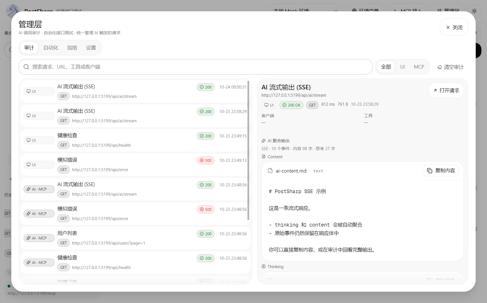

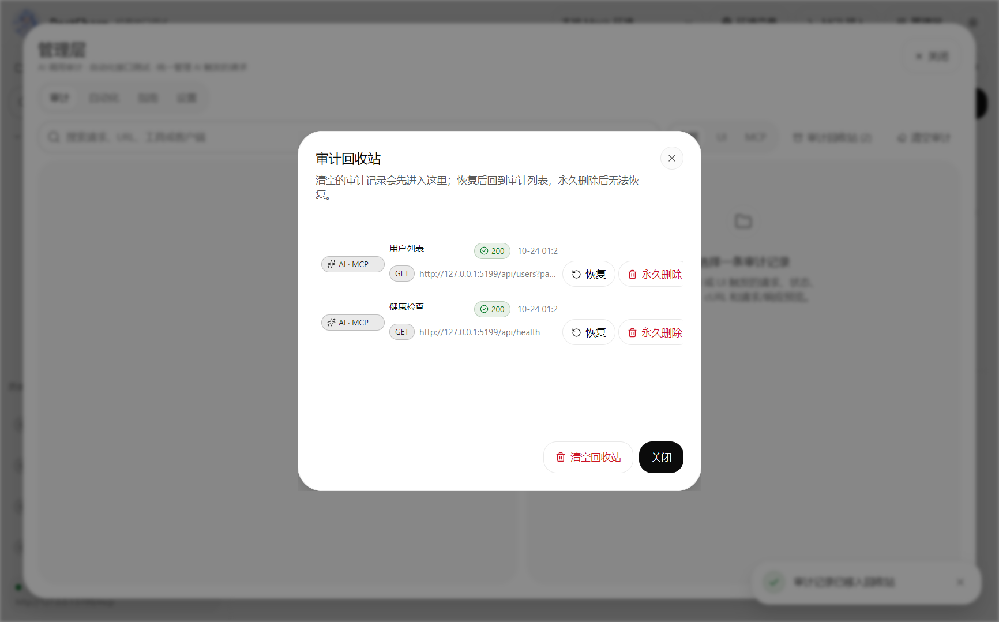

### 自动化套件

- **组装套件**：在自动化页勾选任意集合（含二级集合），把各集合中的请求组装成一个套件；步骤顺序沿用集合/请求排序，也可通过 MCP `create_suite` / `create_suite_from_collections` 创建。
- **AI 自主编排**：MCP 可完整创建/更新/重排/删除套件；`get_suite` 返回稳定步骤 id，`update_suite` 可整体替换步骤，运行结果带 `stepId` 和解析后的 URL，便于 AI 对照规则迭代。
- **工作流定位**：套件支持顺序/并行组、延迟、状态码/响应体/JSONPath/响应头断言、出参映射、失败重试、条件执行（上一步成功/失败）、失败停止和定时运行；DAG 依赖和条件跳转表达式属于下一步增强。
- **下一步延迟**：每个步骤可设置当前步骤结束到下一请求的延迟，默认 200ms；用于维护接口依赖的调用间隔。
- **前序出参映射**：每个步骤可配置多条映射规则，从前序某个步骤的响应中提取字段，写入当前请求的：
  - 请求体（支持 `data.token` 这类嵌套路径）
  - 请求头
  - 查询参数
  - URL 占位符（`{id}` / `:id`）
- **来源路径**：支持点路径和数组索引，例如 `data.token`、`items[0].id`。
- **值模板**：默认 `{value}`，也可写成 `Bearer {value}` 等；目标为请求体时保留原始 JSON 类型，模板自定义时自动解析 JSON 或作为字符串。
- 每个步骤支持：
  - `expectedStatus`：期望状态码；省略时接受 2xx/3xx。
  - `bodyContains`：响应体必须包含的文本。
- `stopOnError` 控制失败后是否停止。
- 运行结果展示通过/失败、状态码、耗时和错误原因，并逐条写入审计。
- 套件组装和映射规则窗口会按主窗口宽度自适应加宽；映射规则采用单行五列布局（来源步骤、来源字段、目标类型、目标字段、值模板），一屏可同时查看和编辑更多规则。

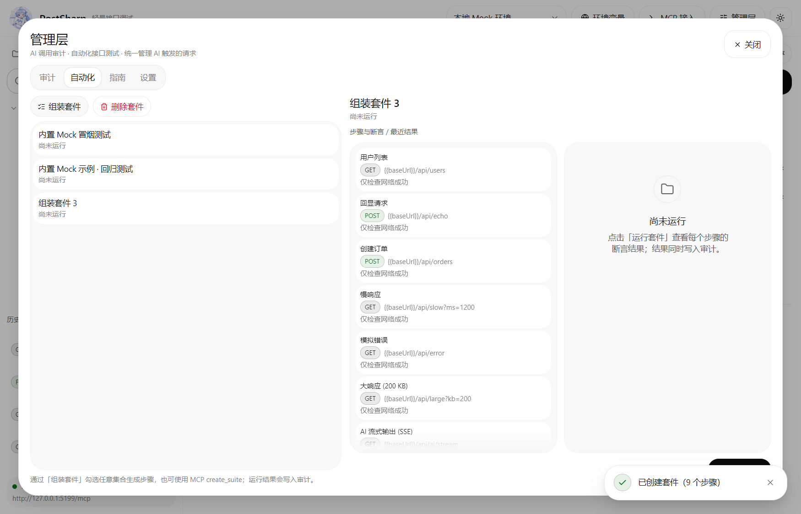

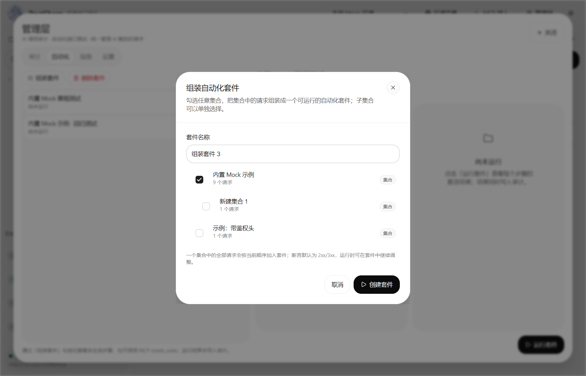

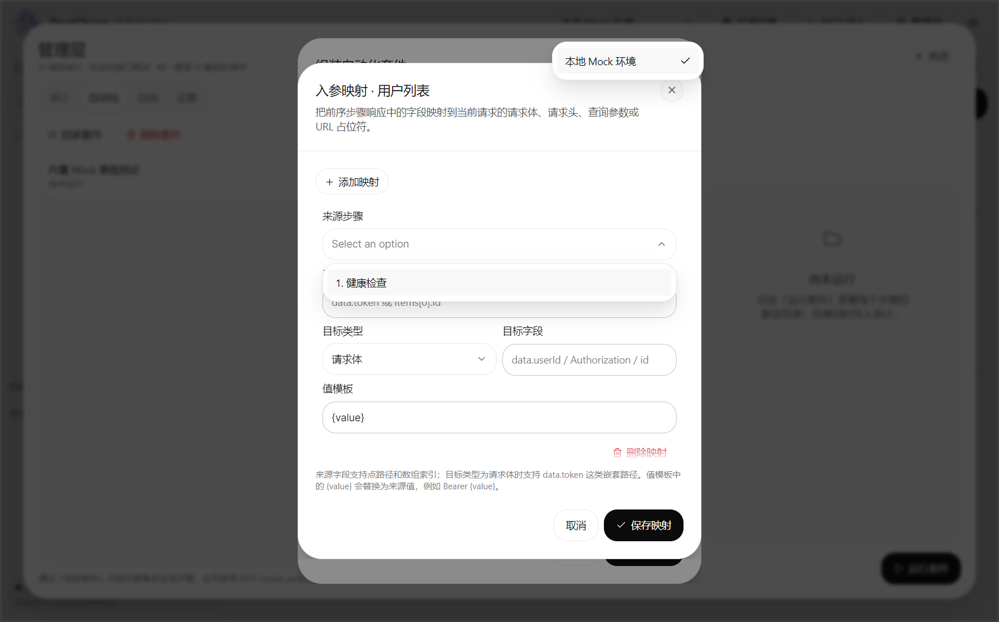

### SSE / AI 输出聚合

普通 Postman 只保留 SSE 的推送结果，用户看不到完整生成过程。PostSharp 会：

1. 按 SSE 规范读取 `event:` / `data:` 事件。
2. 兼容常见 AI 协议：
   - OpenAI / OpenRouter：`choices[].delta.content`、`reasoning_content`、`reasoning` 和 `reasoning_details[]`。
   - Anthropic：`content_block_delta` 的 `thinking_delta` / `text_delta`。
   - Gemini：`candidates[].content.parts[].text`（含 `thought`）。
   - 阿里云 DashScope / 百炼：OpenAI 兼容模式；原生 `output.choices[].message`、`output.text` 也会自动识别。
   - 常见通用字段 `thinking` / `reasoning` / `content` / `text` / `response`。
   - 非标准结构可在「设置 → SSE 自定义解析」填写思考/内容 JSON 路径，优先于自动识别。
3. 将 thinking 和 content 分别追加聚合，保留原始事件流。
4. 自动切到「AI 聚合」标签，提供内容 / 思考过程 / 原始事件三视图和复制按钮。
5. 流式接收时每 150ms 增量刷新内容，取消后保留已接收部分并标记「已取消」。
6. 取消后若服务端返回过 `id:`，可通过「继续」带 `Last-Event-ID` 重连并追加新事件。
7. 审计和 MCP `send_request` 都返回聚合后的完整输出。

> 适配按事件 JSON 结构自动判断，不需要选择供应商；非 JSON 的 SSE 事件仍保留在「原始事件」中，但不会参与内容聚合。

## 请求与响应能力

- **请求头**
  - 常用头一键插入：JSON Content-Type、Accept JSON、Bearer Token。
  - 重复头提示，不静默覆盖。
  - 发送时自动补充 Accept / User-Agent，JSON/文本请求体自动补充 Content-Type。
- **请求体**
  - JSON/XML 格式化与 JSON 压缩。
  - JSON 请求体提供「JSON 视图」开关，可切换为与响应体一致的 JsonViewer（展开、搜索、复制路径/值）。
  - 长请求体在编辑区固定高度内滚动，不再撑开页面或缺少滚动条。
  - 表单上传：多文件列表、每个文件的字段名、拖拽添加、表单字段；自动构造 multipart。
- **请求超时**：每个请求可单独设置超时秒数（0–3600，0 表示跟随设置中的全局超时）；请求级超时优先于全局值。
- **cURL**：按当前环境解析变量，支持 `-H`、`--data-raw`、`-F`。
- **响应**
  - JSON 树、响应头、AI 聚合。
  - 响应体支持「JSON 视图」开关，以及「格式化」「压缩」操作。
  - 压缩后切换到原始文本视图，以单行 JSON 显示并带水平和垂直滚动条。
  - 大响应折叠为 8 KB 预览，详情窗口按 16 KB 分页，支持复制完整内容。
  - 自动格式化开关和阈值可配置。
- **列表**：所有长文本使用省略号 + Tooltip，来源/状态/时间列对齐。

### 历史记录与回收站

- 历史列表支持单条删除；删除按钮位于每行右侧。
- 单条删除和「清空」都会先弹出确认框，确认后移入回收站，不会立即永久删除。
- 回收站支持恢复、单条永久删除和清空；永久删除前会再次确认。
- 回收站内容随工作区一起持久化，重启后仍可恢复。

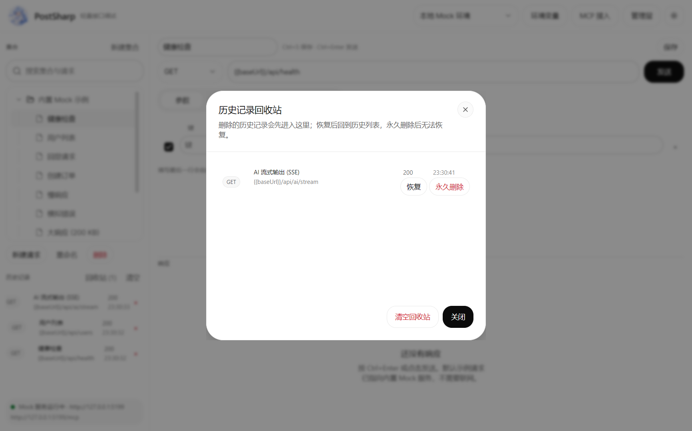

## 系统全局设置

顶栏「设置」打开独立设置窗口。窗口内编辑的是草稿，点「保存设置」后写入 `%APPDATA%\PostSharp\settings.json`，并立即更新内存中的设置；下次启动重新读取该文件。

- **主题**：跟随系统 / 浅色 / 深色。跟随系统会在启动时读取 Windows 主题，并在系统切换时同步。
- **全局圆角**：0–2 倍滑杆，0 = 直角，1 = Arc 默认，2 = 双倍圆角；通过 `TKCode.Arc.Themes.Corners` 统一覆盖 Arc 设计令牌，不改变颜色、边框、阴影和动效。
- **SSE 自定义解析**：可填写「思考节点路径」和「内容节点路径」，例如 `output.choices[0].message.reasoning_content`、`output.choices[0].message.content`；留空时使用内置自动识别，填写后优先按自定义路径提取。
- **日志目录**：默认 `%APPDATA%\PostSharp\logs`；可浏览选择其他目录或直接打开。保存时会校验目录可写，校验失败会保留原设置并给出原因；若写入配置文件失败，当前会话仍会应用新值，但重启后回到上次成功保存的设置。
- **日志级别**：调试 / 信息 / 警告 / 错误，默认「调试」。低于所选级别的日志不会写入文件，更严重的日志始终保留；保存后立即作用于当前会话，并写入 `settings.json` 供下次启动读取。
- **界面字体 / 代码字体**：内置 Inter、系统默认、微软雅黑、Geist Mono、Consolas、Cascadia Mono；导入或扫描到的自定义字体会追加到列表。
- **字体**：「导入字体文件…」把 TTF / OTF / TTC 复制到 `%APPDATA%\PostSharp\fonts` 并立即加载；「添加字体目录…」直接扫描已有目录（例如系统字体目录或下载的字体包）。点击已加载字体名可同时设为界面和代码字体；「打开字体库」「重新扫描」分别定位目录和重新读取。字体目录列表支持移除外部目录。
- **代码字号**：12 / 13 / 14 / 16。
- **请求超时**：10 / 30 / 60 / 120 / 300 秒，作为未单独设置超时的请求的全局默认值。
- **默认请求体**：无 / JSON / 文本 / 表单上传（用于新建请求）。
- **大响应折叠阈值**：32 / 64 / 128 / 256 KB。
- **审计保留条数**：100 / 500 / 1000 / 2000。
- **自动格式化 JSON/XML 响应**。
- **恢复默认**：把草稿恢复为默认值，保存后生效。

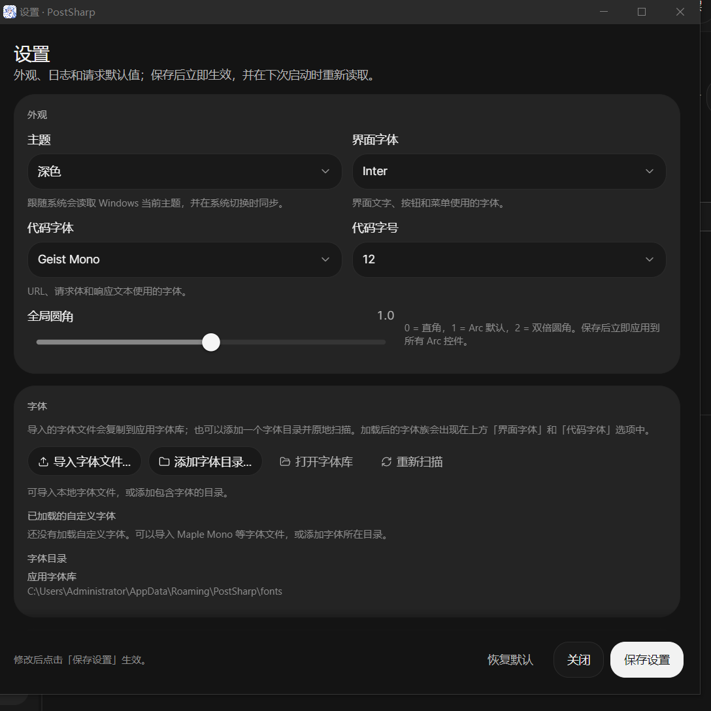

## 快捷键

| 快捷键 | 动作 |
| --- | --- |
| `Ctrl+Enter` | 发送 |
| `Ctrl+S` | 保存 |
| `Ctrl+N` | 新建请求 |
| `Ctrl+Shift+F` | 格式化请求体 |
| `Delete`（集合树获得焦点时） | 删除选中的集合或请求，先弹出二次确认 |
| `Ctrl+Enter`（确认弹窗内） | 执行确认（删除 / 移入回收站 / 永久删除） |
| `Enter`（单行输入框内） | 发送 |
| `Enter`（弹窗内） | 激活当前焦点按钮；重命名弹窗直接保存 |
| `Shift+F10` / 菜单键 | 集合树右键菜单 |
| `Esc` | 关闭弹窗 / 右键菜单 / 管理层 |

## 数据与配置

```text
Windows: %APPDATA%\PostSharp\
  workspace.json   集合、请求、环境、历史、回收站、自动化套件
  audit.json       UI / MCP 请求审计（含 AI 聚合输出）
  audit-trash.json 被清空审计的回收站
  settings.json    主题、字体、字体目录、侧栏宽度、历史折叠、日志目录、日志级别、超时、阈值、审计保留条数
  fonts\           导入的字体文件（应用字体库），启动时自动加载
  logs\            默认日志目录；postsharp-YYYYMMDD.log，按天滚动
```

- 删除整个目录即可恢复首次运行的示例。
- 工作区、审计和设置均为 UTF-8 JSON。
- 日志为 UTF-8 文本，默认保留最近 30 个文件；修改设置中的日志目录或日志级别后立即生效，旧日志不会自动迁移。
- 字体文件只在本机读取；导入时复制到应用字体库，移除字体目录不会删除已导入的文件。
- 数据不上传任何服务。

## 项目结构

```text
src/PostSharp/
  Assets/                 透明底 Logo、紧凑图标、多尺寸 ICO
  Models/
    RequestItem.cs        请求/集合、multipart 字段、收藏与展开状态
    TreeDisplayNode.cs    展平后的侧栏树行
    SuiteSourceCollection.cs 套件来源集合选择
    AppSettings.cs        全局设置（字体、字体目录、侧栏宽度、历史折叠等）
    FontDirectoryItem.cs  设置窗口中的字体目录行
    AuditEntry.cs         审计记录
    TestSuite.cs          自动化套件、步骤、结果
    HistoryEntry.cs       历史快照
    EditableRow.cs        自动补行的键值编辑集合
    OpenApiImport.cs      OpenAPI 导入后的分组/请求模型
    TransferImport.cs     Postman / cURL / HAR 导入的分离式请求与导出文档模型
  Services/
    AppPaths.cs           本地数据与日志目录
    AppLog.cs             Serilog 文件日志与目录切换
    ThemeService.cs       主题偏好解析与 AtomUI 应用
    FontService.cs        字体导入、字体目录扫描与 Avalonia 私有字体集合
    OpenApiImportService.cs OpenAPI/Swagger JSON、YAML、URL 解析
    PostmanImportService.cs Postman Collection v2.0/v2.1 解析、认证/请求体转换与提示
    PostmanEnvironmentImportService.cs Postman Environment JSON 解析
    PostmanExportService.cs 集合/工作区导出为 Postman Collection v2.1
    HarImportService.cs   HAR 1.2 请求提取、静态资源过滤、请求体转换与提示
    InsomniaImportService.cs Insomnia v4 workspace/request_group/request/environment 解析
    HoppscotchImportService.cs Hoppscotch Collection JSON 解析
    ImportFileDetector.cs 批量导入文件格式自动识别
    CurlImportService.cs   bash 风格 cURL 参数解析与请求还原
    RequestComposer.cs    环境变量、URL、cURL、multipart 组合
    HttpRequestService.cs HTTP、超时、格式化、SSE 解析聚合
    MockApiServer.cs      Mock API / SSE / 上传
    McpServer.cs          MCP JSON-RPC 协议与工具
    McpWorkspaceAdapter.cs MCP 与 UI 线程的适配
    WorkspaceStore.cs     工作区持久化
    AuditStore.cs         审计持久化
    SettingsStore.cs      设置持久化
  ViewModels/
    MainWindowViewModel.cs 状态、命令、审计、套件运行、导入导出
    SettingsViewModel.cs  设置草稿、校验与保存
  Views/
    MainWindow.axaml      主界面 + 管理层
    SettingsWindow.axaml  独立设置窗口
    TextViewerWindow.axaml 大响应分页详情
  Controls/
    IconLabel.cs          统一图标 + 文字按钮内容
  Styles/
    ToolTipStyles.axaml   全局 Tooltip 浮层卡片样式
  App.cs                  全局样式与主窗口启动
  Program.cs               Arc / AtomUI 启动注册
tests/
  PostSharp.Tests/
    PostmanImportServiceTests.cs
    PostmanExportServiceTests.cs
    PostmanEnvironmentImportServiceTests.cs
    HarImportServiceTests.cs
    InsomniaImportServiceTests.cs
    HoppscotchImportServiceTests.cs
    OpenApiImportServiceTests.cs
    ImportFileDetectorTests.cs
    CurlImportServiceTests.cs
docs/
  screenshot.png
  postman-import.png
  har-import.png
  management-audit.png
  management-automation.png
  guide.png
  settings.png
  history-trash.png
  tree-actions.png
  suite-builder.png
  suite-mapping.png
  audit-trash.png
  context-menu.png
```

## 设计与实现

- **MVVM**：CommunityToolkit.Mvvm 源生成器，XAML 编译绑定，列表模板声明 `x:DataType`。
- **Arc**：控件、令牌、主题；没有硬编码颜色/圆角/字号。
- **弹层**：Arc 弹层使用窗口内 popup overlay；普通 Avalonia Window 通过 `EnablePopupOverlayLayer()` 反射开启（README 的常见问题有说明）。
- **线程**：MCP 在监听线程接收，工作区读写切回 UI 线程；HTTP 在后台执行，结果回 UI 线程。
- **SSE**：`HttpCompletionOption.ResponseHeadersRead` + 流式 `StreamReader`；按事件聚合，不做全量 JSON 猜测。
- **大响应**：主视图只绑定预览字符串，完整文本只保存在 VM；详情窗口按页取子串，避免一次性布局超大文本。
- **侧栏树**：可见行扁平化为 `TreeDisplayNode`；刷新时按集合/请求对象做增量对账，未变化的行复用节点与容器，`ItemsControl` 使用 `VirtualizingStackPanel` 只实例化视口内的行。
- **审计**：发送路径统一走 `RecordAudit`，UI/MCP 共用；MCP 客户端名和工具名由调用上下文传入。
- **安全**：Mock/MCP 仅回环。

## 验证记录

初始版本在 Windows 上验证：

| 项目 | 结果 |
| --- | --- |
| 健康检查 | `200 OK` |
| 用户列表（含查询参数） | `200 OK`，total=5 |
| 回显请求 | `200 OK`，`X-Demo-Token = demo-token-123`，JSON body 正确 |
| 创建订单 | `201 Created` |
| 慢响应 1200ms | `200 OK`，约 1.2s |
| 模拟错误 | `500` |
| 用户详情 | `200 OK` |
| 大响应 200KB | 主视图折叠，详情分页可读 |
| SSE | 10 个事件，聚合 content 98 字、thinking 27 字；AI 标签自动打开；接收中每 150ms 增量刷新，取消保留已收内容 |
| SSE 取消 | 取消后状态显示「已取消 · 保留已接收内容」，已收 thinking/content 不清空 |
| SSE 供应商适配 | OpenRouter `reasoning_details[]`、阿里云 DashScope 原生 `output.choices[].message` / `output.text` 聚合通过；OpenAI 兼容模式保持 |
| SSE 继续 | 取消后带 `Last-Event-ID` 的「继续」请求重连并追加内容；无 id 时按钮隐藏 |
| 全局圆角 | 设置滑杆 0 / 1 / 2 保存后立即重绘 Arc 控件；0 为直角、1 为默认、2 为双倍圆角 |
| multipart 上传 | `200 OK`，receivedBytes 107111，fileName `screenshot.png` |
| multipart 多文件 | 两个文件分别配置字段名并写入 multipart；cURL/Postman 导出均保留全部文件；拖拽添加与单文件移除验证通过 |
| multipart 进度 | 文件按 64KB 流式读取；发送中显示已上传/总大小和百分比，取消按钮可中断 |
| MCP `send_request` SSE | 返回 `isSse=true`、`sseEventCount=10`、完整 content/thinking |
| MCP 审计 | `list_audit` 来源/客户端/工具正确；`get_audit` 含 AI 输出 |
| MCP 套件 | create/run/delete 通过；断言 3/3 |
| MCP 集合/请求 | 嵌套集合创建/移动/删除、请求顺序调整、`create_suite_from_collections` 生成套件、`update_suite` 重排全部通过 |
| MCP 映射 | `sourceStepIndex` 将健康检查 `status` 映射到下一步请求体，运行 2/2 |
| 参数合并 | `existing=1&page=2&q=中文` |
| 历史记录删除 | 单条/清空均先确认并移入回收站；恢复、二次确认永久删除均已验证 |
| 审计删除 | 清空先确认并移入审计回收站；恢复与清空回收站二次确认已验证 |
| 菜单一致性 | 三点菜单与右键菜单共用最大功能集（复制/收藏/上移/下移/新建/重命名/删除），均带图标 |
| 同级排序 | 集合/请求上移、下移；顺序持久化并影响套件步骤优先级 |
| 套件延迟 | 步骤延迟默认 200ms；300ms 测试中请求间隔符合预期 |
| 出参映射 | 健康检查 `status` 映射到回显请求体 `fromHealth`，运行结果 2/2，回显体包含 `fromHealth: ok` |
| 套件断言 | JSONPath `$.data.token`、`items[0].id` 与响应头 `X-Trace` 断言通过；失败路径显示实际值 |
| 套件重试 | 失败步骤按配置重试，结果区显示尝试次数；重试次数上限 10 次 |
| 套件条件/并行/定时 | 上一步成功/失败条件、并行组、定时分钟数写入工作区；条件不满足显示「跳过」，并行组忽略延迟/映射 |
| PowerShell | `Invoke-RestMethod` 的 URI/Method/Headers/Body/Form/TimeoutSec 导入通过；导出 `.ps1` 与 bash cURL 并存 |
| 二级集合 | 3 点菜单创建二级集合、父子缩进、ParentId 持久化验证 |
| 拖拽 | 请求上下拖动调整同级顺序；集合拖入集合/拖到上边缘排序；自动阻止自身/后代循环 |
| 收藏筛选 | 收藏请求/集合显示星标；「收藏」筛选独立展示；重启后保留 |
| 集合组装套件 | 勾选集合生成 9 步骤套件并出现在自动化列表 |
| 设置窗口 | 顶栏「设置」直达独立窗口；主题、日志、字体、请求默认值分组展示，保存后写入 `settings.json` 并立即应用；重复点击只激活已打开窗口 |
| 设置弹层 | 设置窗口内的 Arc 下拉正常弹出，不再触发「no overlay layer」崩溃 |
| 请求级超时 | 慢响应请求单独设为 1 秒后发送，返回「请求超时，1 秒内没有收到响应」；超时期间可通过取消停止请求 |
| 启动主题 | Windows 为深色时「跟随系统」启动为深色；切换为「浅色」或「深色」重启后保持对应外观 |
| 文件日志 | 启动写入 `%APPDATA%\PostSharp\logs\postsharp-20261025.log`；修改日志目录并保存后，新日志立即写入新目录 |
| 日志级别 | 设置窗口把级别从「调试」改为「信息」「警告」并保存，`settings.json` 写入 `LogLevel`；当前会话立即过滤低级别日志，重启后从启动首行起按保存级别写入 |
| 设置截图 | 「日志」分组新增「日志级别」下拉，`docs/settings.png` 已更新 |
| cURL 预校验 | 空白 URL 调用 `BuildCurl` 直接返回「# 无法生成 cURL：请输入请求地址。」，日志中不再出现「生成 cURL 失败」和异常堆栈 |
| 异常日志 | 所有 `catch` 均记录结构化异常；工作区写入失败、请求超时、OpenAPI 解析失败等可在日志中检索 |
| 树节点 Delete | 选中请求按 `Delete` 弹出「删除请求？」；`Esc` 取消且保留请求，`Ctrl+Enter` 确认后删除 |
| 确认弹窗快捷键 | 删除、移入回收站、永久删除弹窗均显示 `Ctrl+Enter 确认，Esc 取消`，键盘可完成全部操作 |
| OpenAPI JSON | Petstore 样例：3 个请求 / 2 个分组；服务器地址、query/header、`$ref` schema 示例生成正确 |
| OpenAPI YAML | Swagger 2 风格路径样例：2 个请求 / 1 个分组；路径级参数与 DELETE 正确解析 |
| OpenAPI URL | 从本地 HTTP 服务下载 OpenAPI JSON 后导入，集合、分组、请求 URL 正确 |
| Postman 导入 | 参考目录 9 个 Postman Collection v2.1 样例全部解析成功；飞友版收辅 Saas 53 个请求、38 个请求的吉祥航数据接口等数量与原文件一致，缺失 URL 与脚本/认证差异以提示列出 |
| Apifox 迁移 | 导入对话框提示 Apifox「项目设置 → 导出数据 → Postman / OpenAPI」路径，并新增 HAR 迁移入口；Apifox 原生格式适配列入后续计划 |
| Postman 嵌套/表单 | 嵌套文件夹、query/header、Bearer 认证、raw JSON、urlencoded、formdata 单文件、集合变量导入为环境均验证通过 |
| Postman 导出 | 选中集合导出后再导入，集合名、子集合、请求、查询参数、禁用请求头、multipart 字段与文件路径保持 |
| Postman 提示 | 导入完成后保留兼容性提示区；集合变量自动创建并激活独立环境，脚本/测试不会执行 |
| Postman 环境 | Environment JSON 导入 `baseUrl`、`token` 和禁用变量；重复变量保留第一个并显示提示 |
| HAR 导入 | Chrome/Postman/Apifox 风格 HAR：XHR/Fetch 过滤、query/header/cookie、JSON body、form-data 和重复请求去重验证通过 |
| HAR 静态资源 | 默认跳过 image/script/stylesheet/font/document；勾选「包含静态资源」后全部导入 |
| HAR 提示 | 静态资源、重复请求、Cookie、multipart 文件内容均进入兼容性提示，不静默丢弃 |
| springdoc | OpenAPI 标签页「填入 springdoc / Knife4j 地址」可把服务地址补全为 `/v3/api-docs` |
| cURL 导入 | Postman 风格多行 cURL、JSON 请求体、multipart、Basic Auth、`--max-time`、`-G` 查询参数解析通过 |
| cURL 保存 | 当前请求可保存为 `.sh`；与「复制 cURL」共享同一份已解析环境变量结果 |
| Insomnia 导入 | v4 JSON：workspace、request_group、request、environment、bearer 认证和 JSON body 解析通过 |
| Hoppscotch 导入 | Collection JSON：文件夹、params、headers、JSON body、bearer 认证解析通过 |
| OpenAPI 增强 | `x-apifox-folder` 分组、securitySchemes 占位 Authorization、多服务器选择与请求 URL 重基、外部 `$ref` 自动下载与失败提示通过 |
| OpenAPI 外部引用 | 相对文档 URL 引用、下载失败降级、20 个/2 MB/10 秒限制通过 |
| 导入来源卡片 | OpenAPI、Postman Collection、Postman Environment、cURL、HAR、Insomnia、Hoppscotch、YApi/ApiPost/Eolink、Apifox 九张卡片同屏展示，选中态清晰 |
| 批量导入 | 文件选择器允许多选；自动识别 OpenAPI / Postman / HAR / Insomnia / Hoppscotch / cURL，逐文件成功/失败互不影响 |
| 导入反馈 | 导入完成后弹出成功对话框，显示文件/请求/分组/环境统计和失败数；批量结果与兼容性提示保留在导入窗口可展开 |
| 粘贴区 | 长 JSON 在固定高度内自适应滚动；底部边框完整，不再被外层裁切 |
| 请求体 JSON 视图 | JSON 请求体可切换 JsonViewer；搜索、展开、复制路径/值可用；长 JSON 在固定高度内滚动 |
| 响应 JSON 底部 | 响应区 JsonViewer 高度按 Tab 实际高度收敛，最后一行和底部边界在窗口内可见 |
| 响应体工具栏 | JSON 视图开关切换树/原文；格式化显示 JSON 树；压缩切换为单行原文；操作失败有提示 |
| 响应滚动 | 原始文本和压缩后的单行 JSON 均显示水平/垂直滚动条，长行可横向查看 |
| SSE 自定义路径 | 设置 `payload.thought` / `payload.answer` 后从非标准 SSE 事件提取思考/内容，留空回到自动识别 |
| 单实例 | 第二次启动立即退出，系统中始终只有 1 个 PostSharp 进程 |
| 导入框架 | 导入状态、命令和反馈拆分到 `ImportViewModel`，工作区写入通过 `IImportHost` 边界完成；批量解析通过 `IImportProvider` 注册表分发；来源切换、粘贴导入和批量导入行为保持 |
| 导入导出 UI | 「导入 / 导出」对话框宽 720–900 DIP；来源卡片可收起，批量入口、粘贴区、可折叠结果/提示区在 125% 缩放下不重叠 |
| 自测 | `dotnet test tests/PostSharp.Tests/PostSharp.Tests.csproj`：70 个测试全部通过 |
| 列表对齐 | 1000/1400 宽度下审计行、状态/时间、方法徽标、操作列保持对齐 |
| 树节点操作 | 悬浮三点菜单（新建请求/二级集合/收藏/重命名/删除）、双击重命名、右键菜单（含收藏）均验证 |
| 收藏持久化 | 收藏请求后显示星标，重启应用后仍保留 |
| 树节点拖拽 | 请求上下拖动调整同级顺序；集合拖入集合或拖到边缘排序成功；循环/深度校验生效 |
| 集合层级 | 集合最多五级；新建与拖拽路径均做深度校验 |
| 键值行对齐 | 参数、请求头、环境变量和上传字段的复选框与输入框垂直居中 |
| 树展开性能 | 26 个集合 / 147 个请求的工作区：展开/收起视口内集合约 0.2–19ms，展开含 171 行的根集合约 92ms（优化前同场景 0.7–1.7s）；仅视口内的行被实例化 |
| 指南布局 | 左侧说明、右侧竖排操作，按钮宽度和位置统一（1000×660 可滚动） |
| 套件窗口 | 组装套件/映射窗口按主窗口宽度自适应加宽；映射规则单行五列，滚动区可展示更多规则 |
| 无头标题栏 | 顶部栏空白区域拖拽移动；右上角最小化/最大化还原/关闭；边缘缩放可用 |
| 回收站对齐 | 方法、名称、状态、时间、恢复/永久删除列固定对齐 |
| 右键菜单 | 请求/集合菜单可用，复制请求/URL 已验证 |
| 侧栏拖拽 | 拖动分隔条从 320 调到 400 DIP，`settings.json` 写入 `TreePaneWidth=400`；重启后保持；双击分隔条恢复 320 DIP |
| 请求/响应拖拽 | 拖动中间分隔条改变上下高度，`settings.json` 写入 `RequestPaneRatio`；重启后保持；双击恢复 1:1 |
| 历史折叠 | 点击箭头后历史列表收起、集合树占满侧栏，`HistoryCollapsed=true` 持久化；重启后保持折叠，再次点击恢复展开 |
| 字体导入 | 设置窗口导入 `MapleMono-NF-CN-Bold.ttf`，文件复制到 `%APPDATA%\PostSharp\fonts`，状态显示成功且字体列表刷新 |
| 字体目录 | 「添加字体目录…」扫描目录并加载 7 个字体族；外部目录可从列表移除，保存后 `FontDirectories=[]` |
| Maple Mono | 界面与代码字体均设为 `Maple Mono NF CN`，启动日志确认字形解析为同一字体族，主界面/请求/响应/历史均使用该字体 |
| Tooltip 视觉 | 按钮、历史 URL、分隔条的悬浮提示统一为浮层卡片；深色/浅色主题下背景、边框、阴影和文字对比正常，不再是无底色的裸文本 |
| 构建 | Debug / Release 0 警告、0 错误 |

## 开发约定

### 分支策略

```text
master                 稳定可发布
  └── dev              集成分支
        ├── feature/initial-mvp
        ├── feature/logo
        ├── feature/ai-workbench
        ├── feature/history-recycle
        ├── feature/ui-polish
        ├── feature/sidebar-actions
        ├── feature/tree-polish
        ├── feature/audit-trash
        ├── feature/suite-priority
        ├── feat/settings-logging-openapi
        └── feat/postman-curl-transfer
```

- 功能从 `dev` 拉出 `feature/<short-name>`（本次需求使用 `feat/<short-name>`），合并回 `dev` 自测，再合并 `master`。
- 当前 `master` / `dev` 已包含 AI 工作台、历史回收站、UI 图标/层级修复与集合树操作；对应 feature 分支保留提交。
- `feat/settings-logging-openapi`：独立设置窗口、Serilog 日志、系统主题、树节点 Delete、确认弹窗快捷键、OpenAPI 导入。
- `feat/postman-curl-transfer`：Postman Collection 导入/导出、cURL 导入/保存、HAR 1.2、Postman 环境文件、Insomnia V4、Hoppscotch、springdoc/Knife4j 预设、来源卡片、OpenAPI 增强与 xUnit 自测。

### 提交与代码

- Conventional Commits：`feat:`, `fix:`, `docs:` 等。
- 使用 Arc 令牌，不写十六进制颜色、固定圆角/字号。
- 每个字段有可见 `Label`；图标按钮有 `AutomationProperties.Name`。
- 长文本列表使用 `TextTrimming="CharacterEllipsis"` + `ToolTip.Tip`。
- `.editorconfig` / `.gitattributes` 统一 UTF-8 + LF。
- Avalonia 固定 `12.1.4`；升级 TKCode.Arc 前确认其 Avalonia 依赖仍为 `12.1.4`，不同时改 `global.json`。

## 常见问题

**Mock 端口被占用？**  
自动顺延，侧栏底部显示实际地址；示例环境变量使用实际端口。

**Arc Select/菜单不显示？**  
确认 `EnablePopupOverlayLayer()` 被调用，窗口内有 `VisualLayerManager EnableOverlayLayer="True"`；管理层、对话框和 Toast 需放在该 `VisualLayerManager` 的内容中，才能让下拉层显示在它们之上。

**如何恢复示例？**  
关闭应用，删除 `%APPDATA%\PostSharp`，重新启动。

**日志在哪里？**  
默认 `%APPDATA%\PostSharp\logs\postsharp-YYYYMMDD.log`，按天滚动、保留最近 30 个文件；可在设置窗口修改目录和日志级别，保存后新日志立即按新设置写入。

**设置保存失败怎么办？**  
设置窗口会保留原设置并显示失败原因。优先检查日志目录是否存在写权限，或 `settings.json` 是否被其他程序占用。

**SSE 请求一直等到超时？**  
当前按流结束或 `[DONE]` 结束；若服务端保持连接不关闭，会受请求超时控制。

**上传文件名是什么？**  
选择文件时取文件名；Mock 接口会回显文件名和字节数。

**大响应为什么只显示一部分？**  
超过阈值后主视图只展示预览，点「查看完整响应」按 16KB 分页查看，也可复制完整内容。

**深色标题栏？**  
自绘标题栏使用当前主题的顶栏颜色；Windows DWM 适配仅影响原生窗口边框/阴影。

## 已知限制与路线图

### 已完成（导入升级）

- OpenAPI / Swagger、Postman Collection、Postman Environment、cURL、PowerShell、HAR 1.2、Insomnia V4、Hoppscotch 导入。
- Postman Collection、cURL、PowerShell 导出。
- 导入来源小分类卡片：可收起，避免大分类隐藏入口。
- 批量导入：多选文件、自动识别格式、逐文件成功/失败结果。
- 导入反馈：成功弹出统计对话框；逐文件结果和兼容性提示默认折叠，可展开。
- OpenAPI：`x-apifox-folder` 分组、securitySchemes 占位头、多服务器选择、外部 `$ref` 自动下载。
- SSE：接收中 150ms 增量刷新，取消保留已接收内容，支持 `Last-Event-ID` 继续。
- 套件：JSONPath / 响应头断言、失败重试、上下步条件、并行组、定时运行。
- multipart：多文件、拖拽添加、单文件移除、64KB 流式上传进度与取消。
- 界面：请求/响应独立拖拽高度并持久化、请求体 JSON 视图、全局圆角、单实例保护。
- 迁移指南：YApi / ApiPost / Eolink / Apifox 卡片引导。
- 自测：70 个 xUnit 测试。

### 当前 MVP 限制

- SSE 取消后可用 `Last-Event-ID` 手动「继续」；自动重连和从任意断点恢复仍依赖服务端支持。
- multipart 已支持多文件、64KB 流式上传、进度和取消；断点续传、分片上传协议和超大文件校验未实现。
- 套件已支持上一步成功/失败条件、并行组和定时运行；复杂条件表达式、DAG 依赖和任意跳转未实现。
- PowerShell 导入/导出覆盖常见 Invoke-RestMethod / Invoke-WebRequest 参数；`-Credential`、证书、代理等高级参数需要手工补充。
- Postman 导入支持 Collection v2.0 / v2.1 与环境文件；脚本/测试、OAuth2/Digest/NTLM 认证、多文件字段不会完整转换，导入后会以提示列出。
- HAR 导入不保存响应、脚本和二进制文件内容；静态资源默认过滤，multipart 文件字段需要重新选择文件。
- Insomnia 目前支持 v4 JSON；Insomnia v5 YAML 需要先从 Insomnia 导出为 v4 JSON。
- Hoppscotch 支持 Collection JSON；环境文件、multipart 文件内容和脚本不会导入。
- 字体设置主要覆盖窗口正文和代码视图；Arc 组件的内部令牌字体不保证全部跟随。
- OpenAPI 导入会优先使用 `x-apifox-folder`，支持 securitySchemes 占位认证头、服务器选择和外部 `$ref` 自动下载；回调/Webhook 仍未实现。
- Cookie 管理、代理、客户端证书、OAuth、Postman 脚本/测试执行未实现；Postman / HAR / cURL / Insomnia / Hoppscotch 已支持基础导入，Postman Collection 与 cURL 支持导出。
- MCP 仅本地回环，无 OAuth；SSE 通知未实现。

### 后续路线图

1. 导入对话框 XAML 独立拆分，继续降低 `MainWindow.axaml` 体积。
2. OpenAPI 更多安全方案与回调/Webhook 提示。
3. Apifox 原生格式评估：先收集官方导出样本和 schema，不做无样本逆向。
4. 套件复杂条件表达式、DAG 依赖、CLI 运行。
5. 上传断点续传；JMeter / WSDL / SOAP 等重格式按需求立项。

## 许可证

本项目采用 **MIT License**，可自由使用、修改、分发和商用，只需保留版权声明与许可证文本。

完整条款见 [LICENSE](LICENSE)。

---

如果这个工具对你有用，欢迎基于 `dev` 继续扩展；核心原则不变：**AI 触发、全程留痕、结果可回归、人工可接管**。
